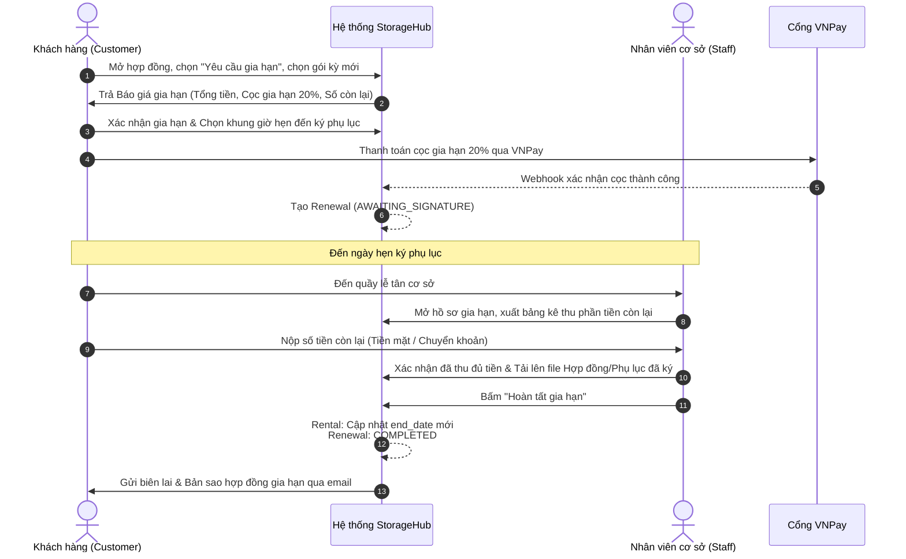
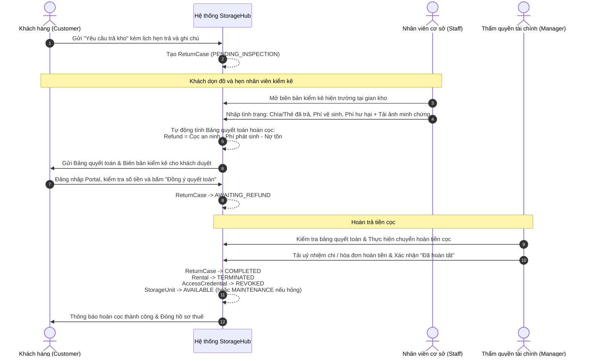

# ĐẶC TẢ CHI TIẾT 2 LUỒNG NGHIỆP VỤ CHÍNH (BUSINESS FLOWS)
## DỰ ÁN: STORAGEHUB — HỆ THỐNG QUẢN LÝ CHO THUÊ KHO TỰ QUẢN (SELF-STORAGE)

---

## 1. TỔNG QUAN KIẾN TRÚC 2 LUỒNG CHÍNH (HIGH-LEVEL OVERVIEW)

Hệ thống **StorageHub** vận hành dựa trên kiến trúc **Dual-Portal (Customer Portal & Back-Office Portal)**. Toàn bộ hoạt động cốt lõi của hệ thống được quy tụ thành **2 Luồng Nghiệp Vụ Trọng Tâm (2 Main Business Flows)** tạo thành một vòng tròn khép kín từ lúc khách hàng tiếp cận đến khi kết thúc hợp đồng:

```mermaid
flowchart TD
    subgraph Flow1 ["MAIN FLOW 1: Khởi tạo Thuê & Bàn giao Kho (Onboarding & Fulfillment)"]
        A[Khách chọn kho & Khai báo hàng hóa] --> B[Tính báo giá tự động & Xác minh OTP]
        B --> C[Thanh toán Cọc giữ chỗ 20% qua VNPay]
        C --> D[Manager duyệt & Phân gian kho vật lý]
        D --> E[Staff nghiệm thu thực tế & Thu nốt tiền thuê + Cọc an ninh]
        E --> F[Ký Hợp đồng điện tử & Cấp mã mở kho]
        F --> G[Khách xác nhận nhận kho]
    end

    G -->|Hợp đồng chuyển trạng thái ACTIVE| ActiveState[("Gian kho: OCCUPIED<br/>Hợp đồng: ACTIVE")]

    subgraph Flow2 ["MAIN FLOW 2: Quản trị Vòng đời & Xử lý Cuối kỳ (Contract Lifecycle & Resolution)"]
        ActiveState -->|Chạm mốc D-14 đến D-3| Decision{"LỰA CHỌN CỦA KHÁCH HÀNG"}
        
        %% Nhánh A: Gia hạn
        Decision -->|Muốn tiếp tục thuê| RenewalBranch["NHÁNH A: GIA HẠN (RENEWAL)"]
        RenewalBranch --> R1[Khách lấy báo giá kỳ mới & Đặt lịch hẹn ký]
        R1 --> R2[Thanh toán cọc gia hạn VNPay]
        R2 --> R3[Staff thu tiền còn lại tại quầy & Ký phụ lục]
        R3 --> R4[Cập nhật thời hạn hợp đồng mới<br/>(Kho giữ nguyên trạng thái OCCUPIED)]

        %% Nhánh B: Trả kho
        Decision -->|Muốn dừng thuê| ReturnBranch["NHÁNH B: TRẢ KHO & QUYẾT TOÁN (RETURN)"]
        ReturnBranch --> T1[Khách gửi yêu cầu trả kho & Đặt lịch kiểm kê]
        T1 --> T2[Staff kiểm kê hiện trạng, hư hại & Lập bảng quyết toán]
        T2 --> T3[Khách xác nhận cấn trừ Cọc an ninh]
        T3 --> T4[Thẩm quyền tài chính duyệt hoàn tiền cọc còn lại]
        T4 --> T5[Thu hồi mã truy cập & Giải phóng kho về AVAILABLE]
    end

    R4 --> ActiveState
    T5 --> TerminatedState[("Hợp đồng: TERMINATED<br/>Gian kho: AVAILABLE / MAINTENANCE")]

    style Flow1 fill:#f0f7ff,stroke:#0066cc,stroke-width:2px
    style Flow2 fill:#fff7ed,stroke:#ea580c,stroke-width:2px
    style Decision fill:#fef08a,stroke:#ca8a04,stroke-width:2px
    style ActiveState fill:#dcfce7,stroke:#16a34a,stroke-width:2px
    style TerminatedState fill:#f1f5f9,stroke:#475569,stroke-width:2px
```

---

## 2. MAIN FLOW 1: KHỞI TẠO THUÊ & BÀN GIAO KHO (RENTAL ONBOARDING & FULFILLMENT)

### 2.1 Mục tiêu nghiệp vụ
Dẫn dắt khách hàng từ nhu cầu tìm kiếm đến khi hoàn tất thanh toán, ký hợp đồng pháp lý, nhận mã mở khóa cửa kho và kích hoạt hợp đồng thuê chính thức.

### 2.2 Sơ đồ chi tiết phân làn tác nhân (Swimlane Activity Diagram)

```mermaid
sequenceDiagram
    autonumber
    actor C as Khách hàng (Customer)
    participant SYS as Hệ thống StorageHub
    actor M as Quản lý cơ sở (Manager)
    actor S as Nhân viên cơ sở (Staff)
    participant GW as Cổng VNPay

    %% Bước 1 -> 4: Đặt chỗ & Thanh toán cọc
    Note over C,SYS: Giai đoạn 1: Báo giá & Đặt chỗ (Quote & Reserve)
    C->>SYS: Chọn loại kho, ngày thuê, nhập kích thước hàng hóa (Dài x Rộng x Cao)
    SYS-->>SYS: Quy đổi thể tích: W = (L x W x H) / 5000.<br/>Kiểm tra kho khả dụng & áp voucher
    SYS->>C: Hiển thị Báo giá (Quote) & Số tiền cọc giữ chỗ (20%)
    C->>SYS: Xác nhận đặt chỗ & Nhập mã OTP xác minh email
    C->>GW: Thanh toán cọc giữ chỗ 20% qua VNPay
    GW-->>SYS: IPN Webhook xác nhận thanh toán thành công
    SYS-->>SYS: Tạo Reservation (CONFIRMED)

    %% Bước 5: Phân kho
    Note over M,SYS: Giai đoạn 2: Phân bổ kho vật lý (Unit Assignment)
    M->>SYS: Xem danh sách đơn đặt chỗ chờ gán kho
    M->>SYS: Chọn gian kho vật lý phù hợp (vd: U-102) và xác nhận
    SYS-->>SYS: Reservation -> UNIT_RESERVED; StorageUnit -> RESERVED

    %% Bước 6 -> 8: Check-in & Ký HĐ
    Note over C,S: Giai đoạn 3: Nghiệm thu & Bàn giao (Check-in & Handover)
    C->>S: Đến cơ sở theo lịch hẹn mang theo giấy tờ & hàng hóa
    S->>SYS: Mở hồ sơ Check-in, đối chiếu CCCD và hàng hóa thực tế
    S->>C: Xuất bảng kê thu: Tiền thuê còn lại + Cọc an ninh (1 tháng)
    C->>S: Thanh toán phần còn lại (Tiền mặt / Chuyển khoản)
    S->>SYS: Xác nhận đã thu đủ tiền, hoàn tất Checklist bàn giao
    S->>C: Đưa Hợp đồng điện tử ký duyệt; Cấp mã PIN/Thẻ từ/Chìa khóa (AccessCredential)

    %% Bước 9: Kích hoạt
    Note over C,SYS: Giai đoạn 4: Hoàn tất & Kích hoạt (Activation)
    C->>SYS: Đăng nhập Customer Portal, bấm "Xác nhận đã nhận kho"
    SYS-->>SYS: Rental -> ACTIVE<br/>StorageUnit -> OCCUPIED<br/>Reservation -> COMPLETED
```

### 2.3 Bảng ma trận các bước chi tiết (Step Matrix)

| Bước | Tác nhân | Thao tác trên giao diện / API | Thực thể & Bảng DB bị tác động | Trạng thái chuyển đổi (State Transition) | Quy tắc nghiệp vụ bắt buộc (Business Rules) |
| :--- | :--- | :--- | :--- | :--- | :--- |
| **1** | Customer | Nhập kích thước kiện hàng, thời gian thuê, chọn loại kho | `reservation_quotes` | `NEW` | Thể tích quy đổi $W = \frac{L \times W \times H}{5000}$ (cm sang kg). Báo giá có hiệu lực trong 15 phút. |
| **2** | Customer | Xác nhận đặt chỗ, nhập OTP gửi qua email | `reservations`, `reservation_goods_items` | `PENDING_PAYMENT` | Kiểm tra tính tương thích hàng cấm/hàng đặc biệt. Nếu có hàng đặc biệt $\rightarrow$ chuyển `PENDING_REVIEW` cho Staff duyệt. |
| **3** | Customer | Thanh toán cọc giữ chỗ 20% qua VNPay | `payments`, `reservations` | Payment: `SUCCESS`<br>Reservation: `CONFIRMED` | Cọc giữ chỗ cố định bằng 20% tổng tiền sau voucher. Thời gian thanh toán tối đa 15 phút. |
| **4** | Manager | Vào màn hình *Phân kho đặt chỗ*, gán số gian kho cụ thể | `storage_units`, `reservations` | Reservation: `UNIT_RESERVED`<br>StorageUnit: `RESERVED` | Chỉ được chọn kho còn trống (`AVAILABLE`), đúng loại kích thước và thuộc cơ sở phụ trách. |
| **5** | Staff | Tiếp đón khách, mở màn hình *Check-in*, kiểm tra giấy tờ | `check_ins` | `IN_PROGRESS` | Đối chiếu CCCD gốc và kiểm tra hàng hóa không thuộc danh mục cấm. |
| **6** | Staff | Thu phần tiền thuê còn lại + Tiền cọc an ninh (1 tháng) | `payments` | Payment: `PAID` | Tiền cọc an ninh (Security Deposit) = 1 tháng tiền thuê tiêu chuẩn, độc lập với 20% cọc giữ chỗ. |
| **7** | Staff | Cho khách ký hợp đồng điện tử, cấp mã PIN/thẻ từ | `contracts`, `access_credentials` | Contract: `SIGNED`<br>AccessCredential: `ACTIVE` | Mã mở cửa được kích hoạt hiệu lực theo ngày bắt đầu thuê của hợp đồng. |
| **8** | Customer | Nhận gian kho, kiểm tra và bấm "Xác nhận đã nhận kho" | `rentals`, `storage_units`, `reservations` | Rental: `ACTIVE`<br>StorageUnit: `OCCUPIED`<br>Reservation: `COMPLETED` | **Điểm chốt của Flow 1:** Rental chính thức có hiệu lực; bắt đầu tính kỳ cước đầu tiên. |

---

## 3. MAIN FLOW 2: QUẢN TRỊ VÒNG ĐỜI HỢP ĐỒNG & XỬ LÝ CUỐI KỲ (CONTRACT LIFECYCLE & RESOLUTION)

### 3.1 Điểm kích hoạt (Trigger Point)
Khi hợp đồng thuê đang ở trạng thái `ACTIVE` và chạm mốc **$D-14$ đến $D-3$ ngày trước khi kết thúc kỳ thuê**:
- Hệ thống tự động gửi email/thông báo thông báo kỳ hạn kết thúc.
- Khách hàng đứng trước quyết định tại ngã rẽ nghiệp vụ:
  - **Nhánh A (Duy trì / Extension):** Khách muốn tiếp tục thuê $\rightarrow$ Thực hiện **Gia hạn (Renewal)**.
  - **Nhánh B (Thanh lý / Termination):** Khách muốn dừng thuê $\rightarrow$ Thực hiện **Trả kho & Quyết toán (Return & Settlement)**.

---

### 3.2 Nhánh A: Gia hạn hợp đồng (Renewal Extension Flow)

#### A. Đặc điểm nghiệp vụ cốt lõi:
- **Hàng hóa và người dùng giữ nguyên hiện trạng tại kho:** Không cần dọn đồ, không kiểm tra hiện trạng hư hại.
- **Mã truy cập kho giữ nguyên hiệu lực:** Không thu hồi mã PIN/thẻ từ.
- **Gian kho giữ nguyên trạng thái `OCCUPIED`:** Hệ thống chỉ cập nhật thời hạn mới trên hợp đồng.

#### B. Sơ đồ thực thi Nhánh A:


#### C. Bảng các bước Nhánh A (Renewal Matrix):
| Bước | Tác nhân | Thao tác | Bảng DB tác động | Trạng thái chuyển đổi | Quy tắc nghiệp vụ |
| :--- | :--- | :--- | :--- | :--- | :--- |
| **A1** | Customer | Chọn gói kỳ mới, lấy báo giá gia hạn | `renewal_quotes` | `GENERATED` | Kiểm tra hợp đồng không có tranh chấp hoặc lệnh quá hạn chặn luồng. |
| **A2** | Customer | Chọn lịch hẹn ký, thanh toán cọc VNPay | `renewals`, `payments` | Renewal: `AWAITING_SIGNATURE`<br>Payment: `PAID` | Cọc 20% tiền gia hạn. Sau khi cọc, khung giờ hẹn ký được giữ chỗ. |
| **A3** | Staff | Thu phần tiền còn lại tại quầy, tải bản ký phụ lục | `payments`, `renewals` | Renewal: `SETTLED` | Staff kiểm tra đúng số tiền còn lại trên bảng kê của hệ thống trước khi thu. |
| **A4** | Staff | Bấm "Hoàn tất gia hạn" | `rentals`, `renewals` | Rental: `end_date` tăng lên<br>Renewal: `COMPLETED` | Cập nhật ngày kết thúc hợp đồng đúng 1 lần; không tạo mới Rental ID; kho giữ `OCCUPIED`. |

---

### 3.3 Nhánh B: Trả kho & Quyết toán hoàn cọc (Return & Settlement Flow)

#### A. Đặc điểm nghiệp vụ cốt lõi:
- **Khách dọn toàn bộ đồ đạc ra khỏi gian kho.**
- **Bắt buộc có bước kiểm kê hiện trường (Inspection):** Nhân viên kiểm tra độ sạch sẽ, hư hại tường/cửa, bàn giao chìa/thẻ.
- **Quyết toán cấn trừ Cọc an ninh (Security Deposit):**
  $$\text{Số tiền hoàn} = \text{Tiền cọc an ninh} - (\text{Phí hư hại} + \text{Phí vệ sinh} + \text{Nợ cước trễ hạn})$$
- **Thu hồi mã truy cập (`REVOKED`)** và **Giải phóng gian kho** về `AVAILABLE` hoặc đưa vào `MAINTENANCE`.

#### B. Sơ đồ thực thi Nhánh B:


#### C. Bảng các bước Nhánh B (Return & Settlement Matrix):
| Bước | Tác nhân | Thao tác | Bảng DB tác động | Trạng thái chuyển đổi | Quy tắc nghiệp vụ |
| :--- | :--- | :--- | :--- | :--- | :--- |
| **B1** | Customer | Gửi yêu cầu trả kho trên Customer Portal | `return_cases` | `PENDING_INSPECTION` | Chỉ được gửi khi hợp đồng đang `ACTIVE` và trong thời hạn cho phép. |
| **B2** | Staff | Đi kiểm tra kho thực tế, nhập biên bản kiểm kê & ảnh chụp | `return_cases`, `return_settlement_receipts` | `AWAITING_CUSTOMER_CONFIRMATION` | Nếu có hư hỏng: khai báo loại hỏng hóc theo biểu phí quy định của ban điều hành. |
| **B3** | Customer | Xem bảng kê cấn trừ và bấm "Đồng ý quyết toán" | `return_cases` | `AWAITING_REFUND` | Nếu khách không đồng ý $\rightarrow$ Chuyển sang trạng thái `DISPUTED` (Tranh chấp) để Manager giải quyết. |
| **B4** | Manager | Thực hiện lệnh chuyển khoản hoàn cọc và tải chứng từ | `refunds`, `payments`, `return_cases` | ReturnCase: `COMPLETED` | Bắt buộc đính kèm mã tham chiếu chuyển tiền/ảnh ủy nhiệm chi. |
| **B5** | System | Tự động xử lý tài nguyên vật lý và bảo mật | `rentals`, `access_credentials`, `storage_units` | Rental: `TERMINATED`<br>Credential: `REVOKED`<br>Unit: `AVAILABLE` / `MAINTENANCE` | Tự động vô hiệu hóa mã mở cửa ngay khi hoàn tất. Nếu có phí sửa chữa $\rightarrow$ Unit chuyển sang bảo trì. |

---

## 4. TỔNG KẾT SO SÁNH ĐỐI LẬP TRONG LUỒNG 2 (KEY TAKEAWAYS FOR DEFENSE)

Bảng tóm tắt giúp trả lời câu hỏi phản biện của Hội đồng: *"Tại sao lại gom Gia hạn và Trả kho vào chung một Luồng chính?"*

| Tiêu chí | Nhánh A: Gia hạn (Renewal) | Nhánh B: Trả kho & Quyết toán (Return) |
| :--- | :--- | :--- |
| **Bản chất kinh doanh** | **Giữ chân khách hàng (Retention)** | **Thanh lý & Giải phóng tài nguyên (Offboarding)** |
| **Dòng tiền (Cashflow)** | Dòng tiền dương (Thu tiếp tiền kỳ mới) | Dòng tiền đối soát (Hoàn lại phần cọc an ninh còn thừa) |
| **Hàng hóa & Gian kho** | Hàng hóa ở nguyên; Kho giữ nguyên `OCCUPIED` | Hàng dọn sạch; Kho về `AVAILABLE` hoặc `MAINTENANCE` |
| **Mã mở cửa (Access PIN)** | Giữ nguyên hiệu lực truy cập | Lập tức thu hồi (`REVOKED`) sau quyết toán |
| **Kiểm kê hiện trường** | Không cần kiểm kê hiện trường | Bắt buộc có biên bản kiểm kê, ảnh chụp và bảng phí phạt |
| **Vòng lặp tiếp theo** | Quay lại trạng thái `ACTIVE` của **Luồng 1** | Kết thúc hoàn toàn vòng đời thuê (`TERMINATED`) |
