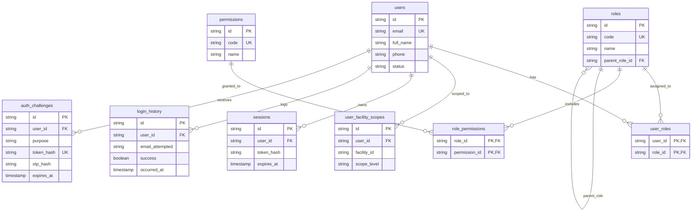
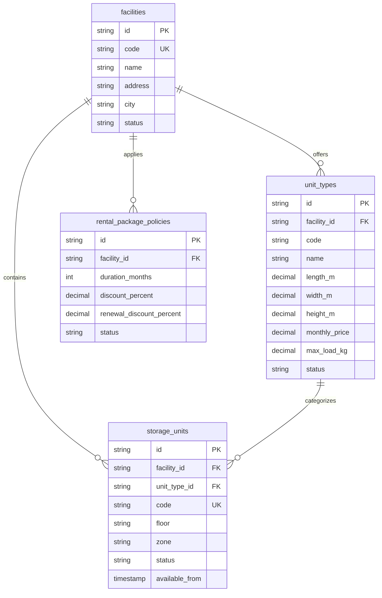
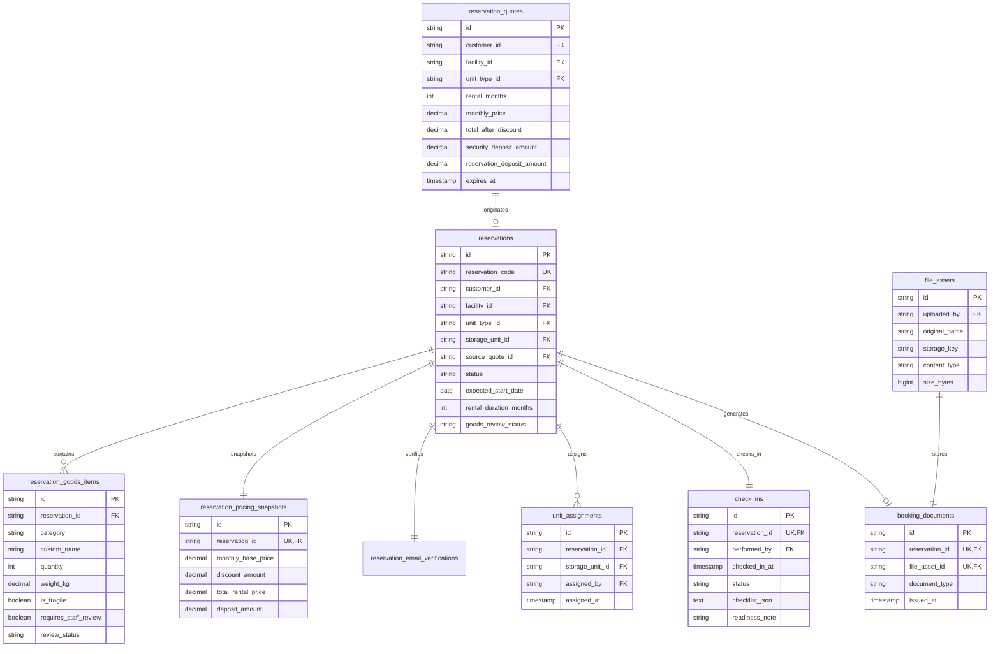
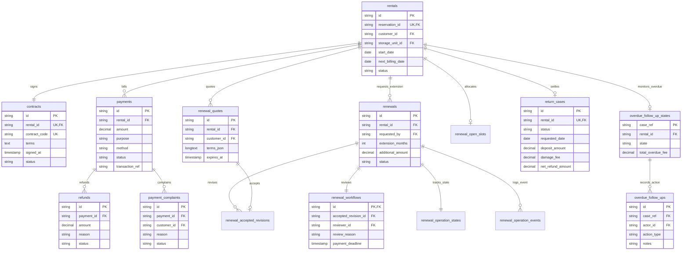
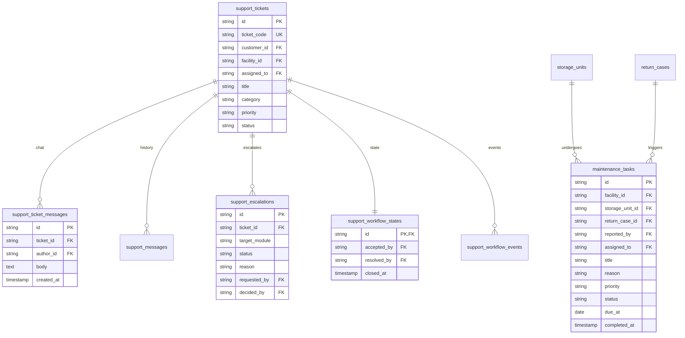
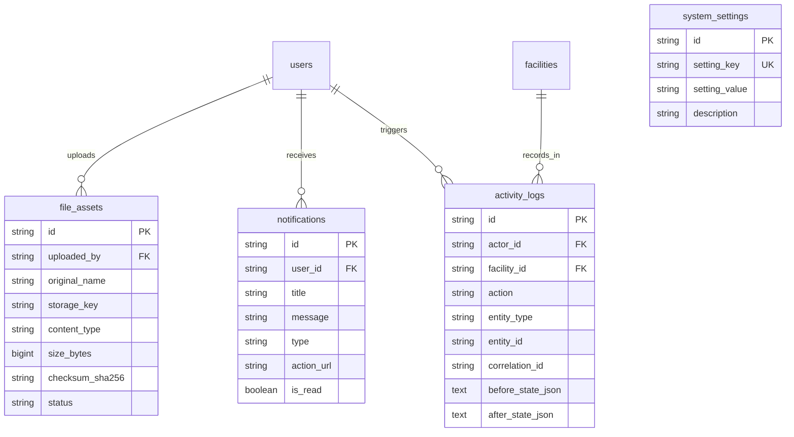
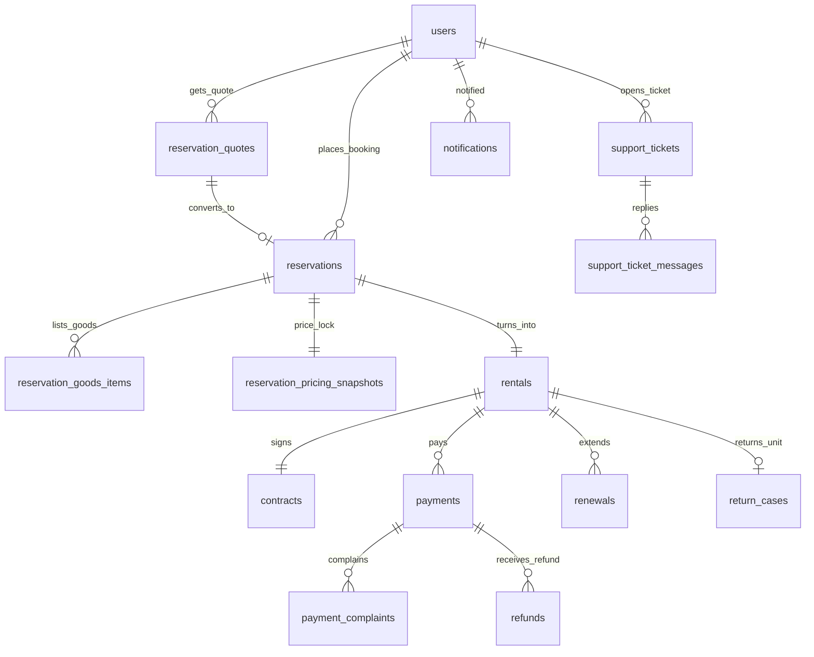
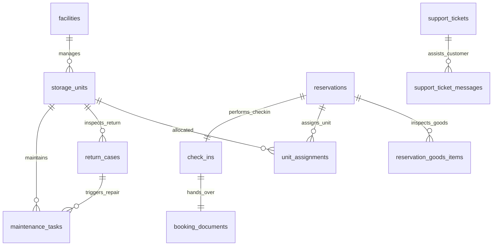
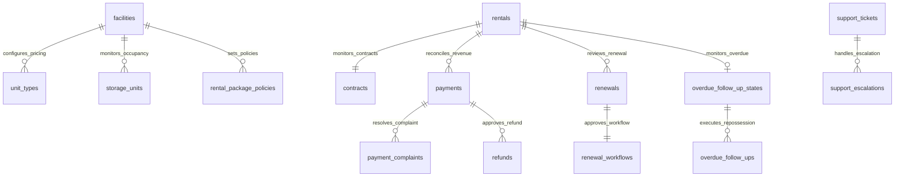
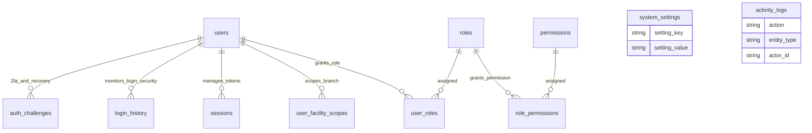

# STORAGEHUB - TÀI LIỆU CSDL & HƯỚNG DẪN XUẤT ERD THEO NGHIỆP VỤ & ROLE

Tài liệu này tổng hợp toàn bộ 49 bảng nghiệp vụ của hệ thống **StorageHub**, được phân rã thành các "cục" (module & role) độc lập, tự chứa (self-contained) với khóa ngoại chuẩn chỉ để bạn:
1. **Chụp hình ERD trực tiếp từ Mermaid** trong file này (dán thẳng vào SRS/Docs).
2. **Import từng file SQL vào DBeaver / MySQL Workbench** để render sơ đồ quan hệ ERD đồ họa độ nét cao và chụp ảnh/xuất PNG.

---

## I. DANH MỤC CÁC TỆP SQL PHÂN RÃ (ĐÃ ĐƯỢC GENERATE)

Tất cả các tệp SQL đã được kiểm tra cú pháp và toàn vẹn ràng buộc khóa ngoại (Foreign Keys) thành công 100% trên MySQL:

### 1. Phân rã theo Phân hệ Nghiệp vụ (`scripts/erd_modules/`)
| STT | File SQL | Tên Phân hệ Nghiệp vụ | Vai trò liên quan | Số bảng |
| :--- | :--- | :--- | :--- | :---: |
| 1 | [`module_1_auth_rbac.sql`](file:///d:/SWP391/BE/self-storage-BE/scripts/erd_modules/module_1_auth_rbac.sql) | Xác thực, Người dùng & Phân quyền RBAC | Admin, Toàn bộ Users | 9 |
| 2 | [`module_2_facilities_units.sql`](file:///d:/SWP391/BE/self-storage-BE/scripts/erd_modules/module_2_facilities_units.sql) | Quản lý Cơ sở, Loại kho & Ô kho lưu trữ | Manager, Business Ops | 4 |
| 3 | [`module_3_booking_checkin.sql`](file:///d:/SWP391/BE/self-storage-BE/scripts/erd_modules/module_3_booking_checkin.sql) | Báo giá, Đặt chỗ, Kiểm định hàng & Check-in | Customer, Staff, Manager | 10 |
| 4 | [`module_4_rentals_payments_renewals.sql`](file:///d:/SWP391/BE/self-storage-BE/scripts/erd_modules/module_4_rentals_payments_renewals.sql) | Hợp đồng, Thanh toán, Gia hạn & Trả kho / Xử lý nợ | Customer, Business, Staff | 15 |
| 5 | [`module_5_support_maintenance.sql`](file:///d:/SWP391/BE/self-storage-BE/scripts/erd_modules/module_5_support_maintenance.sql) | Hỗ trợ CSKH, Chuyển cấp & Bảo trì ô kho | Customer, Staff, Technician | 9 |
| 6 | [`module_6_system_assets_audit.sql`](file:///d:/SWP391/BE/self-storage-BE/scripts/erd_modules/module_6_system_assets_audit.sql) | Cấu hình tham số, File tài sản & Nhật ký kiểm toán | Admin, System Audit | 4 |

### 2. Phân rã theo Vai trò Người dùng (`scripts/erd_roles/`)
| STT | File SQL | Tên Góc nhìn Vai trò (Role View) | Mục đích báo cáo Docs |
| :--- | :--- | :--- | :--- |
| 1 | [`role_1_customer.sql`](file:///d:/SWP391/BE/self-storage-BE/scripts/erd_roles/role_1_customer.sql) | **Role: Customer** (Khách hàng) | Minh họa toàn bộ luồng trải nghiệm khách hàng: Tìm kho -> Đặt chỗ -> Hàng hóa -> Hợp đồng -> Thanh toán -> Gia hạn -> Trả kho -> Khiếu nại/Hỗ trợ. |
| 2 | [`role_2_staff_technician.sql`](file:///d:/SWP391/BE/self-storage-BE/scripts/erd_roles/role_2_staff_technician.sql) | **Role: Staff & Technician** (Nhân viên & Kỹ thuật) | Minh họa quy trình tác nghiệp tại kho: Duyệt danh mục hàng hóa, gán ô kho, lập biên bản check-in, kiểm tra trả kho, tạo và hoàn thành phiếu bảo trì ô kho. |
| 3 | [`role_3_manager_business.sql`](file:///d:/SWP391/BE/self-storage-BE/scripts/erd_roles/role_3_manager_business.sql) | **Role: Manager & Business** (Quản lý & Kinh doanh) | Minh họa quy trình điều hành: Quản lý biểu giá, chính sách khuyến mãi gói, duyệt gia hạn, đối soát hoàn tiền/khiếu nại, giám sát nợ quá hạn và thu hồi kho. |
| 4 | [`role_4_admin.sql`](file:///d:/SWP391/BE/self-storage-BE/scripts/erd_roles/role_4_admin.sql) | **Role: Admin** (Quản trị viên) | Minh họa phân hệ bảo mật & quản trị: Phân quyền vai trò RBAC, phạm vi chi nhánh (scope), phiên đăng nhập (sessions), thử thách OTP/2FA, cấu hình và nhật ký kiểm toán. |

---

## II. HƯỚNG DẪN IMPORT & CHỤP ẢNH ERD TRONG DBEAVER

Khi làm tài liệu phần mềm (Software Architecture Document / SRS):
1. Mở **DBeaver**.
2. Kết nối tới MySQL local (Database `storagehub_local`).
3. **Cách 1 - Xem ERD theo schema riêng**:
   - Tạo một schema tạm (ví dụ `erd_module_1`).
   - Mở file `.sql` tương ứng trong DBeaver (`Ctrl + O` chọn file `scripts/erd_modules/module_1_auth_rbac.sql` hoặc `scripts/erd_roles/role_1_customer.sql`).
   - Bấm `Alt + X` để thực thi toàn bộ script tạo bảng.
   - Bên cây điều hướng trái (Database Navigator), nhấp đúp vào schema vừa tạo -> Chọn tab **ER Diagram**.
   - DBeaver sẽ tự động sắp xếp các bảng và vẽ các đường nối quan hệ (Foreign Keys) đẹp mắt, không bị rối.
4. **Cách 2 - Xuất ảnh chất lượng cao**:
   - Nhấp chuột phải vào khoảng trống trên sơ đồ ERD -> Chọn **Save diagram as image...** (chọn định dạng PNG).
   - Chọn chế độ hiển thị: Có thể bấm nút góc trên thanh công cụ để ẩn bớt các cột phụ, chỉ hiển thị Khóa chính (PK) và Khóa ngoại (FK) để sơ đồ gọn gàng, chữ to rõ nét trong Docs.

---

## III. SƠ ĐỒ MERMAID ERD CHI TIẾT THEO TỪNG CỤC (XEM TRỰC TIẾP & CHỤP NGAY)

Bạn có thể bật tính năng **Markdown Preview** của VS Code (`Ctrl + Shift + V`) để xem ngay sơ đồ đồ họa của các khối dưới đây và dùng công cụ Snipping Tool (`Win + Shift + S`) chụp nhanh đưa vào docs.

### Cục 1: Phân hệ Xác thực & Phân quyền (Auth & RBAC)

---

### Cục 2: Quản lý Cơ sở, Loại kho & Ô kho lưu trữ (Facilities & Units Inventory)

---

### Cục 3: Báo giá, Đặt giữ chỗ & Check-in (Booking & Check-in)

---

### Cục 4: Hợp đồng, Thanh toán, Gia hạn & Xử lý nợ (Rentals, Renewals & Overdue)

---

### Cục 5: Hỗ trợ Khách hàng & Bảo trì kho bãi (Support & Maintenance)

---

### Cục 6: Quản trị Hệ thống, File tài sản & Kiểm toán (System Assets & Audit)

---

## IV. SƠ ĐỒ MERMAID ERD THEO GÓC NHÌN VAI TRÒ (ROLE-BASED ERD)

Dành cho các mục trong tài liệu Docs phân tích theo góc nhìn từng đối tượng người dùng (Actors / Personas):

### 1. Góc nhìn Khách hàng (Customer Persona ERD)

### 2. Góc nhìn Nhân viên & Kỹ thuật viên (Staff & Technician Persona ERD)

### 3. Góc nhìn Quản lý & Kinh doanh (Manager & Business Persona ERD)

### 4. Góc nhìn Quản trị viên (Admin Persona ERD)

