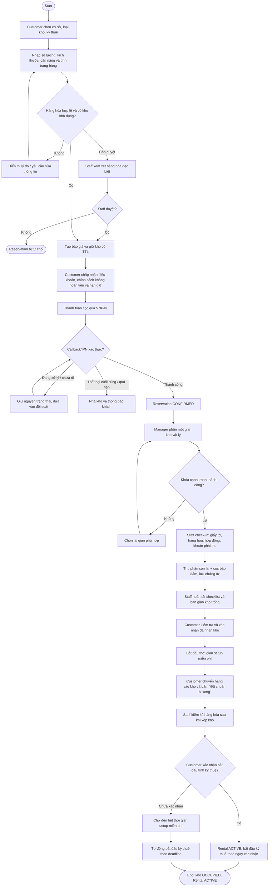
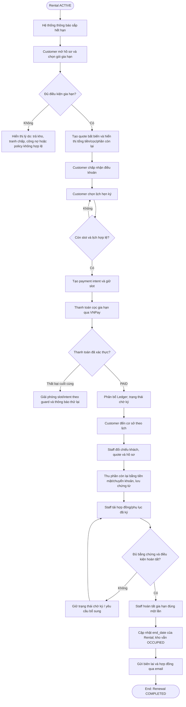
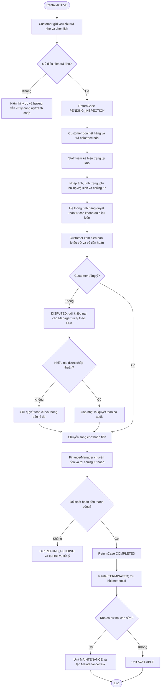
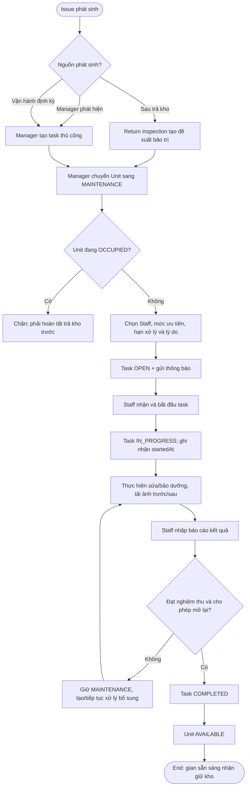
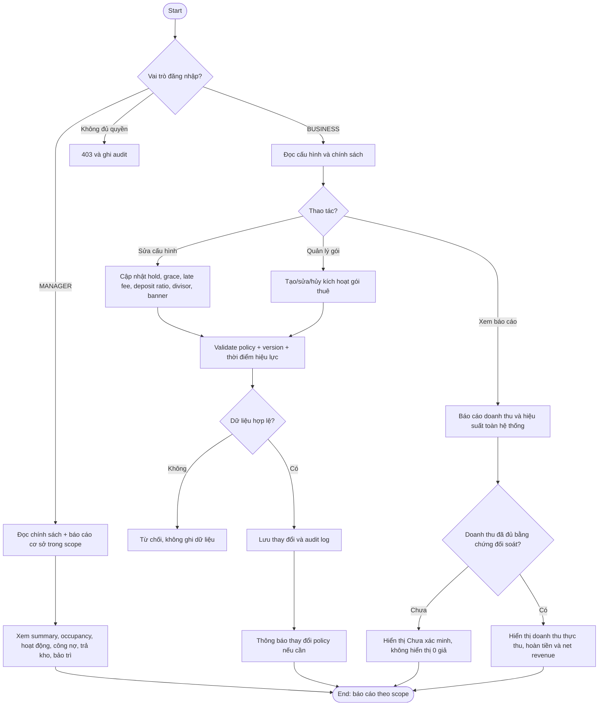
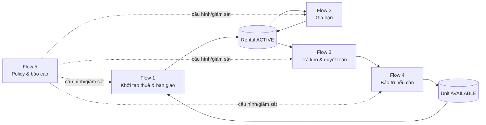

# StorageHub — Tài liệu vẽ 5 flow nghiệp vụ

Tài liệu này là bản đặc tả ngắn để vẽ các tab flow trong tài liệu thuyết trình. Có thể chuyển trực tiếp thành sơ đồ swimlane trên draw.io hoặc dùng Mermaid để kiểm tra nhanh.

## 1. Quy ước chung

### Tác nhân/lane

| Lane | Trách nhiệm chính |
| --- | --- |
| Customer | Tìm kho, đặt/giữ kho, thanh toán, nhận kho, gia hạn, trả kho |
| StorageHub | Kiểm tra điều kiện, khóa tài nguyên, tính tiền, đổi trạng thái, gửi thông báo |
| VNPay | Xử lý và xác thực kết quả thanh toán qua callback/IPN |
| Staff | Check-in, thu tiền tại quầy, ký/bàn giao, kiểm kê, xử lý bảo trì |
| Manager | Phân kho, quản lý tài nguyên và công việc bảo trì tại cơ sở |
| Business/Finance | Quản lý chính sách chung, báo cáo và đối soát/hoàn tiền |

### Quy tắc vẽ

- Hình chữ nhật: thao tác hoặc xử lý.
- Hình thoi: điều kiện rẽ nhánh.
- Hình trụ: dữ liệu/bằng chứng được lưu.
- Mũi tên nét đứt: thông báo/email hoặc tác vụ bất đồng bộ.
- Màu xanh: thành công; vàng: chờ khách/đối soát; đỏ: từ chối, lỗi hoặc tranh chấp.
- Mỗi flow nên có một nút **Start**, một hoặc nhiều nút **Decision**, và nút **End/State** rõ ràng.

> Nguồn ưu tiên khi vẽ là hành vi API/code hiện tại. Các tài liệu cũ có thể còn mô tả OTP ở mỗi lần đặt kho hoặc Manager phải phân công Staff cho gia hạn; đó không còn là bước bắt buộc của flow hiện hành.

## 2. FLOW 1 — Khởi tạo thuê kho và bàn giao

### Mục tiêu

Đi từ lúc khách chọn kho đến khi hàng đã được kiểm kê và kỳ thuê chính thức bắt đầu.

### Điều kiện đầu vào

- Cơ sở hoạt động, loại kho và gói thuê còn hiệu lực.
- Tài khoản đã xác minh email; khách guest chỉ xác minh email khi hệ thống yêu cầu.
- Hàng hóa có kích thước, số lượng, khối lượng và thông tin dễ vỡ hợp lệ.

### Sơ đồ chính

### Các điểm phải thể hiện trên sơ đồ

1. **Không gửi OTP ở mỗi lần đặt kho** đối với tài khoản đã xác minh email. OTP/email verification dùng cho đăng ký hoặc tình huống rủi ro/guest.
2. Giữ kho có TTL; giới hạn số lượt giữ chưa thanh toán và rate limit được xử lý ở hệ thống.
3. Khi chỉ còn một gian, việc kiểm tra khả dụng và gán gian phải nằm trong transaction/lock; không để hai reservation cùng nhận một gian.
4. Cọc đã thanh toán nhưng callback chưa rõ không được tự nhả kho. Chỉ giải phóng sau kết quả thất bại cuối cùng được xác minh.
5. Staff bàn giao kho trống chưa phải điểm bắt đầu tính tiền. Sau đó khách xác nhận nhận kho, chuyển hàng, Staff kiểm kê bước cuối và khách xác nhận bắt đầu tính kỳ thuê.
6. Nếu khách không xác nhận sớm, hệ thống vẫn phải có deadline setup rõ ràng để tự động chuyển sang kỳ thuê chính thức.

### State chuyển đổi để ghi cạnh mũi tên

`QUOTE/HELD → PAYMENT_PENDING → CONFIRMED → UNIT_RESERVED → CHECKIN_IN_PROGRESS → HANDOVER_PENDING_CUSTOMER → SETUP_IN_PROGRESS → INVENTORY_CHECKED → ACTIVE`.

Nhánh lỗi thường dùng: `PAYMENT_FAILED/EXPIRED → UNIT_AVAILABLE`, `GOODS_REVIEW_REJECTED → RESERVATION_REJECTED`, `PAYMENT_UNKNOWN → RECONCILIATION_REQUIRED`.

## 3. FLOW 2 — Gia hạn hợp đồng

### Mục tiêu

Giữ khách và gian kho đang `OCCUPIED`, chỉ cập nhật thời hạn sau khi đủ thanh toán, lịch hẹn, hợp đồng/phụ lục và xác nhận của Staff.

### Ghi chú nghiệp vụ

- Thanh toán thành công **không tự kích hoạt gia hạn** và không tự đổi ngày kết thúc.
- Không có bước Manager phân công Staff trong flow mới; Staff có quyền tại đúng cơ sở xử lý hồ sơ.
- Khung 30 phút là slot sức chứa lịch ký, không phải hạn khách bắt buộc phải hoàn tất ký.
- Callback trễ, payment không rõ, thiếu Ledger hoặc thiếu chứng từ đi vào đối soát; không tự đánh dấu `COMPLETED`.
- Replay thao tác hoàn tất không được cộng thêm thời hạn lần hai.

## 4. FLOW 3 — Trả kho và quyết toán

### Mục tiêu

Đóng hồ sơ thuê, kiểm kê thực tế, tính số tiền hoàn/cấn trừ minh bạch và giải phóng kho an toàn.

### Quy tắc tính và đối soát

- Số tiền hoàn là số dư các khoản đã thu và đủ điều kiện hoàn, trừ phí hợp lệ, nợ/phạt và hư hại có bằng chứng; không mặc định hoàn toàn bộ số tiền khách từng thanh toán.
- Nếu lịch trả kho được đổi, hệ thống tính lại ngày và loại quyết toán trước khi Staff kiểm kê.
- Phí đã phản ánh trong phần hoàn tiền thuê không được trừ thêm lần nữa vào cọc bảo đảm.
- Mọi quyết định tranh chấp, khấu trừ và hoàn tiền phải có người thực hiện, thời điểm, ghi chú và chứng từ.

## 5. FLOW 4 — Quản lý bảo trì và phân công Staff

### Mục tiêu

Đưa gian kho hỏng hoặc cần bảo dưỡng ra khỏi nguồn cung, giao việc cho Staff và chỉ mở lại khi có nghiệm thu.

### Trạng thái và quyền

- Manager: xem lịch sử, đổi `available/maintenance`, tạo task, phân công, hủy task.
- Staff: xem task trong phạm vi cơ sở, nhận/bắt đầu, hoàn tất và tải minh chứng.
- `occupied → maintenance` bị chặn nếu chưa hoàn tất thủ tục trả kho.
- Hoàn tất task chỉ tự chuyển `available` khi yêu cầu `makeUnitAvailable=true`; nếu không, gian vẫn ở `maintenance`.

## 6. FLOW 5 — Quản trị chính sách và báo cáo

### Mục tiêu

Business/Finance quản lý các chính sách được công bố; Manager chỉ đọc chính sách và xem báo cáo trong phạm vi cơ sở.

### Endpoint để ghi cạnh sơ đồ

| Nhóm | Endpoint chính | Quyền |
| --- | --- | --- |
| Cấu hình | `GET/PUT /api/business/config` | `policies:read/update` |
| Gói thuê | `GET/POST/PUT/DELETE /api/business/policies/packages` | Business |
| Báo cáo cơ sở | `GET /api/manager/reports/summary`, `GET /api/manager/reports/activities` | Manager theo facility scope |
| Báo cáo hệ thống | `GET /api/business/reports/revenue`, `GET /api/business/reports/performance` | Business |

### Điểm cần nhấn mạnh khi thuyết trình

- Manager không được tự sửa policy chung; Business là chủ sở hữu policy.
- `monthlyRecurringRevenue` là doanh thu dự kiến theo Rental đang active, không đồng nghĩa tiền đã thu.
- `collectedRevenue` chỉ hiển thị số khi có bằng chứng thanh toán/đối soát đủ; nếu chưa đủ thì hiển thị **Chưa xác minh**, không hiển thị 0 gây hiểu nhầm.
- Báo cáo luôn lọc theo facility scope và quyền của người xem.

## 7. Quan hệ giữa 5 flow

## 8. Checklist trước khi vẽ bản cuối

- [ ] Mỗi flow có đủ Customer/System/Staff/Manager/Business/VNPay lane cần thiết.
- [ ] Mỗi nhánh lỗi đều có nơi kết thúc hoặc quay lại bước hợp lệ.
- [ ] Các điểm chờ thanh toán, chờ xác nhận, chờ đối soát được tô màu khác với thành công.
- [ ] Ghi rõ chứng từ ở các điểm: thanh toán, hợp đồng, bàn giao, kiểm kê, hoàn tiền, bảo trì.
- [ ] Không vẽ OTP ở mỗi lần đặt kho và không vẽ Manager phân công Staff như một bước bắt buộc của gia hạn.
- [ ] Ghi trạng thái cuối: `Rental ACTIVE`, `Rental TERMINATED`, `Unit AVAILABLE/MAINTENANCE`, `Policy AUDITED`.
