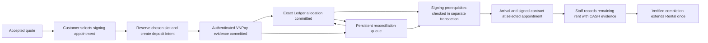

# Renewal API contract

## Mốc hẹn ký và hạn hoàn tất — 22/10/2026

- Lịch ký hiển thị một mốc `appointmentStart`: giờ khách dự kiến đến cơ sở.
- Không dùng `appointmentEnd` để từ chối ghi nhận khách đến hoặc yêu cầu đổi lịch chỉ vì đã qua 30 phút. Staff vẫn được ghi nhận khách đến và hoàn tất gia hạn trong `effectiveSigningDeadline`, với các điều kiện thanh toán, minh chứng và quyền hiện có.
- `appointmentEnd` và khung 30 phút trong calendar chỉ phục vụ đặt chỗ/phân bổ sức chứa Staff, không phải hạn hoàn tất ký của khách. Không thay đổi schema hay xóa dữ liệu lịch cũ.
- Hạn hoàn tất ký, cutoff xử lý quá hạn/thu hồi và kiểm tra idempotency vẫn có hiệu lực. Replay một lượt khách đến đã thành công không tạo thêm sự kiện, kể cả sau hạn ký.
- Mô tả lịch 30 phút ở các phần lịch sử bên dưới được hiểu là khung đặt chỗ nội bộ, không phải thời hạn bắt buộc hoàn tất gia hạn.

## Điều kiện gói gia hạn, 22/10/2026

- Gói phải thuộc đúng cơ sở, đang hoạt động và được chọn trong chính sách gia hạn của cơ sở.
- Luồng gia hạn không kiểm tra ngày bắt đầu hoặc ngày kết thúc hiệu lực riêng của từng gói. Ngày hiệu lực của chính sách gia hạn cấp cơ sở vẫn được áp dụng.

## Cách tính báo giá hiện hành, 21/10/2026

Mục này thay thế mô tả tỷ lệ cọc 40% và phần còn lại 60% của báo giá mới bên dưới.

- Đơn giá tháng lấy từ `unit_types.monthly_price` của loại gian kho tại đúng cơ sở. Tỷ lệ giảm lấy từ gói thuê đang có hiệu lực.
- `FULL_TERM`: tạm tính = đơn giá tháng × số tháng, giảm giá = tạm tính × tỷ lệ giảm của gói, tổng phải trả = tạm tính trừ giảm giá. Cọc = 20% tổng sau giảm, phần còn lại khi ký = tổng sau giảm trừ cọc.
- `MONTHLY`: không áp dụng giảm giá cả kỳ. Cọc = 20% đơn giá tháng, thu phần còn lại của tháng đầu khi ký, các tháng sau theo lịch thanh toán.
- Tổng tiền và giảm giá làm tròn 2 chữ số thập phân HALF_UP, cọc của phương án thanh toán mới làm tròn đến đồng HALF_UP. Phần còn lại luôn lấy tổng trừ cọc.
- Ví dụ `FULL_TERM`, 2.000.000 đ/tháng trong 3 tháng, giảm 5%: tạm tính 6.000.000 đ, giảm 300.000 đ, tổng 5.700.000 đ, cọc 1.140.000 đ, còn lại 4.560.000 đ.
- Không ghi đè báo giá đã chấp nhận hoặc khoản đã thanh toán. Yêu cầu chưa thanh toán cần lấy báo giá mới và xác nhận lại nếu điều khoản thay đổi.

## Cập nhật mất cọc và xử lý Recovery — 15/10/2026

Quy tắc mới thay thế mô tả disposition theo hạn ký phía dưới: gia hạn không cần Manager duyệt. Chỉ ghi nhận mất cọc khi đến `recoveryStart` ngày quá hạn thứ 8 mà chưa hoàn tất gia hạn, dựa trên tiền cọc đã xác thực và phân bổ; không tự thu thêm tiền và không lấy tiền bảo đảm Rental. API xử lý nhiệm vụ, chứng từ quyết toán và giải phóng kho sau thu hồi được mô tả tại [RECOVERY_TASK_API_CONTRACT.md](RECOVERY_TASK_API_CONTRACT.md). Chưa sửa giao diện.

## Mốc quá hạn và cảnh báo đọc từ server — 13/10/2026

### Bàn giao Recovery ngày quá hạn thứ 8

Khi bật `shared-payment-schema`, `storagehub.integration.recovery-tasks.enabled=true` và `storagehub.integration.renewal-auto-recovery.enabled=true`, worker đọc Rental còn active theo giờ server, xác minh kỳ thuê và policy, rồi bàn giao vào `RecoveryTaskSource` trong cùng transaction. Runner local bật hai cờ qua `-EnableRenewalPayments -EnableAutoRecovery` và nạp `db/recovery-migration`. Receiver tạo đúng một `recovery_tasks` trạng thái `OPEN` cho mỗi Rental; `RECOVERY_HANDOFF`, audit, thông báo Customer và hủy Renewal chưa hoàn tất cùng commit. Chạy lại không tạo thêm nhiệm vụ hoặc thông báo. Manager/Staff xem nhiệm vụ đã lưu qua `GET /api/{manager|staff}/recovery-tasks?facilityId=...&page=0&size=20` và `GET /api/{manager|staff}/recovery-tasks/{id}`, cần quyền xem Rental và scope cơ sở.

Receiver kiểm tra lại thời điểm bắt đầu Recovery, trạng thái Rental/gian kho và ReturnCase trước khi nhận. Nếu Payment đang chờ đối soát, nguồn policy/hold/Recovery thiếu hoặc dữ liệu không nhất quán, worker hoãn và thử lại; không tạo ACK giả. Renewal đã hoàn tất ở các kỳ trước là lịch sử, không chặn thu hồi của kỳ hiện tại. Cọc đủ bằng chứng được đối soát `FORFEITED` theo quy tắc ngày thứ 8 trong cùng transaction; cọc đã duyệt/chi hoàn không bị đảo tự động. Handoff chỉ tạo việc thu hồi; Rental và gian vẫn giữ trạng thái vật lý hiện tại cho đến khi kiểm kê, quyết toán và xử lý tài sản hoàn tất. Bảng nội bộ không chứng minh không có Recovery ở hệ thống khác: khi chưa có task, API trạng thái trả `UNKNOWN`, không trả kết luận an toàn.
## Thanh toán cùng bộ xử lý Reservation — 13/10/2026

- Cọc giữ nguyên `VnpayService`, cấu hình merchant, URL, HMAC Return/IPN và `LedgerStore.receiveSandbox` dùng chung. Mỗi Renewal vẫn ràng buộc accepted revision và số tiền cọc của snapshot, không gọi endpoint tạo cọc của Reservation.
- Phần còn lại khi ký dùng `ManualRentalPaymentService` giống Check-in Reservation. Staff chọn `CASH` hoặc `BANK_TRANSFER`, gửi mã biên nhận/giao dịch thực tế, chứng từ và bảng kê hiện hành; số tiền do BE lấy từ Ledger. Lưu một Payment `RENTAL_BALANCE`/`MANUAL` của Renewal, audit resource-bound, receipt/allocation và event thu tiền trong cùng transaction. Không liên kết Payment Renewal sang đơn Reservation và không thu lại cọc bảo đảm.
- DTO `cash-receipts` nhận thêm `paymentMethod`, mặc định CASH để giữ tương thích. Receipt/event bổ sung `paymentId` và `paymentMethod`; lịch sử thanh toán dùng Payment ID và hiển thị đúng phương thức. Legacy receipt thiếu Payment ID vẫn đọc được, không tự tạo proof cho dữ liệu cũ.
- Hoàn tất kiểm tra Payment cọc VNPay và Payment phần còn lại, số tiền/currency/revision, refund, phân bổ, chứng từ và Staff event. Trong chế độ rút gọn local đã bật, kiểm tra công nợ/tranh chấp đã ghi nhận thay yêu cầu coverage lịch sử COMPLETE; không chứng nhận dữ liệu chưa biết là không có nợ. Giờ ký, hợp đồng, quyền và an toàn kho/Recovery giữ kiểm tra hiện hành.
- Migration gateway local được bổ sung bằng version mới `2026101302`, không sửa lịch sử version `1202`. Chi tiết rollout tại [Payment contract](PAYMENT_API_CONTRACT.md).

## Bộ chọn lịch cùng cách dùng Reservation — 13/10/2026

FE chọn lịch ký bằng hai ô `date` và `time` trong cùng hàng như form Reservation, bước thời gian 30 phút. Hiển thị khoảng lịch hợp lệ từ BE; giờ bắt đầu 08:00–16:30 theo giờ Việt Nam. Customer chọn ngày, FE đọc lại các slot còn trống của ngày đó. Nút lưu chỉ mở khi thời điểm chọn có trong kết quả của đúng Renewal và workflow version, BE vẫn recheck khi ghi/mở Payment.

GET `signing-slots` bổ sung `availableAt` (thời điểm bắt đầu lượt sớm nhất trong tương lai) và `deadlineAt` (thời điểm bắt đầu lượt muộn nhất còn đủ 30 phút trước hạn ký/cutoff và trong giờ phục vụ). Hai trường là giới hạn chọn giờ bắt đầu, không phải bằng chứng đã reserve lịch. Khi không có slot phù hợp, danh sách rỗng và FE yêu cầu chọn ngày khác. Phản hồi khác version hoặc chưa xác minh nguồn không cho lưu lịch.

## Bỏ phụ thuộc chính sách ký trong flow thường — 13/10/2026

- Chọn/đổi lịch trước cọc, mở intent và chuẩn bị ký theo lịch đã chọn không yêu cầu `RenewalOperationSources.PolicySource` hoặc `BO_SIGNING_POLICY`. Thiếu policy xử lý ngoại lệ không khóa các nút chọn lịch thông thường.
- Lịch phải hợp lệ theo giờ phục vụ, thời lượng và sức chứa Calendar, nằm trọn trước cutoff đã công bố. Không dùng `signingWindow` của policy ngoại lệ làm giới hạn chọn lịch.
- Quy tắc trên chỉ mô tả bản lịch sử `RENEWAL_SELECTED_APPOINTMENT/1`. Flow hiện hành dùng hạn ký từ paidAt đã xác thực + 72 giờ, giới hạn bởi cutoff; lượt ký 30 phút không là hạn hiệu lực. State mới ghi `RENEWAL_DEPOSIT_SIGNING_WINDOW/2`. Hạn trả cọc vẫn theo cửa sổ thanh toán và trước giờ ký.
- Hồ sơ đã trả tiền theo flow cũ nhưng chưa có lịch giữ protocol ký cũ để đối soát. Các lệnh duyệt ngoại lệ/kéo dài hạn của Manager vẫn cần policy riêng tại thời điểm thực hiện; thay đổi này không cấp quyền kéo dài hạn tùy ý.

Mục này thay thế các mô tả yêu cầu policy ký/ngoại lệ trong flow thường bên dưới.

## Chọn lịch ký trước cọc — 13/10/2026

Quy tắc hạn ký cập nhật: không cần Manager duyệt; Customer chọn lịch trước thanh toán cọc. Sau khi xác thực tiền, `signingDeadline = MIN(depositPaidAt + 72 giờ, recoveryCutoff)`. `recoveryCutoff` là 17:00 ngày quá hạn thứ 7 theo timezone của chính sách đã công bố. Lượt hẹn 30 phút chỉ quản lý phục vụ, không phải hạn hiệu lực yêu cầu. Trước cọc, slot đọc/chọn và mở intent được giới hạn trong `MIN(serverNow + 72 giờ, recoveryCutoff)`; lịch phải bắt đầu sau lúc trả cọc và nằm trọn trong hạn ký thực tế.

Nếu lịch đã qua nhưng còn hạn ký, hồ sơ vẫn `SIGNING` và Customer được đổi lịch mà không đặt cọc lại; Staff chỉ ghi nhận khách đến theo lịch hiện tại còn hiệu lực. Đổi lịch thông thường không reset hạn ký. Chỉ hết hạn ký thực tế mới đưa hồ sơ sang hết hiệu lực/chờ đối soát. Không tự thay đổi ngày hết hạn Rental.

Runner local bật `renewal-signing-window-correction.enabled` cùng profile `shared-payment-schema`: sửa có audit các state được tạo bởi quy tắc `RENEWAL_SELECTED_APPOINTMENT/1` với deadline đúng bằng appointmentEnd. Chỉ sửa giao dịch PAID đã xác thực và phân bổ, đúng accepted revision, không refund/ngoại lệ/hoàn tất, còn trong hạn ký mới và chưa có xung đột. Hold RELEASED có thể khôi phục sau kiểm tra quyền giữ kho và overlap; hold CONSUMED không thể khôi phục. Không sửa giá, số tiền, paidAt, hợp đồng hoặc sự kiện thanh toán lịch sử.

Flow hiện tại: chấp nhận báo giá → chọn lịch ký → thanh toán cọc → xác nhận tiền và chuẩn bị ký → khách đến, thu phần còn lại và ký → hoàn tất.

- Customer được đọc `signing-slots` và tạo/đổi appointment trong trạng thái `accepted` trước khi có Payment. Lưu lịch dự kiến bằng event APPOINTMENT và operation phase `AWAITING_PAYMENT_INTENT`; Renewal vẫn `accepted`, không giả đã trả tiền hoặc đổi ngày thuê. Lịch trong giờ phục vụ, 30 phút, phải nằm trọn trong cửa sổ ký BO và trước cutoff đã công bố.
- Chọn lịch chưa giữ sức chứa. POST `payment-intents` bắt buộc có lịch tương lai, kiểm tra lại và reserve đúng lịch trong cùng transaction với tạo intent. Hết chỗ thì trả 409 và rollback; khách chọn lại trước khi trả tiền. Hạn trả cọc không vượt cửa sổ thanh toán, cutoff và thời điểm lịch ký trừ một giây.
- Khi intent đã bắt đầu, không đổi lịch dự kiến hoặc chấp nhận revision mới để thay ràng buộc giao dịch. Sau khi tiền được xác minh và phân bổ, bước chuẩn bị ký giữ lịch đã chọn và chuyển phase `SIGNING`, Renewal `appointment_scheduled`. Lịch đã qua vẫn có thể mở SIGNING nếu còn hạn ký 72 giờ/cutoff để Customer đổi lịch; lịch nằm ngoài hạn ký thực tế hoặc tiền chưa đủ bằng chứng vẫn giữ PAID/chờ đối soát, không âm thầm đặt lịch khác.
- Đổi lịch sau thanh toán tiếp tục dùng các guard ký hiện có. Ghi nhận khách đến, thu phần còn lại và hoàn tất chỉ được thực hiện trong bước ký đã xác minh Payment. Chỉ chọn lịch không mở các thao tác này.
- Hết hạn Payment với thất bại cuối cùng được xác minh thì giải phóng reservation lịch trong cùng transaction. Tiền đã nhận hoặc gateway chưa rõ kết quả không tự giải phóng. Chấp nhận báo giá mới trước khi có Payment xóa lựa chọn lịch cũ để khách chọn lại.
- FE cho phép chọn lịch trước trả cọc và khóa nút trả cọc khi chưa có lịch tương lai. API vẫn kiểm tra độc lập; không tin điều kiện trên trình duyệt. Không đổi bố cục UI và không cần thêm cột DB.

Mục này thay thế các mô tả bắt buộc thanh toán xong mới chọn lịch ở bên dưới. Nguồn calendar/policy/cutoff còn thiếu vẫn trả `DEFERRED_SOURCE`.

## Bỏ bước phân công Staff — 13/10/2026

- Renewal không cần Manager phân công Staff. POST `/api/manager/renewals/{id}/staff-assignment` đã gỡ; lời gọi nội bộ cũ bị từ chối trước khi ghi dữ liệu hoặc replay lệnh cũ.
- Staff ACTIVE với role, permission và scope OPERATE hiện hành ở đúng cơ sở được xem và xử lý Renewal. Danh sách Staff lọc theo các cơ sở được phép trước phân trang; đọc/arrival/incident/thu tiền/hoàn tất vẫn kiểm tra quyền chuyên biệt trong token và DB.
- Lịch ký giữ quy tắc 30 phút/lượt và tối đa một khách trên mỗi đơn vị sức chứa Staff. Calendar tự giữ một đơn vị sức chứa còn trống trong transaction, không đọc STAFF_ASSIGNMENT và không buộc khách chờ Manager chọn nhân viên. Staff có quyền tại cơ sở được xử lý; bản ghi sức chứa không xác lập quyền sở hữu hồ sơ.
- UI bỏ lựa chọn phân công, mã nhân viên và phần hiển thị phân công hiện tại; phần xác minh sự cố của Manager giữ chức năng hiện có. GET phân công chỉ còn đọc metadata lịch sử để đối soát, không phải bước của flow mới.
- Mã nguồn thiếu nguồn `STAFF_PERMISSION_ASSIGNMENT` được giữ tương thích API nhưng chỉ biểu thị thiếu AuthorizationSource; không biểu thị thiếu phân công. Event phân công lịch sử không bị xóa và không quyết định quyền hiện tại. Không cần migration DB cho thay đổi này.

Mục này thay thế các mô tả bắt buộc phân công hoặc “assigned Staff” bên dưới.

## Cập nhật cọc gia hạn — 13/10/2026

Quy tắc này thay thế mô tả trả toàn kỳ của báo giá mới ở các mục đối chiếu bên dưới:

- Báo giá mới dùng tỷ lệ chung với Booking (`RentalDepositPolicy.RATE`): cọc trả trước 40% tiền thuê sau giảm giá, phần còn lại 60% thu khi ký. Làm tròn scale 2 HALF_UP; phần còn lại = tổng sau giảm − cọc. Không thu thêm cọc bảo đảm đã giữ của Rental. `depositRate` trong bản policy cũ không ghi đè tỷ lệ chung này.
- Customer chấp nhận snapshot → `payment-intents` dùng Payment/VNPay chung, số tiền = `renewalDepositAmount`. Callback xác thực và Ledger phân bổ đúng nghĩa vụ `RENEWAL_DEPOSIT`; chuẩn bị ký chuyển sang `deposit_paid`. Chưa cập nhật ngày thuê.
- Khi mở intent, ghi cả hai nghĩa vụ của accepted revision: `RENEWAL_DEPOSIT` và `RENEWAL_REMAINDER`. Nghĩa vụ tiền còn lại của chính revision được phép tồn tại khi chuẩn bị ký; công nợ khác và tranh chấp vẫn chặn. Khóa, idempotency, hash báo giá và bằng chứng gateway được giữ.
- Staff đọc `GET /api/staff/renewals/{id}/payable-statement` và gửi `POST /api/staff/renewals/{id}/cash-receipts` với `payableStatementRef`, `receiptReference`, `receiptFileId`, `received=true`, `expectedVersion` và header `Idempotency-Key`. Bảng kê xác định số tiền từ Ledger; client không nhập số tiền. Reference/version ràng buộc accepted revision và revision Ledger; thay đổi số dư thì đọc lại bảng kê.
- `receiptFileId` là FileAsset ACTIVE do Staff có quyền tại cơ sở tải lên, gắn đúng Renewal, entityType `DUONG_RENEWAL_CASH_RECEIPT`. Thu tiền và sự kiện CASH ghi trong cùng transaction. Thiếu chứng từ, bảng kê cũ hoặc khoản đã trả bị chặn.
- Hoàn tất yêu cầu đủ allocation cọc VNPay, phần còn lại CASH có chứng từ và sự kiện Staff, không refund, cùng các điều kiện lịch ký/arrival/hợp đồng/quyền/an toàn hiện có. Nguồn vận hành thiếu vẫn trả `DEFERRED_SOURCE`; không tự chứng nhận coverage tài chính hoàn chỉnh.
- Snapshot đã chấp nhận không bị sửa: hồ sơ cũ có cọc 0 tiếp tục trả toàn kỳ; snapshot chia cọc cũ giữ nguyên tỷ lệ. Muốn dùng 40% cho yêu cầu cũ chưa thanh toán, Customer lấy báo giá mới và chấp nhận lại. API mô phỏng cọc không được mở lại. Không cần thêm cột DB cho thay đổi này.

Đây là contract duy nhất cho flow gia hạn: yêu cầu/báo giá, thanh toán, ký, hoàn tất và tích hợp nguồn. API Payment chung đọc tại [Payment contract](PAYMENT_API_CONTRACT.md).

## Quy tắc hiện hành và thứ tự áp dụng

Cập nhật 13/10/2026 — mở thanh toán rút gọn: `storagehub.integration.renewal-simple-payment.enabled=true` áp dụng nguồn DB cục bộ cho options/quote/submit/payment. Runner Payment local bật chế độ này. Giữ quyền sở hữu, Rental active/chưa trả, gian occupied, policy/gói/giá hợp lệ, khoảng thời gian gửi yêu cầu và cutoff do BO công bố, accepted revision/hash và deadline bất biến. Kiểm tra ReturnCase, RECOVERY_HANDOFF đã ghi nhận, công nợ Ledger khác Renewal hiện tại đã đến hạn và PaymentComplaint PENDING/REVIEW_OVERDUE. Không yêu cầu chứng nhận toàn bộ tài chính lịch sử, receiver Recovery hay lịch ký/Staff/extension hold trước khi mở cổng.

Giới hạn có chủ ý: Ledger trống không chứng minh hết nợ; thiếu hồ sơ Recovery không chứng minh chưa bị thu hồi ở hệ thống khác. Chế độ này chỉ kiểm tra dữ liệu đã ghi nhận và projection ghi `LOCAL_DB_AND_PUBLISHED_CUTOFF_ONLY`, không công bố coverage COMPLETE. Khi chưa có tài khoản Ledger, mở tài khoản đúng Rental/Customer/cơ sở để ghi nghĩa vụ gia hạn mới; không tạo tiền/công nợ lịch sử giả. Vẫn chặn dữ liệu lỗi, sai binding, policy/giá thiếu và nghĩa vụ trùng; callback VNPay, số tiền/currency/purpose/revision, provenance và receipt chống trùng vẫn được giữ.

Extension hold chuyển sang chuẩn bị ký sau thanh toán; nguồn lịch ký, an toàn giữ kho và tài chính hoàn tất tiếp tục kiểm tra ở bước này. Không có nguồn thật thì tiền PAID/phân bổ vẫn giữ, trạng thái chờ ký/đối soát; không tự completed hoặc đổi ngày thuê. Intent chưa có hold chỉ giải phóng open slot sau xác nhận thất bại cuối cùng; PAID hoặc kết quả VNPay chưa rõ vẫn được giữ. Cấu hình shared mặc định chưa bật chế độ rút gọn; các mô tả chặn đầy đủ phía dưới áp dụng khi chế độ này tắt.

Options gia hạn đọc gói đang hiệu lực từ catalog của cơ sở và lọc theo policy đã công bố. Mỗi option gồm `pricingPackageCode`, `rentalMonths` và `pricingPackageName` (tên `RentalPackagePolicy.name`, có thể null với adapter cũ). FE dùng tên gói để hiển thị; code vẫn là định danh gửi lên quote. Mã seed local như `DEMO_3M` không được dùng làm tên giao diện. Điều khoản đã chấp nhận hiển thị số tháng từ snapshot; không đổi mã, giá, hash hoặc revision lịch sử để thay nhãn.

- Renewal mới: hệ thống kiểm tra điều kiện, Customer chấp nhận báo giá bất biến, trả trước 40% qua Payment/VNPay chung, phần còn lại thu khi ký; không yêu cầu Manager duyệt.
- Xác minh Payment, phân bổ Ledger và chuẩn bị ký có transaction riêng. Chỉ hoàn tất ký/bàn giao với đủ bằng chứng mới cập nhật thời hạn Rental.
- Nguồn cấu hình/tài chính/lịch ký/quyền giữ kho còn thiếu vẫn chặn bằng `UNKNOWN`/`DEFERRED_SOURCE`; không suy dữ liệu thiếu là 0 hoặc đã thanh toán.
- Các mô tả Manager `approved`/`decision` trong phần đối chiếu phía dưới chỉ dùng cho tương thích hồ sơ cũ. Flow mới là `accepted → deposit_paid → appointment_scheduled → completed`.
- API Customer mô phỏng cọc Renewal đã bị gỡ. Thanh toán mới dùng `POST /api/customer/renewals/{renewalId}/payment-intents`; dữ liệu cọc lịch sử vẫn được đọc để đối soát.
- Khi mô tả lịch sử mâu thuẫn, quy tắc ở mục này và phần **Current payment and lifecycle** được ưu tiên. Các ghi chú rollout/test có ngày tháng chỉ phản ánh thời điểm được ghi, không xác nhận trạng thái deploy hiện tại.

## Nội dung

- [Thanh toán và vòng đời hiện tại](#current-payment-and-lifecycle)
- [Yêu cầu và đọc hồ sơ](#request-and-read-api)
- [Ký và vận hành](#signing-and-operations-api)
- [Tích hợp nguồn dùng chung](#shared-source-integration)

## Current payment and lifecycle

### Renewal Payment integration — cập nhật 13/10/2026

#### Policy and lifecycle

Reservation and Renewal use the same `VnpayService`, `VnpayProperties` and signed URL builder (`gatewayPaymentUrl`). Both use `app.vnpay` merchant credentials, gateway URL and `/api/public/payments/vnpay/return` / IPN callback verification. There are no separate Renewal merchant credentials. Renewal's customer endpoint creates a shared `Payment` with purpose `RENEWAL`, accepted-revision binding and the accepted deposit amount (full-period amount for earlier zero-deposit quotes); it does not call the Reservation deposit endpoint.

New quotes use **40% rental prepayment and 60% remaining rent**. Customer accepts the immutable server quote; the system validates eligibility. Ordinary Renewal has no Manager approval step. Original security deposits and previously accepted payment terms are not repriced or rewritten.

Signing remains required by the approved business decisions and the existing `RenewalOperationService.complete` contract. Payment itself neither sets `completed` nor changes `Rental.contractEndDate`.

#### API

| Method/path | Contract |
|---|---|
| `POST /api/customer/renewals/{renewalId}/payment-intents` | JWT Customer, `Idempotency-Key`, no client amount/currency/purpose. Server resolves current accepted revision, amount, deadline, capacity and obligation. |
| `GET /api/customer/renewals/{renewalId}/payment` | JWT owner; latest authoritative shared Payment projection. No client redirect status is trusted. |
| `GET /api/public/payments/vnpay/ipn` | Existing shared HMAC verification and IPN response contract. |
| `GET /api/public/payments/vnpay/return` | Processes authenticated evidence and returns to `page=rental-records&renewalId=…&vnpayReturn=true`. UI must fetch Payment and Renewal. |

Envelope remains `ApiResponse.data`. Response has `paymentId`, `renewalId`, `acceptedRevisionId`, `transactionReference`, `amount`, `currency`, `paymentStatus`, `paymentDeadline`, `paidAt`, `reconciliationRequired`, `message`, `paymentUrl` and additive `settlementStage`.

| `settlementStage` | Meaning |
|---|---|
| `AWAITING_PAYMENT` | Read `paymentStatus` for pending/processing/not-received/failed/cancelled. |
| `VERIFIED_AWAITING_ALLOCATION` | Shared Payment has authenticated received-funds proof; no committed allocation yet. |
| `ALLOCATED_AWAITING_SIGNING` | Exact Ledger receipt committed; signing preparation still pending or blocked. |
| `AWAITING_SIGNING` | Initial payment and signing preparation committed. Remaining rent and contract completion still required for split quotes. |
| `COMPLETED` | Renewal completion has actually succeeded. |
| `RECONCILIATION_REQUIRED` | Received funds cannot safely enter this workflow, including late/historical incomplete evidence. |

`PAID` means received funds, not successful activation. `reconciliationRequired=true` may coexist with an allocated receipt. A retry can return PAID with `paymentUrl=null`; it must not create another payment. New browser keys recover the sole owned unresolved intent for the same accepted revision. Conflicting keys/resources are rejected. The original key and gateway intent remain immutable.

#### Transaction and authority boundaries

1. **A — gateway evidence:** `VnpayService.processCallback` locks Payment and verifies HMAC, merchant, amount, transaction identity and gateway payment time. It commits PAID, stable evidence-log reference and a reconciliation marker. It never calls Ledger or calendar in this transaction. Signed query reconciliation can record the same verified proof only after query signature, merchant, amount, identity and payment-time checks.
2. **B — allocation:** `RenewalPaymentReconciler` runs `REQUIRES_NEW`, locks the persisted Payment and invokes `RenewalVnpaySettlementService.settle`. It checks accepted revision, original quote hash/terms, purpose, currency, exact initial-payment amount, deadline, Payment provenance, refund state, account/customer/facility, one exact obligation and payment-ready writer evidence. Receipt, allocation and Payment receipt-reference commit together.
3. **C — signing preparation:** another `REQUIRES_NEW` rechecks accepted terms, refund/provenance, atomic hold/Recovery/calendar and consistent financial state. It prepares the existing signing phase. Failure preserves A and B. A delayed callback is not rejected just because processing occurs after payment deadline; gateway-paid time determines timeliness. Expired hold/signing rights still block C and require reconciliation.
4. **Actual activation:** Staff completion checks permission/assignment, appointment, arrival, signed document, financial coverage and shared resource guards. The default Ledger accounting adapter verifies the exact shared Payment receipt and, for split quotes, the remaining-rent CASH allocation with a resource-bound file and Staff event. An owner-provided `AccountingSource` takes precedence; historical approval-backed deposit execution remains delegated to its owner adapter.

`LedgerStore` keeps its financial schemas and read contracts. Existing unique payment/gateway evidence and receipt-command keys prevent duplicate allocation and cross-obligation reuse. A missing account/obligation/coverage source is UNKNOWN, never zero debt.

#### Reconciliation and exceptional flows

Payment rows persist evidence/receipt references, allocation/signing timestamps, retry count and next retry time. An AFTER_COMMIT event attempts B/C immediately; the already opt-in Renewal lifecycle scheduler retries persisted rows in batches of 100, with bounded retry delay. Restart does not lose queued work. A failed expiry pass does not prevent the paid-work retry pass.

- Identical callback: reuses the original evidence and allocation. Conflicting callback: cannot overwrite PAID transaction metadata.
- Before-deadline payment with delayed callback: allocate exact received funds; independently decide if signing/extension rights remain valid.
- After-deadline payment: preserve PAID and `PAYMENT_AFTER_DEADLINE`; manual financial/Refund owner reconciliation, no automatic allocation/activation.
- Ledger unavailable: A remains committed; retry B from persisted Payment.
- Signing/activation blocked: A/B remain committed; retry C or route exception handling to Manager/support.
- Pending/processing/not-received at expiry: query shared VNPay, retain resources for unknown outcome. Renewal query response `91` is conservatively UNKNOWN, since it does not prove a delayed payment cannot arrive. Authoritative final failure may release resources only after locked Payment/other attempts/workflow rechecks.
- Expiry/callback race: locked Payment is authoritative; PAID or another unresolved attempt prevents release.
- Accepted revision changed: allocation/activation reject binding mismatch; verified funds remain recorded.
- Historical PAID without the new evidence references: read as reconciliation required; no automatic evidence fabrication or backfill.

#### Schema and rollout

New additive Flyway migration: `V2026101204__renewal_payment_reconciliation.sql`. Adds six reconciliation columns, an evidence FK, unique evidence/receipt references, composite accepted-revision/resource FK and a queue index. Existing `V2026101203` and applied migrations are unchanged. Version 2026101204 did not exist on fetched `origin/develop` at audit time.

The migration stops if existing resource/revision bindings violate the new FK. Operators must investigate historical mismatches; this task does not repair/delete historical data. Test validates the actual SQL with Flyway migrate/validate/replay in isolated H2 and preserves existing monetary/status data. **MySQL validation remains unexecuted without `STORAGEHUB_SCHEMA_TEST_URL`/credentials for an isolated schema.** Do not run against a shared schema as a substitute.

Existing integration properties remain opt-in; no production gateway, schedule, migration profile or optional adapter was enabled by this task. Deploy schema before application code with Hibernate validation. Payment owner coordination: shared Payment fields/provenance, signed query proof, receipt metadata, retry ownership, late funds/refund procedure and migration rollout. Confirm real policy/calendar/coverage/assignment/evidence sources before claiming complete browser-to-VNPay-to-Rental E2E.

---

## Request and read API

### Đặc tả API gia hạn (D2)

#### Eligibility/operational guard — 11/10/2026

Cập nhật 13/10: đã có adapter lịch ký Staff opt-in, dùng quy tắc chung và phân công thực; xem phần “Staff signing calendar and receiver-state API”. Các giới hạn thiếu nguồn Recovery/shared writer và coverage tài chính bên dưới vẫn áp dụng. Adapter local demo không được coi là nguồn vận hành thật.

`SharedRenewalEligibilitySource` triển khai `EligibilitySource`, opt-in cùng `RenewalOperationalGuard` qua `storagehub.integration.renewal-operational-checks.enabled=true`. Gate D2 gọi guard trước policy/eligibility: options, quote, submit, edit, APPROVE và review/allowedActions. Guard chặn Rental đã trả/completed, unit không occupied, ReturnCase, bảo trì đang mở, Rental/booking khác cam kết cùng unit và Recovery handoff. Replay thành công, CANCEL/REJECT không bị đưa qua gate mới.

Adapter đọc ngày từ RentalPeriodResolver và cutoff từ TermSource của policy BO đã công bố; chỉ trả eligibility đầy đủ khi có `RenewalEligibilityEvidenceSource` xác nhận Recovery/khả thi ký đúng Rental/unit/facility và checkedAt bằng server now. `SharedRenewalEligibilityEvidenceSource` hiện là runtime adapter tổng hợp: đọc `RecoverySource.state(Rental,now)` và `CalendarSource.feasible(Rental,now,cutoff)`. Hai method bổ sung mặc định trả Optional.empty để không thay đổi implementation cũ. **Receiver Recovery/lịch ký vẫn chưa có runtime provider đầy đủ**; trước cutoff, thiếu coverage vẫn UNKNOWN; quá cutoff được chặn bằng policy thật. Không suy feasible=true từ vắng conflict, không dùng booking sellable count hoặc hardcode lịch ký/cutoff. Dữ liệu lệch/DB lỗi không chuyển thành eligibility thành công.

`TransactionalRenewalExtensionHoldSource` triển khai cả D2 ExtensionHoldSource và D3 SafetySource, opt-in bằng hai flag `renewal-extension-holds.enabled` và `renewal-operational-checks.enabled` trong namespace `storagehub.integration`. JDBC giữ cùng transaction với caller, khóa Rental → Unit → hold, unique theo renewal, không tự reclaim hold hết hạn, recheck khi retain/consume/release. Migration additive nằm riêng tại `db/renewal-hold-migration`, không thuộc Flyway mặc định, không tự cập nhật DB chung.

Trong runner Payment local (`shared-payment-schema` và `renewal-simple-payment.enabled`), `LocalDatabaseRenewalWriterProtocol` tái sử dụng `RenewalOperationalGuard`, `RentalPeriodResolver`, `RenewalLocalPaymentChecks` và RecoverySource nếu đã tích hợp. Adapter khóa Rental rồi Unit, đọc các xung đột hiện tại bằng locking reads, kiểm tra kỳ gia hạn và cutoff đã công bố. Return request khóa Rental; tạo Maintenance khóa Unit để phối hợp với ký gia hạn. Adapter chỉ xác nhận dữ liệu DB local, không chứng nhận Recovery bên ngoài hoặc toàn bộ công nợ lịch sử. Khi có RecoverySource mà nguồn trả UNKNOWN/BLOCKED hoặc sai binding, ký vẫn bị chặn. Ngoài profile này, vẫn cần implementation shared-writer đầy đủ của các module trước khi bật luồng vận hành chung.

Các giao dịch VNPay PAID có bằng chứng xác thực được bộ `RenewalPaymentReconciler` thử lại theo lịch sẵn có để phân bổ và mở bước SIGNING; không tạo giao dịch thu tiền mới. Lịch đã hết hạn, khoản tiền thiếu bằng chứng hoặc xung đột thực vẫn giữ trạng thái cần đối soát.

Ngày áp dụng policy đã được xác nhận: D2/D3 dùng ngày bắt đầu kỳ gia hạn; cutoff cho eligibility và D4 dùng ngày kiểm tra tại Asia/Ho_Chi_Minh. effectiveFrom/effectiveTo bao gồm cả hai ngày biên. Future-only policy không được dùng làm policy quá hạn hiện hành; thiếu policy hiện hành vẫn UNKNOWN. Publication hiện chỉ giữ một snapshot mỗi cơ sở, chưa lưu lịch sử phiên bản có hiệu lực khác nhau.

Không đổi default flag hoặc tự bật module trong môi trường đang chạy.

#### Bổ sung hoàn thiện theo hướng mở rộng — 06/10/2026

- Phản hồi Renewal bổ sung `acceptedTerms` có thể null (đối tượng lồng `RenewalQuoteResponse.Terms`, không dàn phẳng) và `cancellationReason`. Điều khoản chỉ lấy từ phiên bản điều chỉnh/báo giá đã lưu và được Customer chấp nhận; không tính lại theo giá hiện tại. Bản ghi cũ không có workflow trả null. Lược đồ danh sách/chi tiết/lệnh nhất quán; không bổ sung API tra cứu báo giá công khai riêng.
- Dữ liệu tổng hợp kiểm tra liên kết Rental/Customer của báo giá đã chấp nhận và tính nhất quán giữa amount/newEndDate của yêu cầu đã lưu. Dữ liệu sai lệch trả 409, không sửa bản ghi hoặc làm lộ tài nguyên không liên quan.
- Lý do hủy lấy từ lý do đã được lưu trong workflow hiện có. Không suy ra cancelledBy/cancelledAt từ requestedBy/người duyệt/updatedAt; không thêm các trường này khi chưa có bằng chứng có thẩm quyền.
- `FinancialSource.consistentThroughApproval()` mặc định false. Chủ nguồn phải triển khai giao thức nhất quán dùng chung bằng khóa/phiên bản trước khi bật hỗ trợ; chỉ checkedAt không bảo đảm an toàn đồng thời. Phản hồi đọc có thể là COMPLETE trong khi duyệt vẫn bị chặn do thiếu giao thức nhất quán.
- Giao diện tích hợp tùy chọn `ApprovalLifecycleSource.ready(Rental)` là điều kiện bắt buộc cho APPROVE và APPROVE trong allowedActions, bên cạnh policy/pricing/eligibility/tài chính đầy đủ/giữ chỗ nguyên tử. Không cài đặt lớp triển khai chạy thực tế. Trạng thái sẵn sàng do chủ nguồn xác nhận có nghĩa là liên kết thanh toán, đối soát hạn thanh toán/hết hạn và chuyển giao hold/open-slot tương ứng đã thực sự được triển khai; đây không phải công tắc FE hoặc môi trường.
- Phụ thuộc duyệt còn thiếu xuất hiện trong disabledReasons; từ chối và hủy yêu cầu đang chờ có workflow đã xác minh vẫn độc lập. Duyệt không kéo dài ngày Rental. Bản ghi đã duyệt không bị viết lại bởi bổ sung này.
- Giá/cọc/phần còn lại đã chấp nhận hiển thị cho người dùng là nghĩa vụ phải trả, không phải bằng chứng đã thanh toán. FE hiển thị điều khoản lịch sử đã chấp nhận và giữ đúng trạng thái null/UNKNOWN khi chưa có dữ liệu.

Việc công bố policy chung, giá/điều kiện gói thuê/làm tròn, nguồn ngày/lịch/Recovery, tài chính, giao thức giữ chỗ giữa các bên cùng ghi, vòng đời D3 và migration MySQL được chủ nguồn duyệt vẫn là các phụ thuộc tích hợp bên ngoài. Bổ sung này không tự chọn vòng đời yêu cầu hết hạn hoặc chính sách làm tròn thay cho chủ nguồn khác.

Đường dẫn gốc `/api`; JWT Bearer; dùng ApiResponse/PageResponse/correlationId chuẩn. Không có dữ liệu mẫu chạy thực tế/policy mặc định, nguồn tài chính giả hoặc endpoint HTTP không tồn tại.

#### Thao tác

##### Ngày gia hạn tương thích D1-D4 - 09/10/2026

Terms báo giá và acceptedTerms thêm `endDateConvention` INCLUSIVE/EXCLUSIVE và `rentalStartDate` (JSON snapshot hiện có, không thêm DB column). `oldEndDate` vẫn là raw snapshot của Rental; `newEndDate` và Renewal.newEndDate vẫn là ngày cuối kỳ gia hạn inclusive. `extensionStartDate` là canonical endExclusive kỳ cũ; `extensionEndExclusive` là đầu ngày sau kỳ mới.

D2 cửa sổ gửi yêu cầu dựa trên ngày cuối sử dụng đã xác minh; pricing/policy/hold dùng khoảng canonical. D3 completion ghi raw Rental.contractEndDate theo convention: exclusive ghi extensionEndExclusive, inclusive ghi newEndDate. Không thay giá/cọc/quyền/tiền/lịch hẹn hay body/key replay. Completion proof lưu nội bộ trong event JSON, không trả ra event data công khai. D4 so policy.lastPermittedDate với canonical lastPermittedDate, không nhầm raw exclusive là ngày cuối sử dụng.

Snapshot cũ thiếu metadata vẫn đọc được; command chỉ dùng lại khi có bằng chứng nguồn inclusive và khoảng ngày khớp. Exclusive legacy snapshot thiếu metadata phải requote/review, không đổi nghĩa/reprice snapshot. Thiếu DateSource/proof chặn command cần ngày bằng DEFERRED_SOURCE; không bỏ các gate policy/finance/capacity/hold. Adapter ngày mới tắt mặc định đến khi xác minh rollout.

| Phương thức/đường dẫn | Kết quả | Điều kiện tiên quyết |
|---|---|---|
| GET /customer/rentals/{id}/renewal-options | 200 các lựa chọn đủ điều kiện | Rental đang hoạt động, thuộc Customer; có policy/eligibility/pricing |
| POST /customer/rentals/{id}/renewal-quote | 200 báo giá bất biến | pricingPackageCode; nguồn có thẩm quyền; không giữ chỗ/kéo dài kỳ thuê |
| POST /customer/rentals/{id}/renewal-requests | 201 Renewal | renewalQuoteId,note; Idempotency-Key; báo giá thuộc Customer còn hạn, đủ điều kiện, chỉ một yêu cầu đang mở |
| PATCH /customer/renewals/{id} | 200 phiên bản điều chỉnh | renewalQuoteId,note,expectedVersion; Idempotency-Key; đang pending |
| POST /customer/renewals/{id}/cancel | 200 đã hủy | reason,expectedVersion; Idempotency-Key; workflow pending đã xác minh; không cần policy |
| GET /{customer,manager}/renewals và /{id} | 200 bản ghi trong phạm vi | Customer có quyền sở hữu; Manager có VIEW_RENTALS + READ |
| POST /manager/renewals/{id}/decision | 200 quyết định | APPROVE/REJECT,reason,expectedVersion; Idempotency-Key; MANAGE_RENTALS + MANAGE |

REJECT cần lý do, không cần policy/tài chính/hold. APPROVE kiểm tra lại Rental đang hoạt động, ngày/phân bổ gian vật lý, giá/policy, nghĩa vụ đến hạn/tranh chấp và giữ chỗ nguyên tử. Duyệt không kéo dài Rental hoặc thay giá cũ/trạng thái gian kho. Tài chính UNKNOWN chặn duyệt, không chặn tạo yêu cầu. Hủy sau khi duyệt/thanh toán và hoàn tất cần phối hợp D3, ngoài phạm vi phần này.

Lệnh từ chối trường body không được hỗ trợ. note/reason tối đa 2000 ký tự; version>=0; key dài 1–100 ký tự. Kiểm tra lại quyền trước khi trả kết quả đã lưu; ràng buộc tài nguyên và mã băm payload chuẩn hóa; trả trạng thái/dữ liệu gốc mà không lặp audit/hold; không lưu correlationId vào kết quả dùng lại. RenewalRequestAdvice giới hạn trong module ánh xạ thiếu header thành 400, không thay bộ xử lý dùng chung hoặc hành vi role khác.

#### Truy vấn/dữ liệu tổng hợp

page0,size20 tối đa 100; status đúng enum,rentalId; Manager thêm facilityId/search. Tìm kiếm không phân biệt hoa thường, không diễn giải ký tự đại diện, theo mã gian/tên Customer hoặc UUID Rental/Renewal chính xác. Sắp xếp theo createdAt,newEndDate,amount,id; mặc định createdAt desc + id asc. Tham số không hỗ trợ/lặp trả 400; chi tiết không nhận truy vấn; áp dụng phạm vi/bộ lọc trước phân trang tại cơ sở dữ liệu.

Các trường JSON báo giá được dàn phẳng: id,rentalId,customerId,quotedAt,expiresAt cùng oldEnd, khoảng thời gian nửa mở/newEnd, gian vật lý/cơ sở/loại gian, gói thuê/phiên bản, rate/subtotal/discount/net/deposit/remainder và tham chiếu/phiên bản policy BO. Không có PIN/thông tin gỡ lỗi/bản ghi hợp đồng pháp lý. Chi tiết đọc version workflow/phiên bản đã chấp nhận/người duyệt/thời điểm/lý do/hạn/hold thực tế. Bản ghi cũ không có workflow vẫn là null/UNKNOWN, không giả version0 hoặc lịch sử.

GET tính reviewState và allowedActions theo từng người dùng, không ghi dữ liệu. Tài chính UNKNOWN/null khi nguồn chưa đầy đủ; không bao giờ suy thành nợ bằng 0. Giá/policy thay đổi trước khi duyệt → 409; cần báo giá mới và Customer xác nhận bằng PATCH. Yêu cầu pending không hết hạn chỉ vì TTL của báo giá đã chấp nhận đã hết. Rental không hoạt động hoặc thiếu nguồn không được báo READY.

#### Nguồn có thẩm quyền bắt buộc

PolicySource: tham chiếu/phiên bản BO, TTL, cửa sổ thanh toán/gửi yêu cầu, tỷ lệ cọc, ID gói đủ điều kiện. PricingSource: gói/giá/giảm giá/phiên bản có hiệu lực và ánh xạ loại gian. Bộ tính dùng VND với scale2 HALF_UP: bộ kết nối phải công bố rõ moneyScale2; scale0/tiền tệ khác bị chặn, không chuyển đổi. Chủ nguồn phải xác nhận việc công bố quy tắc làm tròn.

##### Adapter giá đọc danh mục chung — 09/10/2026

`service/renewal/integration/SharedCatalogRenewalPricingSource` là Spring bean triển khai `RenewalSources.PricingSource`. Chỉ đọc `UnitTypeRepository.findById` và `RentalPackagePolicyRepository.findByFacility_IdOrderByRentalMonthsAsc`, không ghi entity/repository/policy chung và không tạo gói mặc định.

- Giá kỳ mới lấy `UnitType.monthlyPrice` hiện hành của loại gian thực sự gắn với Rental. Không lấy lại applied rate kỳ cũ, không chuyển đổi tiền tệ hoặc nhân 26.000.
- Gói đúng cơ sở, đang active, có hiệu lực tại `extensionStartDate`; cả `effectiveFrom` và `effectiveTo` đều bao gồm ngày biên. Truy vết bằng ID/code/policyVersion đã lưu; kỳ thuê và discount lấy nguyên từ gói.
- VND/scale2 theo hợp đồng tiền hiện hữu trong `ReservationQuoteService` và `RenewalTermCalculator`; adapter không tự công bố chính sách làm tròn mới. Giá sai scale/precision, giảm giá sai giới hạn, metadata mơ hồ hoặc lệch cơ sở trả 409, không sửa dữ liệu để làm hợp lệ.
- Không có gói hợp lệ là danh mục rỗng đã xác minh. Thiếu ánh xạ/loại gian đang dùng không khả dụng trả nguồn không xác minh được. Lỗi DB được truyền lên, không chuyển thành danh sách rỗng hay giá 0.
- Adapter chỉ cung cấp **giá ứng viên**, không quyết định gói được phép dùng cho Renewal. `RenewalWorkflowService.prices` vẫn bắt buộc giao với `PolicySource.eligiblePackageIds`. Không kéo ưu đãi Booking sang Renewal nếu BO chưa cho phép.
- Policy/eligibility/financial consistency/extension hold/approval lifecycle chưa có adapter có thẩm quyền vẫn chặn các lệnh liên quan bằng `DEFERRED_SOURCE`. Có PricingSource không đồng nghĩa options/quote/approval hay toàn bộ D2 đã sẵn sàng.

Không đổi endpoint/DTO/permission, không chạy migration. Test adapter dùng H2 cô lập, không phải bằng chứng E2E MySQL/DB triển khai. Khi owner cung cấp PricingSource thay thế, cần phối hợp chỉ giữ một bean cho port; không thêm source song song hoặc `@Primary` để âm thầm ghi đè nguồn.

EligibilitySource: nguồn gốc ngày đã xác minh/mốc giới hạn Recovery/tính khả thi. FinancialSource: tham chiếu nghĩa vụ đến hạn/tranh chấp với checkedAt; độ mới của dữ liệu đọc có thẩm quyền là trách nhiệm bộ kết nối. ExtensionHoldSource: giao thức dung lượng/khóa dùng chung cho phần kéo dài gian đang chiếm; mặc định participatesInTransaction=false nên chặn duyệt. Lớp triển khai giao dịch local đã được rà soát phải chủ động xác nhận hỗ trợ và bảo đảm rollback cùng bên gọi; không tạo tác động bên ngoài từ xa thiếu tính nguyên tử. Lớp triển khai kiểm thử chỉ có trong dữ liệu H2 của test.

#### Lưu trữ/giao dịch

Bổ sung renewal_quotes, renewal_accepted_revisions, renewal_workflows, renewal_open_slots, renewal_idempotency. Giữ nguyên cấu trúc Rental/Renewal/ReservationQuote dùng chung hiện có. Bản chụp/phiên bản điều chỉnh bất biến, ràng buộc duy nhất cho báo giá/phiên bản đã chấp nhận, workflow dùng @Version. Không xóa lịch sử.

Lệnh dùng READ_COMMITTED; thứ tự khóa actor User → Rental → workflow → shared hold; tạo báo giá chỉ khóa Rental. Khóa actor tuần tự hóa xử lý idempotency cùng người dùng; khóa Rental + khóa chính slot bảo đảm một yêu cầu đang mở. Kiểm tra lại quyền sở hữu/phân bổ/phiên bản sau khi khóa. Yêu cầu cũ chưa giải quyết cũng chặn gửi mới. Báo giá đã chấp nhận không được dùng lại sau hủy. Chỉ rejected/cancelled/completed mới giải phóng slot khớp; không tự suy payment_expired là trạng thái kết thúc.

Tính duy nhất của idempotency theo actor/operation/SHA-256(key UTF-8 nguyên văn) tránh nhập nhằng hoa thường/khoảng trắng đệm của collation MySQL. Mã băm chuẩn hóa sắp xếp khóa đối tượng đệ quy, giữ thứ tự mảng; dữ liệu kết quả giữ cách biểu diễn tiền. Không dọn xóa.

Audit tái sử dụng AuditLogService hiện có với người dùng thực trong giao dịch. Hold/hạn/status/audit/idempotency cùng commit; lỗi thì rollback. Khóa local không chứng minh an toàn dung lượng giữa Booking/Return/Assignment; vẫn cần giao thức khóa chung được chủ nguồn thống nhất và kiểm thử hồi quy MySQL.

#### Triển khai/lỗi

docs/sql/renewal-persistence-schema.sql là DDL chỉ để rà soát, chưa bật Flyway. Tác vụ này không chạy migration MySQL hoặc thay đổi dữ liệu thực tế. Cấu hình dev ddl-auto=update hiện có có thể tạo bảng khi khởi động: không chạy trên MySQL chung của team trước khi chủ nguồn duyệt. Staging/prod dùng validate cần migration được duyệt; không bổ sung ngược dữ liệu cũ.

400 trường/truy vấn/header sai hoặc không hỗ trợ; 401 phiên đăng nhập không hợp lệ; 403 thiếu quyền; 404 tài nguyên/báo giá ngoài quyền xem; 409 điều khoản/phiên bản cũ, trùng yêu cầu đang mở, hết hạn, xung đột giai đoạn/trả kho/nợ/dung lượng/nguồn. Thiếu nguồn dùng CONFLICT hiện có + thông điệp DEFERRED_SOURCE; không thay enum toàn cục. Triển khai D2 đầy đủ xuyên role cần nguồn thật, duyệt schema/khóa, phối hợp D3 và xác minh MySQL/E2E.
### Current shared payment contract — cập nhật 13/10/2026

For new accepted Renewals, the current payment/transaction contract is [Renewal Payment integration](RENEWAL_API_CONTRACT.md#current-payment-and-lifecycle). New quotes use the shared Booking 40% prepayment rate without Manager approval. Historical accepted terms remain readable. Payment verification, allocation and signing preparation commit independently; only verified contract completion extends Rental.

---

## Signing and operations API

### Đặc tả API vận hành gia hạn — D3

#### Bổ sung kiểm tra vận hành — 11/10/2026

Khi `storagehub.integration.renewal-operational-checks.enabled=true`, các lần kiểm tra SafetySource của D3 đều qua `RenewalOperationalGuard`: trước/sau kết quả cọc, signing (lịch hẹn/arrival/CASH/completion), xác nhận ngoại lệ đổi lịch và ngay trước consume hold/kéo dài Rental. Chặn dữ liệu Return/bảo trì/Recovery handoff/booking cam kết đã biết; không viết hoặc hủy bản ghi của flow nguồn. Guard không tự cung cấp atomic SafetySource, calendar/office hours, giữ chỗ, accounting hoặc quyền. Các gate thiếu nguồn tiếp tục DEFERRED_SOURCE; retry/replay giữ nguyên vị trí trước kiểm tra cho lệnh đã thành công. Flag mặc định không đổi.

Ngày triển khai: 08/10/2026. Đường dẫn gốc `/api`, JWT Bearer, ApiResponse/PageResponse chuẩn. Đây là phần triển khai BE theo hướng bổ sung, không phải tuyên bố rằng đã sẵn sàng triển khai xuyên role. Đọc cùng RENEWAL_API_CONTRACT.md (D2).

#### Điều kiện tích hợp dùng chung

SafetySource có adapter persistence opt-in `TransactionalRenewalExtensionHoldSource`, dùng cùng holdRef của D2; chưa ready khi thiếu shared-writer protocol. Các nguồn lịch ký/Recovery/accounting/lifecycle vẫn giữ trạng thái thiếu nguồn, không cài đặt giá trị mặc định hoặc fake provider. Overload pre-approval `CalendarSource.feasible(Rental,now,cutoff)` mặc định UNKNOWN và không tạo Renewal giả để gọi lịch ký.

| Giao diện tích hợp  | Bảo đảm do chủ nguồn cung cấp                                                                                                                                                                                   | Hành vi khi thiếu                                                                                       |
| ------------------- | --------------------------------------------------------------------------------------------------------------------------------------------------------------------------------------------------------------- | ------------------------------------------------------------------------------------------------------- |
| AuthorizationSource | Quyền ký/CASH/ngoại lệ/hoàn tiền thực tế, phạm vi OPERATE/MANAGE hiện hành, tập ID được phép theo cơ sở cho hàng đợi trước phân trang                                                                     | Thao tác Staff/Manager chuyên biệt liên quan trả 409 DEFERRED_SOURCE; không tái sử dụng PERFORM_CHECKIN |
| PolicySource        | Cửa sổ ký theo BO, giới hạn kéo dài ngoại lệ, tham chiếu/phiên bản policy, phân loại lỗi cơ sở có thẩm quyền                                                                                                    | Không quyết định cọc/ngoại lệ bằng policy viết cứng                                                     |
| CalendarSource      | Giờ làm việc thực, ngày nghỉ, toàn bộ thời lượng khung hẹn, tính khả thi; giữ/thay khung hẹn trong giao dịch cho mục đích RENEWAL                                                                               | Không cam kết lịch hẹn; không sửa Check-in                                                              |
| SafetySource        | Giao thức khóa chung Rental/hold/Booking/Assignment/Return/Recovery/bảo trì; giữ lại/tái giữ chỗ/tiêu thụ/giải phóng hold trong giao dịch                                                                       | Không cam kết dung lượng hoặc hoàn tất                                                                  |
| AccountingSource    | Liên kết cọc Renewal và các lần thử có thẩm quyền, idempotency ràng buộc tài nguyên, bảng kê phải trả/biên nhận CASH/phân bổ thực, tập khoản thanh toán bắt buộc, đối soát khi hết hạn có thanh toán đang xử lý | Không suy đã thanh toán/nợ bằng 0; không dùng cọc Booking40% thay thế                                   |
| EvidenceSource      | Tham chiếu FileAsset thực, kiểm tra người tải lên/liên kết/tài nguyên/mục đích/phạm vi hiển thị                                                                                                                 | Không nhận URL tùy ý hoặc bằng chứng thuộc tài nguyên khác                                              |
| RefundSource        | Quyền được hoàn theo BO, số tiền thực đã trả/đã hoàn/đang được dành để hoàn, SLA theo lịch nghiệp vụ, dành quyền hoàn trong giao dịch                                                                           | Không báo duyệt/chi trả thành công; duyệt chỉ chờ bên thực thi dùng chung xử lý                         |

`atomic()` mặc định false. Xác nhận hỗ trợ đòi hỏi giao dịch local/rollback thật và tính nhất quán giữa các bên cùng ghi; chỉ một cờ là chưa đủ. Mọi lỗi nguồn phải rollback thay đổi local và dùng chung. Thực thi thông báo/biên nhận/hoàn tiền thuộc chủ nguồn dùng chung; không tạo URL HTTP không tồn tại hoặc sổ tiền thứ hai.

#### Đường dẫn API

| Người thao tác         | Phương thức/hậu tố đường dẫn             | Body                                                                                                | Kết quả                                                                                                             |
| ---------------------- | ---------------------------------------- | --------------------------------------------------------------------------------------------------- | ------------------------------------------------------------------------------------------------------------------- |
| Customer               | GET `/customer/renewals/{id}/operations` | —                                                                                                   | Trạng thái vận hành, expectedVersion workflow đã xác minh, missingSources                                           |
| Customer               | POST/PATCH `.../appointment`             | appointmentAt là thời điểm ISO, reason (bắt buộc với PATCH), expectedVersion                        | 200 Result; toàn bộ khung hẹn thực nằm trong hạn có hiệu lực                                                        |
| Customer               | GET `.../appointment`                    | —                                                                                                   | Trạng thái cùng appointmentRef/thời điểm bắt đầu/kết thúc/các hạn hiện tại                                          |
| Customer               | POST `.../exception-confirmations`       | decisionRef, expectedVersion                                                                        | 200 Result; chỉ đề xuất mới nhất, kiểm tra lại policy/lỗi/lịch/hold/mốc giới hạn                                    |
| Customer/Manager/Staff | GET `/{role}/renewals/{id}/payments`     | page,size                                                                                           | Dòng thời gian sự kiện cọc/CASH D3 đã lưu, không phải lịch sử thanh toán cũ được nhập vào                           |
| Customer/Manager       | GET `/{role}/renewals/{id}/refunds`      | page,size                                                                                           | Lịch sử quyết định/dành quyền hoàn, không phải bằng chứng đã chi trả; loại bằng chứng nội bộ khỏi phản hồi Customer |
| Staff                  | GET `/staff/renewals/{id}`               | —                                                                                                   | Hồ sơ thuộc cơ sở Staff có quyền OPERATE                                                                                    |
| Staff                  | GET `/staff/renewal-appointments`        | page,size,facilityId,date theo ISO YYYY-MM-DD,status SIGNING/SIGNING_EXPIRED/COMPLETED              | Lọc quyền và phạm vi OPERATE TRƯỚC phân trang; sắp xếp appointmentStart/id                                      |
| Staff                  | POST `/staff/renewals/{id}/arrival`      | appointmentRef,evidenceFileIds,expectedVersion                                                      | 201 sự kiện theo đồng hồ server; không nhận arrivalAt từ client/ghi lùi thời gian                                   |
| Staff                  | POST `.../facility-incidents`            | appointmentRef,reason,evidenceFileIds,expectedVersion                                               | 201 sự kiện; có thể ghi nhận sự cố sau hết hạn để xem xét                                                           |
| Staff                  | GET `.../payable-statement`              | —                                                                                                   | statementRef/phiên bản/hạn/số tiền/nghĩa vụ bắt buộc thực tế                                                        |
| Staff                  | POST `.../cash-receipts`                 | payableStatementRef,receiptReference,receiptFileId,received=true,expectedVersion                                  | 201 sự kiện biên nhận thực từ Ledger và chứng từ Staff; không phải hoàn tất                                                 |
| Staff                  | POST `.../completion`                    | expectedVersion,identityVerified=true,arrivalRef,signedDocumentFileId,completionNote                | 200 Result; kéo dài Rental đúng một lần                                                                             |
| Manager                | GET `/manager/renewals/{id}/operations`  | —                                                                                                   | Trạng thái trong phạm vi READ + VIEW_RENTALS                                                                        |
| Manager                | GET `.../facility-incidents`             | page,size                                                                                           | Dòng thời gian sự cố/ngoại lệ nội bộ                                                                                |
| Manager                | POST `.../exception-decisions`           | incidentId,action,appointmentAt/revisedDeadline khi đổi lịch,reason,evidenceFileIds,expectedVersion | 201 đề xuất; cần quyền chuyên biệt                                                                                  |
| Manager                | POST `.../refund-decisions`              | incidentId,decision APPROVE/REJECT,reason,evidenceFileIds,expectedVersion                           | 201 dành quyền hoàn thực tế hoặc từ chối; không bao giờ là chi trả                                                  |

Bắt buộc header `Idempotency-Key`, dài 1–100 ký tự. DTO từ chối trường không được hỗ trợ. reason/note tối đa 2000 ký tự, danh sách bằng chứng tối đa 10 ID FileAsset khác nhau và không null. Không nhận amount, outcome, actor, currency, paidAt, overrideDeadline tùy ý hoặc exception=true. Page0,size20 tối đa 100; bộ lọc không hỗ trợ/lặp trả 400; GET không thay đổi dữ liệu.

Result = `{state: RenewalOperationResponse, event: {id,kind,occurredAt,actorId,data}}`; được bao trong ApiResponse. `state.expectedVersion` là CÙNG phiên bản workflow D2 đã xác minh, không phải phiên bản JPA của trạng thái bổ sung. Mỗi thao tác thành công bắt buộc tăng phiên bản workflow. Thử lại phản hồi 201 vẫn trả 201 và kết quả gốc đã lưu. Kiểm tra quyền role/tài nguyên/phạm vi/phân công hiện tại TRƯỚC khi trả kết quả đã lưu; chỉ kiểm tra trạng thái/phiên bản/hạn mới đối với key mới.

#### Vòng đời và an toàn

- Điều khoản đã duyệt giữ bất biến. Số tiền cọc lấy từ báo giá Customer đã chấp nhận, không phải danh mục đang chạy hoặc giá trị Manager nhập. Bộ xử lý dùng chung ghi SUCCESS/FAILED/NOT_RECEIVED; lần thử thất bại không ghi đè trạng thái nghiệp vụ đã duyệt/đang ký.
- Trước khi nộp cọc: kiểm tra duyệt/hạn thanh toán/mốc giới hạn, hold và tính khả thi lịch hẹn. Kiểm tra paidAt theo đồng hồ server SAU khi gọi bộ xử lý, số tiền/tiền tệ/liên kết và các hạn. Hạn ký được tính từ thời lượng ký dùng chung và mốc giới hạn Recovery; nộp cọc không kéo dài Rental.
- `renewal_operation_states` riêng theo dõi SIGNING, SIGNING_EXPIRED, PAYMENT_EXPIRED, COMPLETED. Không đổi tên/thêm RenewalStatus dùng chung. Hết hạn ký sau khi đã nộp tiền KHÔNG trở thành payment_expired hoặc tự quy lỗi/mất cọc cho Customer.
- Trạng thái đọc có thể hiển thị SIGNING_EXPIRY_PENDING khi thời gian đã qua nhưng chưa chạy đối soát; GET không thực thi hết hạn. Yêu cầu đã duyệt được xác minh nhưng chưa có dòng D3 hiển thị AWAITING_DEPOSIT; dữ liệu cũ chưa xác định vẫn là UNKNOWN/null.
- Lịch hẹn chỉ thay tham chiếu lịch hiện tại và đặt lại ghi nhận đến hiện tại trước khi khách đến; sau khi khách đến cần xem xét sự cố cơ sở. Calendar giữ khung hẹn thực trong giao dịch, mục đích RENEWAL, không phải Check-in.
- Ghi nhận đến là sự kiện server thực gắn với lịch hiện tại; không thay endDate/hạn. Bằng chứng đã ký và tập nghĩa vụ tài chính đã thanh toán đầy đủ vẫn bắt buộc khi hoàn tất.
- Hoàn tất thông thường khóa actor User → Rental → workflow D2, kiểm tra lại đang hoạt động/chưa trả kho/phân bổ/bản chụp ngày kết thúc, bằng chứng, toàn bộ tập thanh toán bắt buộc và an toàn dùng chung; sau đó tiêu thụ hold, đặt ngày kết thúc Rental đúng newEndDate đã chấp nhận, đánh dấu hoàn tất và chỉ giải phóng renewal open slot khớp. Không giải phóng gian vật lý/quyền truy cập.
- Cho phép hoàn tất đúng thời điểm bằng hạn/mốc giới hạn có hiệu lực; sau đó bị chặn. Cần bảo đảm khóa từ nguồn chung để xử lý cạnh tranh Return/Recovery; chỉ khóa Rental local không chứng minh điều này.
- Ngoại lệ APPROVE_RESCHEDULE_BEFORE_CUTOFF chỉ là đề xuất. Cần lỗi cơ sở đã xác minh, khung hẹn thực và giới hạn kéo dài BO so với hạn GỐC. Theo dõi rõ đề xuất mới nhất; Customer xác nhận thì kiểm tra lại và tái giữ chỗ/tiếp tục giữ hold. Giữ nguyên hạn gốc; yêu cầu kết thúc không được hồi sinh, sau mốc giới hạn không được hoàn tất/tạm dừng Recovery.
- REJECT và REQUEST_POST_CUTOFF_REVIEW chỉ ghi nhận xem xét, không ghi đè hạn hoặc trạng thái Rental. Cần thêm quyền chuyên biệt.
- Duyệt hoàn tiền dành quyền được hoàn thực tế qua chủ nguồn và trả APPROVED_AWAITING_EXECUTION; khoản đang chờ phải ngăn duyệt trùng dưới khóa chung. Không dùng ReturnCase/tiền bảo đảm kho thay thế, khoản thanh toán âm, ví hoặc giao dịch chuyển tiền thực giả lập. Bên thực thi dùng chung phải là Staff được phân công và được cấp quyền, không phải người duyệt, có bằng chứng/lịch sử/idempotency thực; module này KHÔNG tạo API thực thi hoàn tiền.
- `RenewalOperationService.expire(id)` là điểm vào đối soát giao dịch NỘI BỘ. Nó kiểm tra đồng hồ server phải nằm sau hạn, đối soát thanh toán đang xử lý, chỉ giải phóng extension hold và ghi REVIEW_REQUIRED. Giữ lịch sử đã nộp tiền, ngày gốc, open slot và gian vật lý. Không bật bộ lập lịch tự động cho đến khi chủ nguồn/vòng đời/schema duyệt triển khai.

#### Lưu trữ/triển khai

Bổ sung bảng renewal*operation_states, renewal_operation_events; sự kiện bất biến mang người thao tác/thời điểm occurredAt từ server thực và liên kết Renewal cha. Tái sử dụng renewal_idempotency của D2 với không gian tên thao tác riêng (`d3*\*`); không có bộ nhớ đệm thứ hai. Lệnh D3 không giả phiên bản cho bản ghi cũ.

DDL chỉ để rà soát nằm trong docs/sql/renewal-operations-overdue-schema.sql. Không phải migration Flyway, chưa được thực thi. Cấu hình ddl-auto=update hiện có có thể tạo bảng khi khởi động; KHÔNG chạy trên TiDB/MySQL chung của team trước khi phối hợp duyệt schema. Không bổ sung ngược dữ liệu lịch sử hoặc sửa chữa bản ghi.

400 trường sai định dạng/chèn trường không hợp lệ/thiếu header; 401 phiên đăng nhập không hợp lệ; 403 thiếu role/năng lực được cấp; 404 tài nguyên/tham chiếu lồng ngoài quyền xem; 409 phiên bản/giai đoạn/hạn cũ, xung đột hoặc DEFERRED_SOURCE. Mã lỗi/cấu trúc bao toàn cục hiện có giữ nguyên.

Nghiệm thu production đầy đủ vẫn cần bộ kết nối thật, schema/quyền được chủ nguồn rà soát, đối soát hết hạn/open-slot, khả năng xem kết quả thực thi/đối soát hoàn tiền chung, tích hợp thông báo và E2E MySQL/giữa các bên cùng ghi. Bộ kết nối local trong test chỉ là dữ liệu kiểm thử.
### Full-rent payment compatibility — 12/10/2026

See [Renewal Payment integration](RENEWAL_API_CONTRACT.md#current-payment-and-lifecycle) for the current shared VNPay flow. Operations projection uses `depositPaymentRef`/`depositPaidAt` and `DEPOSIT` for accepted split quotes; `fullRentPaymentRef`/`fullRentPaidAt` and `FULL_RENT_PAYMENT` remain for earlier zero-deposit quotes. Signing/appointment/arrival/document requirements remain in force. Completion verifies exact allocated shared Payment evidence and the remaining-rent CASH receipt where applicable; payment confirmation alone is not completion. Historical approval-backed deposit execution requires the original owner adapter.

---

## Shared source integration

### Team service calendar policy — 13/10/2026

`GET /api/staff/facilities/{facilityId}/service-calendar-policy` returns `ApiResponse<ServiceCalendarPolicyResponse>`.
Requires JWT STAFF, current DB/claim `rentals:read`, and current READ scope for the facility. Unauthorized scope/missing facility returns 404; missing role/grant returns 403.

The team policy supplied on 13/10 uses `Asia/Ho_Chi_Minh`, works all seven days, working hours 08:00–17:00, appointment starts 08:00–16:30, rounded upward to a 30-minute boundary. An exact boundary is retained; seconds/nanoseconds after it require the next boundary. After the last start, the next allowed start is 08:00 the following day.

`ServiceCalendarPolicy` is the shared calculation source for Booking and the local Renewal signing calendar. Booking retains its own sequence: optional 9 working hours for OTHER goods review, 6 elapsed hours for deposit payment, 9 working hours for assignment, then a 7-day check-in window. The newer detailed team examples and current Booking code use 9 working hours rather than the earlier screenshot's 24 elapsed hours. Those Booking processing/deposit windows are not added to Renewal.

Response fields are `facilityId`, `facilityStatus`, `timezone`, `workingDays` (MONDAY through SUNDAY), `workingFrom`, `workingTo`, `firstAppointmentStart`, `lastAppointmentStart`, `slotStepMinutes`, `availabilityStatus`. Availability is explicitly `NOT_EVALUATED`: hours do not prove staff capacity, a reservable appointment, Recovery status, or Renewal eligibility. This endpoint does not write appointments or change deadlines.

`LocalDemoSigningCalendarSource` remains opt-in and local-only; its 30-minute service duration and one appointment per facility are demo constraints. Actual capacity/reservations and the Recovery receiver must still supply the existing transactional source contracts. The supplied hours policy does not certify those sources or implement `RenewalSharedWriterProtocol`.

### Contract tích hợp nguồn gia hạn, quá hạn và file hỗ trợ

#### Staff signing calendar and receiver-state API — 13/10/2026

Team-confirmed signing capacity: one customer per Staff at a time, 30 minutes per signing appointment. The policy read response additionally includes `signingDurationMinutes=30` and `maximumConcurrentPerStaff=1`.

`storagehub.integration.renewal-signing-calendar.enabled=true` selects `StaffRenewalSigningCalendarSource` instead of the demo calendar. Add `classpath:db/renewalcalendarmigration` to the existing Flyway locations before enabling outside the local runner. New migration `V2026101403__ensure_staff_signing_calendar` adds the Staff mutex and resource-bound reservation tables; historical calendar SQL 1301 remains immutable and is resolved only for databases where it was applied. The local `run-rental-support-dev.ps1` runner now enables this calendar and migration by default, including when launched with `-EnableRenewalPayments`. Explicit `-EnableStaffSigningCalendar:$false` is a development-only opt-out. There is no fallback to demo capacity while the Staff calendar is enabled.

Capacity is calculated from active Staff with OPERATE/MANAGE scope at the facility and VIEW_RENTALS/MANAGE_RENTALS permissions. Each signing service takes 30 minutes and consumes one Staff slot; Staff reservations are checked across facilities under transaction locks. Opening hours still use the shared `ServiceCalendarPolicy`; this is not a per-person shift roster. No eligible Staff means no available slot.

The migration does not automatically adopt demo appointments. A Customer may reselect their own legacy signing appointment; the replacement must pass current Staff capacity checks and reserve capacity in the same transaction as the appointment update. This does not change the deposit or signing deadline. Other future uncovered historical appointments still return unavailable coverage until explicitly reconciled, because their Staff capacity cannot be inferred safely. See PAYMENT_GATEWAY_MIGRATION.md for develop 1301/1302 history routing. This change has not been applied to local/shared MySQL during implementation.

The provider uses current DB Staff roles/grants/OPERATE scope and the accepted revision. Feasibility searches eligible Staff; reservation automatically consumes available capacity without Manager assignment. A Facility row lock precedes a Staff mutex shared across facilities/instances; overlap reads use current locking reads in explicit READ_COMMITTED transactions. Writes from REPEATABLE_READ/default-isolation callers are deferred rather than using an older capacity snapshot; Payment reconciliation now opens its separate transactions at READ_COMMITTED. Half-open intervals allow adjacent slots. Old appointments remain reserved during reschedule and roll back with the caller on failure. Changing slots rechecks eligible capacity and preserves the existing reservation until the new reservation commits. Verified normal completion releases the calendar reservation in the same transaction; expiry keeps its review/disposition and does not silently release paid rights. The expiry classifier recognizes full-rent payments as paid signing rather than unpaid payment expiry.

Historical SIGNING appointments with a future end that are not bound to the new reservation registry anywhere make coverage UNKNOWN/deferred. Rollout must quiesce old calendar writers and explicitly reconcile those records; an empty new calendar is not historical coverage. This calendar tracks Renewal signing work; it does not claim to certify unrelated Check-in/Maintenance Staff workload or the shared Booking/Return/Recovery writer protocol.

| API | Access | Result |
|---|---|---|
| GET `/api/customer/renewals/{id}/signing-slots?date=YYYY-MM-DD` | Existing Customer ownership guard | Current, nonbinding signing slot candidates |
| GET `/api/staff/renewals/{id}/signing-slots?date=YYYY-MM-DD` | Current facility Staff permission guard | Same facility capacity calendar |
| GET `/api/staff/rentals/{rentalId}/recovery-state` | Current `rentals:read` and READ facility scope | Receiver-owned state, checked at server time |

Slot reads require phase SIGNING, no recorded arrival, an atomic calendar and current signing deadline/Recovery cutoff. Response includes `renewalId`, `expectedVersion`, `checkedAt`, `date`, `sourceCoverage`, `slots` (`reference`, `start`, `end`); the whole slot must fit the deadline. GET neither reserves capacity nor asserts financial/Recovery readiness. Existing POST/PATCH appointment remains the mutation API and rechecks capacity/version/deadlines under locks. Date/time violations or DEFERRED_SOURCE return 400/409; ownership/assignment guards retain existing 403/404 behavior.

Recovery read returns `rentalId`, `facilityId`, `checkedAt`, `sourceCoverage`, `recoveryBlocked`. Missing source/evidence is `UNKNOWN` with null blocked; demo adapters are marked `LOCAL_DEMO`, including proxied beans. Wrong Rental/facility or stale evidence returns 409. This endpoint wires the existing receiver port to Staff reads; it does not fabricate a Recovery receiver, alter Rental/unit/access state, or certify absence of externally initiated Recovery. A non-demo Recovery provider, complete Ledger coverage and the coordinated shared-writer protocol remain required for live end-to-end activation.

Cập nhật 09/10/2026. Đây là API/adapter bổ sung của dự án; không thay Booking, Check-in, Payment, Return, policy config cũ, shared security hoặc schema.
Không tự tạo policy, cấp quyền, phân công, xác nhận tiền hoặc backfill bằng chứng lịch sử.

#### 1. Công bố chính sách gia hạn

GET/PUT /api/business/facilities/{facilityId}/renewal-policy.
Bearer token bắt buộc. GET dành cho BO có policies:read hoặc Manager có policies:read và scope READ thực tại cơ sở.
PUT chỉ BO đang ACTIVE, có policies:read và policies:update thực trong DB và token.
Không sửa role/grant mặc định của dự án để vượt điều kiện này.

Body PUT:

| Trường | Ràng buộc / nghĩa |
|---|---|
| expectedRevision | Bắt buộc >=0; lần đầu 0, lần sau revision từ GET. Sai revision trả 409 |
| effectiveFrom / effectiveTo | effectiveFrom bắt buộc; effectiveTo có thể null, không nhỏ hơn effectiveFrom; khoảng ngày bao gồm hai đầu |
| quoteTtlMinutes / paymentWindowHours | Số nguyên bắt buộc >0, không lấy TTL Booking làm mặc định |
| requestWindowDays | Số nguyên bắt buộc >=0 |
| depositRate | Tỷ lệ 0..1 do BO nhập; không tự điền tỷ lệ đã đề xuất trong tài liệu |
| eligiblePackageIds | Tập ID bắt buộc, <=20, không null; package phải tồn tại và thuộc cùng facility. Tập rỗng không tạo package mặc định |
| signing | Có thể null; nếu có, signingWindowMinutes và exceptionExtensionLimitMinutes bắt buộc >0 |
| term | Có thể null; nếu có, phải đủ các trường dưới đây |

term.calendar hiện chỉ hỗ trợ CALENDAR_DAYS; term.timezone chỉ hỗ trợ Asia/Ho_Chi_Minh.
warningThroughDay >0, seriousThroughDay > warningThroughDay, urgentThroughDay > seriousThroughDay,
recoveryFromDay = urgentThroughDay +1. recoveryCutoffTime và recoveryStartTime bắt buộc là giờ địa phương.
Không cung cấp lịch ngày làm việc/ngày nghỉ bằng dữ liệu giả.
Trường lạ ở body/signing/term bị từ chối.

Response ApiResponse.data chứa schema, facilityId, revision, version, publishedBy, publishedAt và toàn bộ snapshot đã công bố.
version do server sinh mới mỗi lần công bố. GET khi chưa công bố trả 404; policy malformed/incomplete trả lỗi, không giả thành policy rỗng.
Adapter trả Optional.empty khi thiếu snapshot, ngoài effective range hoặc thiếu nhánh signing/term cần dùng.

Persistence dùng SystemSetting sẵn có, key rentalRenewalPolicy:{facilityId}, JSON <=2000 ký tự; không migration/seed.
PUT khóa Facility trước rồi setting, CAS revision và ghi audit cùng transaction. Không thay global config/package DTO hoặc writer cũ.
Chưa chứng minh triển khai trên MySQL/TiDB chung; kiểm chứng DB test ghi/đọc trong bộ integration tests H2.

#### 2. Mapping adapter policy và ngày

PublishedRenewalPolicyAdapters:

- RenewalSources.PolicySource: snapshot theo facility và canonical extensionStart, ref = system-setting:{id}, version/rate/windows/eligible packages từ snapshot thực.
- RenewalOperationSources.PolicySource: cần ngày có bằng chứng và signing đã công bố; deadline vẫn do consumer hiện có kiểm tra.
- OverdueSources.TermSource: ngày cuối được sử dụng L từ RentalPeriodResolver, không dùng raw end exclusive như ngày cuối; cutoff = L + 7 ngày lúc 17:00; recoveryStart = L + 8 ngày lúc 08:00 theo timezone của policy đã công bố. Các ngưỡng/ngày/giờ cũ trong snapshot chỉ còn là dữ liệu legacy.

ProjectHandoffRentalPeriodAdapter chỉ đăng ký khi storagehub.integration.rental-period.enabled=true. Mặc định OFF giữ nguyên.
Không tự sửa ngày Booking/Rental lịch sử hoặc bật profile production. Hồ sơ không có proof giữ UNKNOWN.
Nguồn term không thu phí, khóa kho, tạo Recovery hoặc thay số dư.

#### 3. Staff processing permissions

Manager Staff-assignment POST is removed. Eligible Staff at the Renewal facility can process the request without assignment. The current database and token must grant rentals:read for viewing, `renewals:operate` for arrival/incident/completion, and payments:read/payments:collect for CASH. Historical STAFF_ASSIGNMENT records are metadata only. Staff lists are filtered by current facility OPERATE scope before pagination. Manager uses rentals:read/rentals:update for management decisions.

#### 4. Xác minh lỗi cơ sở

POST /api/manager/renewals/{id}/facility-fault-reviews.
Header Idempotency-Key bắt buộc; body incidentId, facilityFault (boolean bắt buộc), reason, evidenceFileIds (<=10), expectedVersion.
201 Result với event.kind = FAULT_REVIEW; không tự duyệt ngoại lệ, đổi hạn hoặc tạo hoàn tiền.
Incident phải thuộc đúng Renewal. Manager có rentals:read/rentals:update và MANAGE thực.
File phải thuộc purpose FAULT_REVIEW của đúng Renewal, người thực hiện và file thật.
Adapter chỉ chấp nhận kết luận true hiện hành, đúng reviewer và scope/quyền reviewer vẫn hợp lệ.
Kết luận false, thiếu review, reviewer bị revoke hoặc review cùng timestamp mơ hồ đều chặn, không suy từ note incident.

#### 5. Upload và đọc bằng chứng

Tái sử dụng endpoint FileController hiện có: POST /api/files (multipart file/entityType/entityId), GET /api/files/{fileId}.
Giữ nguyên giới hạn size, MIME/magic bytes và metadata response của endpoint.
Thêm namespace riêng:

- DUONG_RENEWAL_ARRIVAL, INCIDENT, SIGNED_CONTRACT, EXCEPTION, FAULT_REVIEW, REFUND (tiền tố DUONG_RENEWAL_ áp dụng cho từng purpose).
- DUONG_SUPPORT_PUBLIC, DUONG_SUPPORT_INTERNAL.
- DUONG_SUPPORT_UPLOAD: vùng chờ riêng của Customer, entityId = uploader.userId; không phải ticket ID.

Upload DUONG_SUPPORT_PUBLIC với entityId null được server lưu thành DUONG_SUPPORT_UPLOAD có owner binding.
Customer chỉ đọc được staging của mình. Khi tạo/gửi Support, adapter khóa file và chuyển staging sang PUBLIC gắn ticket trong cùng transaction.
File đã gắn ticket không được chuyển ticket khác; INTERNAL không được chuyển PUBLIC.
Non-null staging owner binding ngăn writer khiếu nại hiện có lấy nhầm ảnh chưa liên kết; không sửa PaymentComplaintService.

File renewal phải gắn renewalId ngay khi upload; quyền/purpose/current assignment được kiểm tra lại khi attach và download.
Customer chỉ đọc signed contract sau COMPLETED có COMPLETION event thực liên kết đúng file.
Support PUBLIC cần đúng Customer/ticket hoặc Staff hiện được phân công hoặc Manager trong scope.
INTERNAL không cho Customer, kể cả nếu uploader trùng Customer.
Kiểm file ACTIVE, path thực nằm trong storage root, kích thước thật và SHA-256 thật; UUID đơn thuần không phải bằng chứng.

File các namespace cũ giữ nguyên handler/guard. SupportSources.EvidenceSource bổ sung default supportsFiles(List<UUID>) = true để tương thích provider cũ.
Adapter mới chỉ chứng nhận file PUBLIC/INTERNAL riêng; lịch sử chứa file ngoài namespace được trả evidenceCompleteness=UNKNOWN và evidenceFileIds=null,
không làm lỗi toàn bộ timeline và không giả download/COMPLETE. Denied hoặc corruption trên file thuộc adapter không bị nuốt thành success.

#### 6. Bổ sung 10/10/2026: đọc đối chiếu, không đổi writer

##### Chính sách đã lưu

- GET `/api/business/facilities/{id}/renewal-policy/stored` trả snapshot đã lưu, kể cả chưa có hiệu lực hoặc hết hiệu lực.
- Query `revision` không bắt buộc, số nguyên >=1. Khi có, trả đúng lần công bố hiện tại hoặc snapshot `RENEWAL_POLICY_PUBLISHED` trong ActivityLog của cùng SystemSetting/cơ sở; không dùng revision mới hơn thay kết quả của lần cũ.
- Chỉ BO ACTIVE, `policies:read` trong token và DB. Response giữ nguyên DTO PublishedRenewalPolicy, không thêm dữ liệu giả hoặc revision 0.
- Không có lịch sử chứng minh revision yêu cầu: 404. Snapshot lỗi/mơ hồ: 409. FE giữ kết quả chưa xác định, không báo lưu thành công.
- Các reader áp dụng chính sách theo ngày, GET/PUT cũ và điều kiện công bố không đổi.

##### Metadata phân công lịch sử

GET `/api/manager/renewals/{id}/staff-assignment`, Bearer bắt buộc; Manager ACTIVE với `rentals:read` và scope READ thực trong token/DB.
POST cùng path đã gỡ. GET chỉ dùng đọc lịch sử; không quyết định quyền xử lý Renewal, Booking assignment hay Check-in.

Response `{renewalId, expectedVersion, status, staffId, staffName}`:

| status | Ý nghĩa |
|---|---|
| ASSIGNED | Bằng chứng STAFF_ASSIGNMENT hợp lệ với accepted quote hiện tại; Staff còn ACTIVE/quyền/scope OPERATE thực |
| UNASSIGNED | Có workflow/accepted revision nhưng chưa ghi nhận phân công D3; staffId/staffName null |
| UNAVAILABLE | Thiếu workflow/accepted revision hoặc bằng chứng mơ hồ/không hợp lệ; không giả chưa phân công |
| INELIGIBLE | Có bằng chứng phân công nhưng Staff không còn đủ điều kiện; không chứng nhận quyền ký |

expectedVersion là phiên bản workflow thực hoặc null khi thiếu; FE không dùng projection khác phiên bản để chứng nhận phân công hiện tại.
Đọc không ghi event, không tăng version, không tự sửa phân công hoặc cấp quyền.

#### 7. Giới hạn còn giữ nguyên

API mới không mở khóa các guard accounting, hold, service calendar, refund hay delivery.
Simulated-payment vẫn là thử nghiệm, không phải chứng từ thu tiền thật.
Notification persisted/read không được coi là bằng chứng delivery của current resolution cycle.
Từ 10/10/2026 có kernel ledger và outbox/review receipt riêng, mặc định OFF; xem [contract ledger và communication](LEDGER_COMMUNICATION_INTEGRATION_API_CONTRACT.md).
Ledger chưa có writer-backed coverage hoặc engine Accounting/Refund hoàn chỉnh. Outbox chỉ cung cấp proof khi Customer xác nhận nhận đúng notification/current resolution/policy; persistence/readFlag đơn thuần vẫn không phải proof.
Cross-writer hold, trạng thái access/PIN và objective-specific Support result vẫn thiếu implementation.
Không thể suy đủ các trường đó từ Payment.status hoặc ghi chú người dùng. End-to-end D1-D5 chưa được chứng nhận hoàn tất..

### Bổ sung 13/10/2026: phí theo ngày và xử lý cọc gia hạn

Phạm vi adapter hiện tại: profile `shared-payment-schema`, bật `storagehub.integration.ledger.enabled` và `storagehub.integration.renewal-simple-payment.enabled`. Runner `run-rental-support-dev.ps1 -EnableRenewalPayments` sử dụng migration bổ sung `V2026101320__renewal_cancellation_accounting.sql`; không reset dữ liệu.

#### Phí quá hạn

- `lateFeeAmount` đã lưu là mức phí **mỗi ngày quá hạn**, VND nguyên không âm. Không lấy giá trị mặc định khi cấu hình thiếu.
- Tính số ngày từ `lastPermittedDate` của kỳ thuê, theo thời gian server và timezone trong chính sách cơ sở. Ngày sau ngày cuối được phép thuê là ngày quá hạn thứ 1.
- Payable statement bổ sung `remainingRentalAmount`, `overdueFee`, `unpostedOverdueFee`; `amount = remainingRentalAmount + overdueFee` là số tiền còn phải thu.
- Bảng kê hết hiệu lực ở mốc đến sớm hơn giữa hạn ký và đầu ngày kế tiếp tại cơ sở. Staff phải lấy bảng kê mới trước khi thu.
- Phí đã ghi nhận/thu của cùng Rental và kỳ hợp đồng được đối chiếu qua ledger, kể cả từ một renewal khác. Không thu lại; ngày mới chỉ ghi phần phát sinh thêm. Đổi mức phí sau khi đã ghi phí yêu cầu đối soát, không tự định giá lại khoản cũ.
- Thu bổ sung phần phí qua API balance payment hiện có, kèm mã giao dịch và chứng từ thật. Điều kiện hoàn tất ký kiểm tra lại toàn bộ phần tiền thuê và phí còn thiếu.

#### Đọc trạng thái cọc

GET `/api/{customer|manager|staff}/renewals/{id}/deposit-settlement`, envelope `{data, correlationId}`. Quyền đọc reuse guard operations theo vai trò, chủ hồ sơ và scope cơ sở.

`data`: `renewalId`, `expectedVersion`, `status`, `amount`, `refundedAmount`, `currency`, `environment`, `refundId`, `signingDeadline`, `checkedAt`.

| status | Ý nghĩa |
|---|---|
| UNKNOWN / NOT_APPLICABLE | Thiếu bằng chứng cọc / luồng trả toàn bộ tiền thuê không có cọc |
| HELD / APPLIED_TO_RENT | Đã ghi nhận cọc / đã hoàn tất gia hạn |
| REVIEW_REQUIRED | Cần xác minh sự cố hoặc nguyên nhân; chưa kết luận mất cọc |
| AWAITING_RECOVERY_DEADLINE | Hết hạn ký, chờ mốc ngày quá hạn thứ 8 để xử lý cọc |
| FORFEITED | Đã đến mốc ngày quá hạn thứ 8 mà chưa hoàn tất gia hạn, cọc không hoàn lại |
| REFUND_ELIGIBLE | Có kết luận sự cố cơ sở, cần quyết định hoàn |
| REFUND_APPROVED | Đã duyệt và giữ khoản hoàn, chưa ghi nhận chuyển tiền |
| REFUNDED | Đã ghi nhận kết quả hoàn bằng chứng từ |

`environment` là `SANDBOX` hoặc `PRODUCTION` theo bằng chứng gốc, không suy từ nhãn UI. UNKNOWN/NOT_APPLICABLE trả số tiền, environment và refundId null.

Worker mặc định kiểm tra mỗi 60 giây sau hạn ký, nhưng chỉ ghi mất cọc khi đến mốc ngày quá hạn thứ 8. Chỉ xử lý cọc đã có Payment/receipt/ledger đối soát đúng; nguồn thiếu hoặc mơ hồ thì trì hoãn. Khoản hoàn tiền đã được đặt quyền hoặc chi trả không tự đảo ngược. Hủy nghĩa vụ tiền thuê gia hạn chưa thu bằng cancellation credit riêng; giữ nguyên khoản thu, allocation và điều khoản gốc. Ghi mất cọc không cập nhật hạn hợp đồng hoặc chuyển kho thành AVAILABLE.

#### Duyệt và ghi nhận hoàn cọc

- Manager dùng `/refund-decisions` hiện có. Sự cố phải gắn với lịch hẹn hợp lệ đã đóng cọc và có kết luận lỗi cơ sở. Nếu hạn ký còn hiệu lực, calendar phải xác nhận không thể bố trí lịch thay thế trước khi duyệt hoàn.
- POST `/api/manager/renewals/{id}/refund-executions`: bắt buộc `Idempotency-Key`, `expectedVersion`, `refundId`, `receiptFileId`, `transactionReference`, `transferred: true`. Không nhận số tiền do client truyền.
- Chứng từ upload namespace `DUONG_RENEWAL_REFUND`, liên kết đúng renewal, còn ACTIVE và qua kiểm tra file/scope. Guard Manager REFUND kiểm tra lại quyền và phiên bản trước replay.
- API này ghi nhận khoản hoàn đã thực hiện ngoài hệ thống; không gửi lệnh chuyển tiền ngân hàng. Sandbox dùng bằng chứng thử nghiệm có nhãn rõ ràng.
- Response dùng Result operations hiện có, event `REFUND_EXECUTION`. Timeline `/refunds` bổ sung `DEPOSIT_DISPOSITION` và `REFUND_EXECUTION`. Customer không nhận mã giao dịch hoặc file hoàn nội bộ.
- Cập nhật Shared Refund, Payment.refundedAmount và ledger trong cùng transaction. Khoản đã hoàn không được thực hiện lại; retry cùng key/body trả kết quả cũ sau khi kiểm tra quyền hiện tại.

#### Biên lai thanh toán gia hạn

GET `/api/{customer|manager}/renewals/{id}/payments/{paymentId}/receipt` trả envelope biên lai cho khoản PAID đã phân bổ vào ledger. Quyền đọc reuse operations, kiểm tra payment thuộc đúng renewal; thiếu bằng chứng đối soát trả 409, sai liên kết trả 404.

Các trường: `paymentId`, `renewalId`, `transactionReference`, `gatewayTransactionNo`, `amount`, `currency`, `paymentStatus`, `paymentMethod`, `gatewayPayDate`, `paidAt`, `processedAt`, `initiatedByName`, `kind`, `environment`. `kind`: DEPOSIT/FULL_RENT/REMAINING_RENT theo điều khoản và purpose gốc; `environment`: SANDBOX/PRODUCTION theo provenance đã xác minh. Không trả khóa merchant hoặc đường dẫn file nội bộ.

FE dùng chung bố cục biên lai đặt chỗ: tiêu đề, mã yêu cầu gia hạn, trạng thái Đã xác nhận, thông tin giao dịch hai cột và ghi chú đối chiếu. Biên lai chỉ xác nhận khoản thu, không thay thế trạng thái hoàn tất gia hạn.
