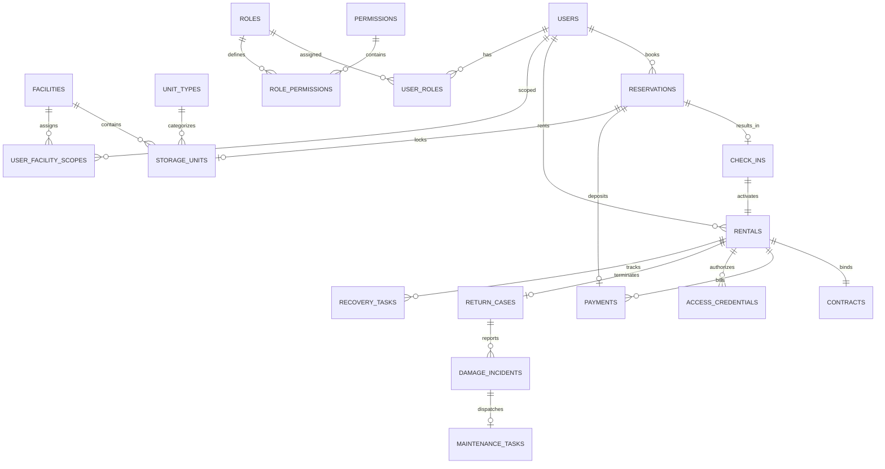
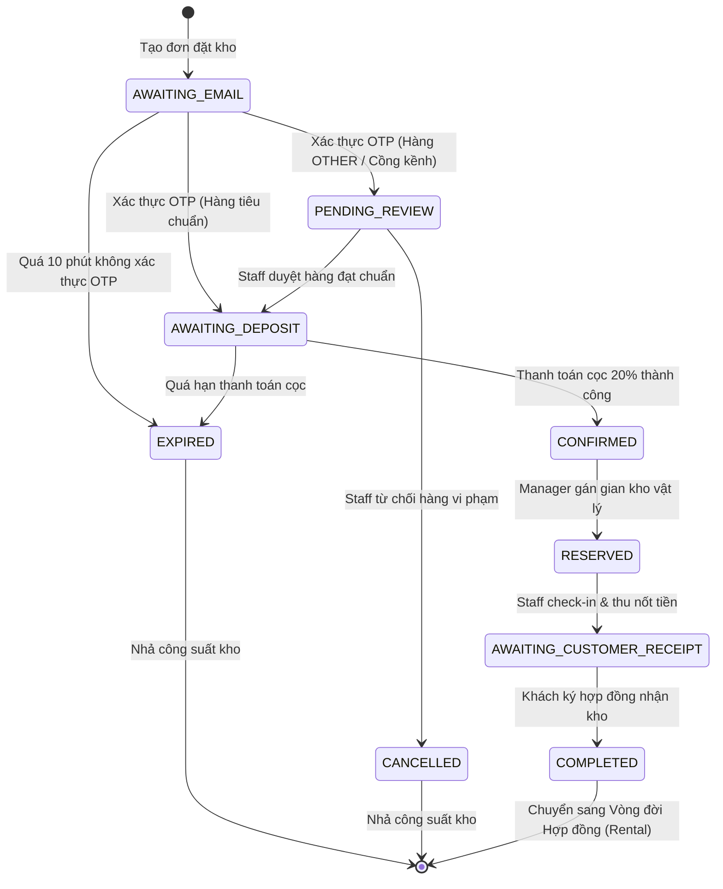
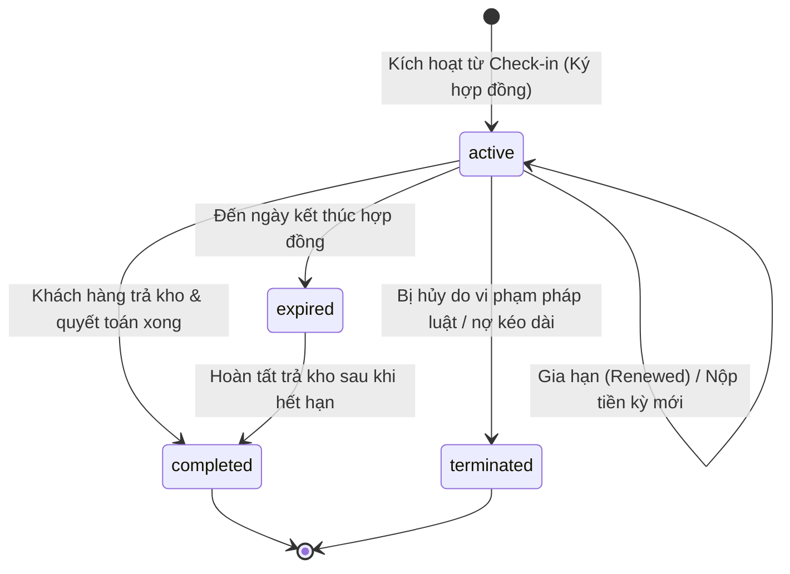
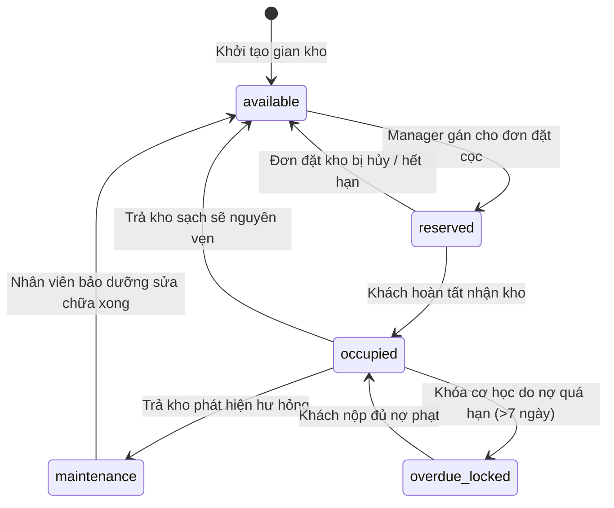
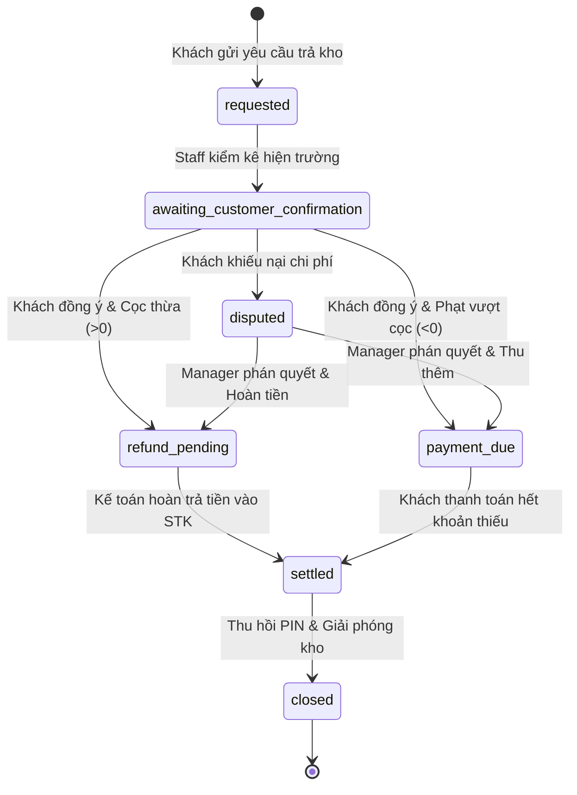

# BÁO CÁO TRÍCH XUẤT TOÀN DIỆN LOGIC HỆ THỐNG STORAGEHUB
## TÀI LIỆU KỸ THUẬT PHỤC VỤ XÂY DỰNG CODE DESIGNS (UML, CLASS SPECS, SEQUENCE DIAGRAMS, SQL QUERIES)

---

## 1. Executive Summary (Tóm Tắt Tổng Quan)

Dự án **StorageHub - Hệ thống Quản lý Cho thuê Kho Tự Quản (Self-Storage Rental Management System)** là giải pháp toàn trình phục vụ vận hành chuỗi cơ sở lưu trữ tự quản. Toàn bộ mã nguồn hiện hữu của hệ thống đã được phân tích và trích xuất dựa trên bằng chứng kỹ thuật (evidence-based) tại cả hai kho lưu trữ mã nguồn:
- **Backend (BE)**: `d:\SWP391\BE\self-storage-BE` (Java 21, Spring Boot 4.1.1, Spring Data JPA / Hibernate, Spring Security, MySQL 8, Flyway Migrations).
- **Frontend (FE)**: `d:\SWP391\FE\self-storage-FE` (React 19, TypeScript 5.7, Vite 8.3, TailwindCSS 4, Vitest 5.0).

### Hiện trạng thực thi tổng thể:
1. **Kiến trúc phân tầng và phân tách cổng (Dual-Portal Architecture)**:
   - Hệ thống phân tách nghiêm ngặt thành 2 cổng vật lý/định tuyến:
     - **Customer Portal**: Đường dẫn `/login`, `/register`, `/portal/*` (hỗ trợ Google OAuth2 Sign-in, đăng ký công khai).
     - **Back-office / Admin Portal**: Đường dẫn `/admin/login`, `/staff/login`, `/admin/*`, `/staff/*` (bắt buộc xác thực 2 lớp - 2FA TOTP 6 chữ số, không mở đăng ký công khai).
2. **Khả năng duy trì dữ liệu (Persistence Layer)**:
   - Backend sử dụng 100% CSDL quan hệ MySQL 8 được đồng bộ chuẩn hóa qua 23 tệp migration Flyway (`V2026100200` đến `V2026101504`).
   - Frontend cấu hình `VITE_ENABLE_DEMO_DATA=false`, thực hiện gọi API trực tiếp tới Backend qua tầng `apiClient.ts` và các service module chuyên biệt. Hệ thống FE vẫn giữ lại các logic mock/fallback nội bộ trong `StorageHubContext.tsx` khi mất kết nối mạng hoặc trong chế độ demo offline.
3. **Phân hệ nghiệp vụ cốt lõi đã hiện thực đầy đủ (Implemented & Verified)**:
   - **Xác thực & Phân quyền (RBAC + Facility Scope)**: Quản lý 5 Role (`CUSTOMER`, `STAFF`, `MANAGER`, `BUSINESS`, `ADMIN`), 32 quyền canonical (`SystemPermission`), và phân quyền theo phạm vi cơ sở kho (`FacilityScopeLevel`: `READ`, `OPERATE`, `MANAGE`).
   - **Đặt giữ kho (Reservation Lifecycle)**: Từ báo giá tức thời (Quote tính cọc 20% + quy đổi kích thước theo hệ số 5000), xác thực OTP qua email, thanh toán cọc VNPay / Mô phỏng, duyệt hàng hóa đặc biệt, gán kho vật lý, đến tạo biên bản check-in.
   - **Nhận kho & Bàn giao (Check-in & Handover)**: Nghiệm thu kích thước thực tế, thu tiền còn lại và tiền cọc an ninh (1 tháng tiền thuê), cấp phát mã định danh mở cửa (`AccessCredential`), và khách hàng ký duyệt hợp đồng điện tử (`Contract`).
   - **Quản lý Hợp đồng & Nhắc nợ (Rental Lifecycle & Overdue Handling)**: Theo dõi kỳ thanh toán, thông báo D-14, D-3, D+1, D+3 (ân hạn grace period), D+7 (escalation thu hồi), phát sinh phí phạt trả chậm 1 lần duy nhất cho mỗi kỳ.
   - **Trả kho & Quyết toán (Return & Settlement)**: Khách hàng yêu cầu trả kho, nhân viên kiểm kê hiện trường (tính toán cấn trừ tiền cọc an ninh với phí hư hỏng, phí vệ sinh, phí thất lạc đồ, nợ thuê), giải quyết tranh chấp bởi Manager, hoàn tiền hoặc thu thêm, thu hồi mã truy cập kho và tự động cập nhật trạng thái kho về trống hoặc bảo trì.
   - **Vận hành & Quản trị (Business Operations & Admin)**: Cấu hình tham số hệ thống (`system_settings`), quản lý danh mục gói thuê (`rental_package_policies`), mã giảm giá voucher (`discount_codes`), ghi nhận sự cố hư hỏng (`damage_incidents`) liên kết lệnh sửa chữa (`maintenance_tasks`), và ticket hỗ trợ (`support_tickets`).

---

## 2. Project Architecture and Directory Map (Kiến Trúc & Bản Đồ Thư Mục)

### 2.1 Kiến trúc tầng Backend (Spring Boot 4.1.1 / Java 21)
```
[ HTTP Client / Browser ]
           │
           ▼
[ Security & Filter Layer ]
  - SecurityConfig.java
  - JwtAuthenticationFilter.java -> ActorPrincipal & ActorContext
           │
           ▼
[ Presentation Layer: Controllers (77 endpoints) ]
  - com.storagehub.api.* (Auth, Reservation, CheckIn, Rental, Return, Payment, Overdue, Support, Admin...)
           │
           ▼
[ Application / Domain Service Layer (45+ Services) ]
  - com.storagehub.service.* (Quote, Creation, CheckIn, Rental, ReturnSettlement, Overdue, VNPay...)
           │
           ▼
[ Persistence & Data Access Layer (38 Repositories) ]
  - com.storagehub.domain.repo.* (Spring Data JPA Repositories)
           │
           ▼
[ Domain Entity Layer (40+ Entities) ]
  - com.storagehub.domain.model.* (JPA Entities with Hibernate annotations)
           │
           ▼
[ Database Layer: MySQL 8 (Flyway Managed Schema) ]
```

### 2.2 Bản đồ thư mục Backend (`self-storage-BE/src/main/java/com/storagehub/`)
- `api/`: Các REST Controller tiếp nhận và kiểm tra request.
  - `auth/`: `AuthController.java`, `UserFacilityScopeController.java`.
  - `reservation/`: `CustomerReservationController.java`, `CustomerReservationQuoteController.java`, `StaffReservationReviewController.java`, `ManagerReservationUnitAssignmentController.java`.
  - `checkin/`: `StaffCheckInHandoverController.java`, `CustomerCheckInConfirmationController.java`.
  - `rental/`: `CustomerRentalController.java`, `StaffRentalController.java`, `ManagerRentalContractController.java`.
  - `returnticket/`: `CustomerReturnController.java`, `StaffReturnHandoverController.java`, `ManagerReturnSettlementController.java`.
  - `payment/`: `VnpayPaymentController.java`, `SimulatedPaymentController.java`, `PaymentComplaintController.java`.
  - `overdue/`: `OverdueManagementController.java`, `RecoveryTaskController.java`.
  - `renewal/`: `RenewalController.java`, `RenewalQuoteController.java`.
  - `maintenance/`: `MaintenanceController.java`, `DamageIncidentController.java`.
  - `configuration/`: `BusinessPolicyController.java`, `DiscountCodeController.java`, `SystemSettingController.java`.
  - `support/`: `SupportTicketController.java`, `SupportMessageController.java`.
  - `reporting/`: `ReportingController.java`.
  - `admin/`: `AdminUserController.java`, `AdminRoleController.java`, `AdminSystemSettingController.java`.
- `service/`: Tầng nghiệp vụ xử lý logic giao dịch, tính toán, và quy tắc nghiệp vụ.
  - `ReservationQuoteService.java`, `ReservationCreationService.java`, `ReservationCapacityService.java`, `ReservationCompatibilityService.java`, `ReservationExpirationService.java`.
  - `CheckInHandoverService.java`, `AccessCredentialService.java`.
  - `CustomerRentalService.java`, `RentalQueryService.java`, `RentalContractLifecycleService.java`, `ManualRentalPaymentService.java`.
  - `ReturnSettlementService.java`, `OverdueService.java`, `RecoveryTaskOperationService.java`.
  - `VnpayService.java`, `SimulatedPaymentService.java`, `PaymentComplaintService.java`.
  - `BusinessPolicyService.java`, `FacilityLifecycleService.java`, `DiscountCodeService.java`, `DamageIncidentService.java`.
  - `SupportService.java`, `ReportingService.java`, `NotificationService.java`.
- `domain/model/`: Các thực thể dữ liệu JPA ánh xạ trực tiếp vào MySQL.
  - `Reservation.java`, `Rental.java`, `Contract.java`, `Payment.java`, `ReturnCase.java`, `CheckIn.java`.
  - `StorageUnit.java`, `UnitType.java`, `Facility.java`, `AccessCredential.java`.
  - `RentalPackagePolicy.java`, `DiscountCode.java`, `DamageIncident.java`, `MaintenanceTask.java`.
  - `SupportTicket.java`, `SupportTicketMessage.java`, `User.java`, `Role.java`, `ActivityLog.java`, `SystemSetting.java`.
- `domain/repo/`: Các Interface `JpaRepository` giao tiếp CSDL.
- `security/`: `ActorContext.java`, `ActorPrincipal.java`, `JwtTokenProvider.java`, `FacilityScopeEvaluator.java`.
- `resources/db/migration/`: 23 tập lệnh Flyway SQL cấu trúc bảng và dữ liệu mẫu.

### 2.3 Bản đồ thư mục Frontend (`self-storage-FE/src/`)
- `main.tsx`, `App.tsx`: Điểm khởi chạy ứng dụng, phân luồng route theo domain/subdomain và URL path.
- `auth/`: `rbac.ts` (định nghĩa 32 permissions, vai trò và hàm chuẩn hóa quyền `normalizeRolePermissions`).
- `domain/`: Chứa các quy tắc nghiệp vụ thuần túy (pure business logic) phía client:
  - `businessRules.ts`: Quy tắc tạo mã cơ sở, giới hạn phân bổ kho, kiểm tra an toàn khi xóa kho.
  - `managerRules.ts`: Quy tắc tính ngày kết thúc tháng lịch, chu kỳ quá hạn, kiểm tra xung đột phân bổ kho, công thức quyết toán trả kho.
  - `facilityRules.ts`: Quy tắc kích thước gian kho, chuẩn làn xe, độ chịu tải sàn.
- `services/`: Các client API gọi HTTP Axios/Fetch sang Backend:
  - `apiClient.ts`: Cấu hình Base URL (`http://localhost:8080/api`), tự động đính kèm `Bearer Token`, tự động gắn `Idempotency-Key` UUID.
  - `authApi.ts`, `reservationApi.ts`, `checkInApi.ts`, `rentalApi.ts`, `returnApi.ts`, `paymentApi.ts`, `supportApi.ts`, `businessApi.ts`, `adminApi.ts`.
- `views/`: Các màn hình theo từng phân hệ người dùng:
  - `customer/`: Đặt kho, tra cứu hợp đồng, thanh toán, yêu cầu trả kho, tạo ticket hỗ trợ.
  - `staff/`: Duyệt hàng hóa, thực hiện check-in nghiệm thu, bàn giao mã truy cập, kiểm tra hiện trường trả kho.
  - `manager/`: Gán gian kho vật lý, xem báo cáo quá hạn, xử lý tranh chấp quyết toán, điều phối lệnh sửa chữa.
  - `business/`: Thiết lập cơ sở kho mới, cấu hình gói thuê (RentalPackagePolicy), quản lý mã voucher, xem báo cáo doanh thu.
  - `admin/`: Quản lý tài khoản nội bộ, phân quyền vai trò (Role-Permission Matrix), cấu hình tham số hệ thống.
- `context/StorageHubContext.tsx`: Quản lý trạng thái chia sẻ (State store) toàn cục phía client.

---

## 3. Complete Feature Inventory (Danh Mục Toàn Bộ Tính Năng)

| Feature ID | Feature Name | Actor | Entry Point | Preconditions | Main Flow | Alternative / Error Flows | Business Rules Enforced | Data CRUD | Status | Evidence |
|---|---|---|---|---|---|---|---|---|---|---|
| **F-001** | Khách hàng đăng ký tài khoản (Customer Register) | Customer | UI: `/register`<br>API: `POST /api/auth/register` | Email chưa được sử dụng trong hệ thống | 1. Nhập họ tên, email, mật khẩu, SĐT.<br>2. BE băm mật khẩu BCrypt, tạo User với role `CUSTOMER`.<br>3. Trả về JWT token. | Email trùng lặp: trả về `409 CONFLICT`.<br>Dữ liệu không hợp lệ: `400 BAD_REQUEST`. | Mật khẩu tối thiểu 8 ký tự, định dạng email chuẩn. | **C**: `users`, `activity_logs` | Implemented | `AuthController.java:L45`<br>`AuthService.java:L78` |
| **F-002** | Khách hàng đăng nhập (Customer Login) | Customer | UI: `/login`<br>API: `POST /api/auth/login` | Tài khoản tồn tại và đang hoạt động (`ACTIVE`) | 1. Nhập email + password.<br>2. BE kiểm tra BCrypt hash.<br>3. Tạo `login_history` ghi nhận IP, thiết bị.<br>4. Trả về Access Token (1h) & Refresh Token (7d). | Sai mật khẩu: `401 UNAUTHORIZED`.<br>Tài khoản bị khóa (`SUSPENDED`): `403 FORBIDDEN`. | Ghi nhận `device_fingerprint`. | **R**: `users`<br>**C**: `login_history` | Implemented | `AuthController.java:L60`<br>`V2026100201...sql` |
| **F-003** | Đăng nhập nội bộ 2 lớp (Back-office 2FA Login) | Staff, Manager, Business, Admin | UI: `/admin/login`, `/staff/login`<br>API: `POST /api/auth/staff-login`, `POST /api/auth/verify-2fa` | Tài khoản nội bộ được cấp phép, có role tương ứng | 1. Nhập email + password.<br>2. BE kiểm tra hợp lệ, sinh mã 2FA tạm thời gửi email/TOTP.<br>3. Nhập mã OTP 6 số.<br>4. Cấp JWT kèm claim `roles`, `permissions`, `facilityScopes`. | Sai OTP hoặc hết hạn (5 phút): `401 UNAUTHORIZED`. | Bắt buộc 2FA cho tất cả nhân viên nội bộ. Không hỗ trợ đăng ký tự do. | **R**: `users`, `roles`, `permissions`, `user_facility_scopes`<br>**U**: `users.last_login_at` | Implemented | `AuthController.java:L110`<br>`portalSeparation.test.ts` |
| **F-004** | Tính báo giá thuê tức thời (Instant Quote Calculation) | Customer, Guest | UI: `/quote`, `/booking`<br>API: `POST /api/reservations/quotes` | Chọn cơ sở (`facilityId`), loại kho (`unitTypeId`), ngày bắt đầu, ngày kết thúc | 1. Gửi thông số thuê và kích thước hàng hóa.<br>2. BE tính số tháng thuê theo lịch.<br>3. Tính trọng lượng quy đổi thể tích.<br>4. Áp dụng chính sách gói thuê và mã voucher.<br>5. Lưu báo giá tạm với TTL 15 phút. | Mã voucher không hợp lệ / hết hạn: bỏ qua chiết khấu voucher hoặc báo lỗi. | Quy đổi thể tích: `(L*W*H)/5000`. Cọc giữ chỗ = 20% tổng tiền sau giảm giá. | **R**: `facilities`, `unit_types`, `rental_package_policies`, `discount_codes`<br>**C**: `reservation_quotes` | Implemented | `ReservationQuoteService.java:L82`<br>`ReservationQuoteController.java` |
| **F-005** | Tạo đơn đặt kho (Create Storage Reservation) | Customer | UI: `/booking/confirm`<br>API: `POST /api/reservations` | Có Quote hợp lệ chưa hết hạn, cơ sở còn sức chứa trống | 1. Nhập thông tin liên hệ, hàng hóa, mã căn cước.<br>2. Kiểm tra `Idempotency-Key`.<br>3. Khóa sức chứa kho (`lockAndRequireAvailableCapacity`).<br>4. Tạo Reservation ở trạng thái `AWAITING_EMAIL`.<br>5. Sinh mã OTP xác thực email (TTL 10 phút). | Trùng Idempotency: trả về kết quả đã xử lý.<br>Hết công suất: `409 CONFLICT`. | Cửa sổ giữ chỗ tạm 10 phút. Khoá công suất chống race-condition. | **R**: `facilities`, `storage_units`<br>**C**: `reservations`, `activity_logs` | Implemented | `ReservationCreationService.java:L65`<br>`CustomerReservationController.java` |
| **F-006** | Xác thực Email Đặt kho (Verify Reservation Email OTP) | Customer | UI: `/booking/verify-otp`<br>API: `POST /api/reservations/{id}/verify-email` | Đơn đang ở `AWAITING_EMAIL`, mã OTP gửi qua email | 1. Khách hàng nhập mã OTP 6 số.<br>2. BE kiểm tra tính hợp lệ và thời hạn OTP.<br>3. Nếu hàng hóa là `OTHER` hoặc cồng kềnh -> chuyển `PENDING_REVIEW`.<br>4. Nếu hàng hóa thông thường tiêu chuẩn -> chuyển `AWAITING_DEPOSIT`. | Sai mã OTP hoặc hết hạn: `400 BAD_REQUEST`. | Phân luồng thẩm định hàng hóa tự động dựa trên danh mục hàng hóa. | **U**: `reservations.status`, `reservations.email_verified_at` | Implemented | `ReservationCreationService.java:L142`<br>`ReservationGoodsReviewServiceTests` |
| **F-007** | Nhân viên duyệt hàng hóa đặc biệt (Staff Goods Review) | Staff | UI: `/staff/reservations/review`<br>API: `POST /api/staff/reservations/{id}/review-goods` | Đơn ở trạng thái `PENDING_REVIEW`, Staff có quyền cơ sở | 1. Nhân viên xem xét khai báo hàng hóa, kích thước, ảnh chụp.<br>2. Chọn Phê duyệt (`APPROVE`) hoặc Từ chối (`REJECT`).<br>3. Nếu duyệt: chuyển sang `AWAITING_DEPOSIT`. Nếu từ chối: giải phóng công suất, chuyển `CANCELLED`. | Nhân viên không thuộc cơ sở kho: `403 FORBIDDEN`. | Không chấp nhận hàng hóa độc hại, dễ cháy nổ, chất cấm. | **U**: `reservations.status`, `reservations.goods_review_notes` | Implemented | `StaffReservationReviewController.java:L55`<br>`CheckInHandoverService.java` |
| **F-008** | Thanh toán tiền cọc giữ chỗ (Pay Reservation Deposit) | Customer | UI: `/booking/payment`<br>API: `POST /api/payments/vnpay/create`, `POST /api/payments/simulated` | Đơn ở `AWAITING_DEPOSIT`, số tiền = 20% tổng đơn | 1. Chọn phương thức VNPay hoặc Thử nghiệm.<br>2. Chuyển hướng sang VNPay Sandbox hoặc gọi API mô phỏng.<br>3. Webhook/Callback xác thực IPN.<br>4. Ghi nhận giao dịch Payment `PAID`.<br>5. Chuyển Reservation sang `CONFIRMED`. | Thanh toán thất bại hoặc timeout: huỷ đơn sau khi hết hạn giữ chỗ. | Bắt buộc đối soát chữ ký SHA-512 đối với VNPay IPN. | **C**: `payments`<br>**U**: `reservations.status`, `reservations.deposit_paid_at` | Implemented | `VnpayService.java:L120`<br>`SimulatedPaymentService.java:L45` |
| **F-009** | Quản lý gán gian kho vật lý (Manager Physical Unit Assignment) | Manager | UI: `/manager/reservations/assign`<br>API: `POST /api/manager/reservations/{id}/assign-unit` | Đơn ở trạng thái `CONFIRMED`, kho có gian vật lý trạng thái `available` | 1. Quản lý xem danh sách đơn đã cọc.<br>2. Chọn gian kho vật lý (`unitId`) tương thích kích thước.<br>3. Cập nhật `storage_units.status = 'reserved'`.<br>4. Cập nhật `reservations.unit_id = unitId`, chuyển status `RESERVED`. | Gian kho đang bị chiếm dụng (`occupied`/`reserved`): `409 CONFLICT`. | Gian kho được gán phải thuộc cùng `facilityId` và `unitTypeId`. | **R**: `storage_units`<br>**U**: `reservations`, `storage_units` | Implemented | `ManagerReservationUnitAssignmentController.java`<br>`UnitAssignmentService.java` |
| **F-010** | Lập lịch hẹn check-in (Schedule Check-in Appointment) | Customer | UI: `/portal/reservations/{id}/schedule`<br>API: `POST /api/customer/reservations/{id}/schedule-checkin` | Đơn ở trạng thái `RESERVED` | 1. Chọn ngày và khung giờ check-in mong muốn.<br>2. BE kiểm tra khung giờ làm việc của cơ sở (8:00 - 18:00).<br>3. Lưu thông tin lịch hẹn. | Chọn ngoài giờ mở cửa: `400 BAD_REQUEST`. | Phải đặt trước ít nhất 2 giờ so với thời điểm hiện tại. | **U**: `reservations.checkin_appointment_time` | Implemented | `CustomerReservationController.java:L190`<br>`FacilityAppointmentHoursTests` |
| **F-011** | Thực hiện nghiệm thu bàn giao kho (Staff Perform Check-in Handover) | Staff | UI: `/staff/checkin/{id}`<br>API: `POST /api/staff/checkin/handover` | Đơn ở trạng thái `RESERVED`, khách hàng có mặt tại kho | 1. Nhân viên đo đạc thể tích thực tế kiện hàng, chụp ảnh tình trạng ban đầu.<br>2. Ghi nhận thanh toán khoản tiền còn lại và tiền cọc an ninh (`dueAtCheckIn`).<br>3. Sinh mã mở khóa (`AccessCredential`).<br>4. Tạo bản ghi `CheckIn`, cập nhật đơn sang `AWAITING_CUSTOMER_RECEIPT`. | Kích thước thực tế vượt quá 10% hạn mức: tính phụ phí quá khổ. | Bắt buộc thu đủ tiền trước khi cấp quyền truy cập. | **C**: `check_ins`, `access_credentials`, `payments`<br>**U**: `reservations.status` | Implemented | `StaffCheckInHandoverController.java`<br>`CheckInHandoverService.java:L95` |
| **F-012** | Khách hàng ký nhận bàn giao & Kích hoạt hợp đồng (Customer Confirm Handover) | Customer | UI: `/portal/checkin/confirm`<br>API: `POST /api/customer/checkin/{id}/confirm-receipt` | Đơn ở `AWAITING_CUSTOMER_RECEIPT` | 1. Khách hàng kiểm tra điều khoản và biên bản nghiệm thu.<br>2. Đồng ý điều khoản và nhấn xác nhận.<br>3. BE tạo bản ghi `Rental` (status: `active`).<br>4. Sinh hợp đồng pháp lý `Contract` (status: `SIGNED`).<br>5. Cập nhật `storage_units.status = 'occupied'`.<br>6. Chuyển Reservation sang `COMPLETED`. | Quá 24h không xác nhận: hệ thống gửi cảnh báo nhắc nhở. | Giao dịch diễn ra trong 1 Database Transaction duy nhất (`@Transactional`). | **C**: `rentals`, `contracts`<br>**U**: `reservations`, `storage_units` | Implemented | `CustomerCheckInConfirmationController.java`<br>`RentalContractLifecycleService.java` |
| **F-013** | Quản lý hợp đồng & Truy cập kho (View Rental & Gate Access) | Customer | UI: `/portal/rentals/{id}`<br>API: `GET /api/customer/rentals/{id}`, `GET /api/customer/rentals/{id}/access-code` | Đăng nhập tài khoản sở hữu hợp đồng | 1. Hiển thị thông tin gian kho, ngày bắt đầu, ngày hết hạn, chu kỳ thanh toán tiếp theo.<br>2. Hiển thị mã PIN mở cổng / mã thẻ RFID đang hoạt động. | Hợp đồng bị khóa do nợ quá hạn: ẩn hoặc làm mờ mã mở cửa. | Chỉ chủ hợp đồng mới có quyền xem mã mở cổng. | **R**: `rentals`, `contracts`, `access_credentials` | Implemented | `CustomerRentalController.java:L60`<br>`AccessCredentialService.java` |
| **F-014** | Gia hạn hợp đồng thuê kho (Renew Rental Contract) | Customer | UI: `/portal/rentals/{id}/renew`<br>API: `POST /api/customer/rentals/{id}/renewal-quote`, `POST /api/customer/rentals/{id}/renew` | Hợp đồng đang `active` hoặc `overdue` trong hạn ân hạn | 1. Chọn thời gian gia hạn (1, 3, 6, 12 tháng).<br>2. Hệ thống tính tiền gia hạn (áp dụng chiết khấu thời gian).<br>3. Thanh toán qua VNPay hoặc mô phỏng.<br>4. Cập nhật `rentals.end_date` kéo dài tương ứng.<br>5. Cập nhật `rentals.next_due_date`. | Kho đã được khách khác đặt trước sau ngày kết thúc cũ: chặn gia hạn. | Ngày kết thúc tính chính xác theo tháng lịch. | **C**: `renewals`, `payments`<br>**U**: `rentals.end_date`, `rentals.next_due_date` | Implemented | `RenewalController.java`<br>`RenewalQuoteService.java` |
| **F-015** | Nhắc nhở và cảnh báo quá hạn thanh toán (Overdue Notification & Escalation) | System / Scheduled Cron | Hệ thống tự động / API: `POST /api/overdue/scan` | Chạy định kỳ hàng ngày lúc 00:00 | 1. Quét các hợp đồng có `next_due_date < CURRENT_DATE`.<br>2. Mốc D-14, D-3: gửi email nhắc kỳ thanh toán sắp tới.<br>3. Mốc D+1: chuyển `rentals.payment_status = 'overdue'`, gửi cảnh báo trễ hạn.<br>4. Mốc D+3: quá hạn ân hạn (grace period), tính phí phạt trễ hạn 1 lần duy nhất.<br>5. Mốc D+7: tạo nhiệm vụ thu hồi kho (`RecoveryTask`) giao cho Manager. | Đã áp phí phạt trong kỳ hiện tại: không tính phạt lần 2. | Phí phạt trễ hạn cố định hoặc theo tỷ lệ cấu hình tại `system_settings`. | **C**: `activity_logs`, `recovery_tasks`<br>**U**: `rentals.payment_status`, `rentals.late_fee_amount` | Implemented | `OverdueService.java:L115`<br>`LocalRenewalAutoRecoveryServiceTests` |
| **F-016** | Khóa quyền truy cập gian kho nợ hạn (Overdue Lockout & Access Revocation) | Manager | UI: `/manager/overdue/tasks`<br>API: `POST /api/manager/overdue/{id}/lockout` | Hợp đồng quá hạn trên 7 ngày, thuộc quyền cơ sở của Manager | 1. Manager kiểm tra hồ sơ nợ đọng.<br>2. Nhấn Lệnh khóa kho.<br>3. Hệ thống vô hiệu hóa `access_credentials.status = 'revoked'`.<br>4. Đánh dấu khóa vật lý `storage_units.status = 'overdue_locked'`. | Khách hàng đã thanh toán đầy đủ nợ: tự động mở khóa. | Chỉ Manager có quyền cơ sở `MANAGE` mới được thực hiện. | **U**: `access_credentials`, `storage_units`, `recovery_tasks` | Implemented | `RecoveryTaskController.java`<br>`RecoveryTaskOperationService.java` |
| **F-017** | Khách hàng yêu cầu trả kho (Customer Request Return) | Customer | UI: `/portal/rentals/{id}/return`<br>API: `POST /api/customer/rentals/{id}/request-return` | Hợp đồng đang `active`, không có yêu cầu trả kho đang chờ | 1. Khách hàng chọn ngày dự kiến dọn đồ và trả kho.<br>2. Nhập lý do và thông tin số tài khoản nhận tiền hoàn cọc.<br>3. Tạo bản ghi `ReturnCase` ở trạng thái `requested`. | Ngày trả kho trong quá khứ: `400 BAD_REQUEST`. | Ngày yêu cầu trả kho không được trước ngày bắt đầu hợp đồng. | **C**: `return_cases`<br>**U**: `rentals.status` | Implemented | `CustomerReturnController.java:L45`<br>`ReturnSettlementService.java` |
| **F-018** | Nghiệm thu hiện trường trả kho (Staff Inspect Return Case) | Staff | UI: `/staff/returns/{id}/inspect`<br>API: `POST /api/staff/returns/{id}/inspect` | `ReturnCase` ở trạng thái `requested`, khách hàng đã dọn đồ | 1. Staff kiểm tra hiện trường: độ sạch sẽ, hư hỏng tường/cửa/khóa, rác thải bỏ lại.<br>2. Nhập biên bản: phí vệ sinh (`cleaningFee`), phí hư hại (`damageFee`), phí mất chìa (`lostItemFee`).<br>3. Tải lên ảnh bằng chứng hiện trường.<br>4. Chuyển trạng thái `ReturnCase` sang `awaiting_customer_confirmation`. | Tiền phạt vượt quá tiền cọc: hệ thống yêu cầu giải trình chi tiết. | Staff phải chụp ít nhất 1 ảnh hiện trường nếu có phát sinh hư hỏng. | **U**: `return_cases` (các trường chi phí và ghi chú) | Implemented | `StaffReturnHandoverController.java`<br>`ReturnSettlementService.java:L140` |
| **F-019** | Quyết toán hoàn tiền hoặc thu nợ trả kho (Return Settlement Calculation) | Customer, Manager | UI: `/portal/returns/{id}/settlement`<br>API: `POST /api/customer/returns/{id}/accept-settlement`, `POST /api/customer/returns/{id}/dispute` | `ReturnCase` ở `awaiting_customer_confirmation` | 1. Công thức quyết toán: `NetBalance = SecurityDeposit - (Damage + Cleaning + LostItem + OverdueRent + UnpaidBills)`.<br>2. Nếu `NetBalance >= 0`: Chuyển `refund_pending` để kế toán hoàn tiền.<br>3. Nếu `NetBalance < 0`: Chuyển `payment_due`, khách hàng phải nộp thêm tiền thiếu.<br>4. Nếu Khách hàng không đồng ý với tiền phạt: bấm Khiếu nại -> chuyển `disputed`. | Khách hàng khiếu nại: chuyển sang bàn làm việc của Manager. | Tiền cọc an ninh được dùng làm bảo chứng khấu trừ đầu tiên. | **U**: `return_cases.status`, `return_cases.net_balance` | Implemented | `ManagerReturnSettlementController.java`<br>`ReturnSettlementServiceTests` |
| **F-020** | Xử lý khiếu nại quyết toán trả kho (Manager Resolve Dispute) | Manager | UI: `/manager/returns/disputes`<br>API: `POST /api/manager/returns/{id}/resolve-dispute` | `ReturnCase` ở trạng thái `disputed` | 1. Manager xem xét biên bản của Staff và ý kiến của Khách.<br>2. Điều chỉnh lại số tiền phạt (nếu hợp lý) và đưa ra phán quyết cuối cùng.<br>3. Chuyển trạng thái sang `refund_pending` hoặc `payment_due`. | Manager không có quyền cơ sở: `403 FORBIDDEN`. | Phán quyết của Manager là quyết định cuối cùng trong hệ thống. | **U**: `return_cases.status`, `return_cases.manager_notes` | Implemented | `ManagerReturnSettlementController.java:L110` |
| **F-021** | Đóng hồ sơ trả kho & Giải phóng mặt bằng (Close Return & Release Unit) | Staff / System | UI: `/staff/returns/{id}/close`<br>API: `POST /api/staff/returns/{id}/close` | `ReturnCase` đã hoàn tiền hoặc thu nợ xong (`settled`) | 1. Thu hồi toàn bộ quyền truy cập `AccessCredential`.<br>2. Đóng hợp đồng `rentals.status = 'completed'`, `contracts.status = 'TERMINATED'`.<br>3. Nếu kho sạch sẽ: chuyển `storage_units.status = 'available'`. Nếu có hư hỏng: chuyển `storage_units.status = 'maintenance'` và sinh `MaintenanceTask`. | Chưa thanh toán nợ đọng: không thể giải phóng mặt bằng. | Cập nhật đồng bộ trong 1 transaction an toàn. | **U**: `return_cases`, `rentals`, `contracts`, `storage_units`, `access_credentials`<br>**C**: `maintenance_tasks` | Implemented | `ReturnSettlementService.java:L285`<br>`CancelledReservationUnitReleaseService` |
| **F-022** | Quản lý thiết lập cơ sở kho (Business Facility Management) | Business | UI: `/business/facilities`<br>API: `POST /api/business/facilities`, `PUT /api/business/facilities/{id}`, `DELETE /api/business/facilities/{id}` | Role `BUSINESS` hoặc `ADMIN` | 1. Tạo mới hoặc cập nhật cơ sở kho (Tên, địa chỉ, số tầng, diện tích, camera, PCCC).<br>2. Gợi ý mã cơ sở tự động theo thành phố (`HN-F01`, `HCM-F01`).<br>3. Thiết lập thông số tiêu chuẩn làn xe và tải trọng sàn.<br>4. Xóa cơ sở: Kiểm tra an toàn trước khi xóa. | Cơ sở đang có gian kho `occupied` hoặc hợp đồng `active`: chặn xóa tuyệt đối (`400 BAD_REQUEST`). | Gợi ý mã cơ sở chuẩn hóa, kiểm tra ràng buộc toàn vẹn dữ liệu. | **C/U/D**: `facilities`, `storage_units`, `facility_policies` | Implemented | `BusinessPolicyController.java`<br>`FacilityDeletionSafetyTests` |
| **F-023** | Quản lý chính sách gói thuê (Rental Package Policy Management) | Business | UI: `/business/policies`<br>API: `POST /api/business/policies`, `PUT /api/business/policies/{id}/status` | Role `BUSINESS` hoặc `ADMIN` | 1. Tạo gói thuê: thời hạn tối thiểu, tỷ lệ chiết khấu (VD: 3 tháng giảm 5%, 6 tháng giảm 10%, 12 tháng giảm 15%).<br>2. Quản lý vòng đời gói: `DRAFT` -> `PUBLISHED` -> `INACTIVE`.<br>3. Chỉ các gói `PUBLISHED` mới được áp dụng khi tính Quote. | Sửa gói đang được tham chiếu: lưu phiên bản mới (Versioning). | Tỷ lệ chiết khấu phải từ 0% đến 50%. | **C/U**: `rental_package_policies` | Implemented | `BusinessPolicyService.java:L60`<br>`BusinessPolicyLifecycleTests` |
| **F-024** | Quản lý mã giảm giá voucher (Discount Code Management) | Business | UI: `/business/vouchers`<br>API: `POST /api/business/discount-codes`, `PUT /api/business/discount-codes/{id}` | Role `BUSINESS` hoặc `ADMIN` | 1. Nhập mã code (duy nhất), loại giảm (phần trăm hoặc số tiền cố định), giá trị giảm, thời hạn hiệu lực, lượt dùng tối đa.<br>2. Quản lý trạng thái: `ACTIVE`, `DISABLED`, `EXPIRED`. | Mã trùng: `409 CONFLICT`. | Giảm theo phần trăm tối đa 100%, có trần giảm giá tối đa (`maxDiscountAmount`). | **C/U**: `discount_codes` | Implemented | `DiscountCodeController.java`<br>`DiscountCodeService.java` |
| **F-025** | Ghi nhận sự cố hư hỏng cơ sở vật chất (Damage Incident Logging) | Staff, Manager | UI: `/staff/incidents`, `/manager/incidents`<br>API: `POST /api/incidents` | Thuộc phạm vi cơ sở kho | 1. Nhập tiêu đề, vị trí, mức độ nghiêm trọng (`LOW`, `MEDIUM`, `HIGH`, `CRITICAL`).<br>2. Tải ảnh chụp hư hại.<br>3. Hệ thống sinh mã sự cố duy nhất định dạng `INC-YYYYMM-XXXX`.<br>4. Tự động sinh `MaintenanceTask` tương ứng nếu nghiêm trọng. | Mã sự cố được sinh tuần tự chống trùng lặp. | Các sự cố `CRITICAL` lập tức gửi thông báo khẩn cấp tới Manager. | **C**: `damage_incidents`, `maintenance_tasks` | Implemented | `DamageIncidentController.java`<br>`DamageIncidentService.java` |
| **F-026** | Điều phối và xử lý lệnh bảo trì (Maintenance Task Execution) | Staff, Manager | UI: `/staff/maintenance`, `/manager/maintenance`<br>API: `GET /api/maintenance`, `PUT /api/maintenance/{id}/status` | Thuộc phạm vi cơ sở | 1. Xem danh sách công việc bảo trì theo trạng thái (`PENDING`, `IN_PROGRESS`, `COMPLETED`, `CANCELLED`).<br>2. Manager phân công Staff phụ trách.<br>3. Staff cập nhật tiến độ, chi phí vật tư và đóng công việc. | Staff tự hủy task: bị từ chối (chỉ Manager mới có quyền hủy). | Sau khi sửa xong gian kho, cập nhật `storage_units.status` từ `maintenance` về `available`. | **U**: `maintenance_tasks`, `storage_units` | Implemented | `MaintenanceController.java`<br>`MaintenanceService.java` |
| **F-027** | Gửi ticket hỗ trợ khách hàng (Customer Support Ticket) | Customer | UI: `/portal/support`<br>API: `POST /api/support/tickets` | Khách hàng đã đăng nhập | 1. Chọn loại vấn đề (Hợp đồng, Thanh toán, Gian kho, Kỹ thuật), nhập tiêu đề và nội dung.<br>2. Hệ thống sinh mã ticket `TICK-XXXX`.<br>3. Trạng thái khởi tạo `OPEN`. | Nội dung trống: `400 BAD_REQUEST`. | Mỗi ticket gắn với `customerId` và có thể gắn với `rentalId`. | **C**: `support_tickets`, `support_ticket_messages` | Implemented | `SupportTicketController.java`<br>`SupportService.java` |
| **F-028** | Nhân viên phản hồi & Đóng ticket hỗ trợ (Staff Resolve Support Ticket) | Staff, Manager | UI: `/staff/support`<br>API: `POST /api/support/tickets/{id}/messages`, `PUT /api/support/tickets/{id}/status` | Nhân viên hỗ trợ | 1. Nhân viên xem nội dung, gửi tin nhắn phản hồi tới khách hàng.<br>2. Cập nhật trạng thái `IN_PROGRESS` -> `RESOLVED` -> `CLOSED`.<br>3. Hệ thống tự động đóng ticket nếu không có phản hồi mới sau 72h. | Khách hàng gửi tin nhắn mới khi ticket đang `RESOLVED`: tự động mở lại `OPEN`. | Tin nhắn hiển thị kèm vai trò người gửi và mốc thời gian. | **C**: `support_ticket_messages`<br>**U**: `support_tickets.status` | Implemented | `SupportMessageController.java`<br>`SupportAutoCloseCoordinatorTests` |
| **F-029** | Khiếu nại giao dịch thanh toán (Payment Complaint Management) | Customer, Manager | UI: `/portal/payments/complaint`<br>API: `POST /api/payments/{id}/complaint`, `PUT /api/manager/payments/complaint/{id}` | Giao dịch thanh toán bị lỗi hoặc trừ tiền sai | 1. Khách hàng gửi khiếu nại trong vòng 7 ngày kể từ khi phát sinh giao dịch.<br>2. Manager tra soát mã giao dịch với ngân hàng/VNPay.<br>3. Nếu khiếu nại đúng: kích hoạt hoàn tiền và cập nhật hợp đồng.<br>4. Nếu khiếu nại sai: từ chối kèm lý do. | Quá 7 ngày kể từ ngày giao dịch: từ chối tiếp nhận khiếu nại. | Thời hạn khiếu nại tối đa 7 ngày (`COMPLAINT_WINDOW_DAYS = 7`). | **C/U**: `payment_complaints`, `payments` | Implemented | `PaymentComplaintController.java`<br>`PaymentComplaintDeadlineServiceTests` |
| **F-030** | Báo cáo doanh thu & Hiệu suất lấp đầy (Business & Operational Reporting) | Business, Manager | UI: `/business/reports`, `/manager/reports`<br>API: `GET /api/reports/revenue`, `GET /api/reports/occupancy` | Role `BUSINESS`, `ADMIN` hoặc `MANAGER` (trong phạm vi kho) | 1. Chọn khoảng ngày và cơ sở kho.<br>2. Hệ thống tính tổng doanh thu từ các khoản thanh toán thực tế (`payments.status = 'PAID'`).<br>3. Tính tỷ lệ lấp đầy: `OccupiedUnits / TotalActiveUnits * 100%`.<br>4. Xuất file Excel `.xlsx` hoặc hiển thị biểu đồ Recharts. | Manager và Business chỉ xem được cơ sở có scope; Admin xem toàn hệ thống. | Doanh thu chỉ tính từ giao dịch đã hoàn tất đối soát (`PAID`). | **R**: `payments`, `storage_units`, `rentals`, `facilities` | Implemented | `ReportingController.java`<br>`ReportingService.java` |
| **F-031** | Quản lý người dùng nội bộ (Admin User Management) | Admin | UI: `/admin/users`<br>API: `POST /api/admin/users`, `PUT /api/admin/users/{id}`, `PUT /api/admin/users/{id}/status` | Role `ADMIN` | 1. Tạo tài khoản nhân viên (Staff, Manager, Business).<br>2. Gán vai trò (`roles`).<br>3. Khóa (`SUSPENDED`) hoặc kích hoạt tài khoản (`ACTIVE`). | Không thể tự khóa tài khoản của chính mình. | Email phải là duy nhất trên toàn hệ thống. | **C/U**: `users`, `user_roles` | Implemented | `AdminUserController.java`<br>`AdminUserService.java` |
| **F-032** | Phân quyền & Quản lý vai trò (Admin RBAC Permission Matrix) | Admin | UI: `/admin/roles`<br>API: `GET /api/admin/roles`, `PUT /api/admin/roles/{id}/permissions` | Role `ADMIN` | 1. Xem danh sách quyền theo từng vai trò.<br>2. Bật/Tắt các quyền hệ thống (`SystemPermission`).<br>3. Cập nhật phiên bản chính sách quyền (`policy_version`). | Cấm rút quyền quản trị cốt lõi của role `ADMIN`. | Bảo toàn quyền sở hữu chính sách (Policy Ownership) của BO. | **R/U**: `roles`, `role_permissions` | Implemented | `AdminRoleController.java`<br>`V2026100906...sql` |
| **F-033** | Phân bổ phạm vi cơ sở kho cho nhân viên (Admin Facility Scope Assignment) | Admin | UI: `/admin/scopes`<br>API: `POST /api/admin/users/{id}/facility-scopes` | Role `ADMIN` | 1. Chọn nhân viên (Staff/Manager).<br>2. Chọn cơ sở kho (`facilityId`) và cấp độ quyền (`READ`, `OPERATE`, `MANAGE`).<br>3. Lưu cấu hình vào `user_facility_scopes`. | Gán trùng cơ sở: cập nhật lại cấp độ scope thay vì thêm mới. | Staff/Manager chỉ được thao tác tại cơ sở đã được gán scope. | **C/U/D**: `user_facility_scopes` | Implemented | `UserFacilityScopeController.java`<br>`FacilityScopeEvaluator.java` |
| **F-034** | Cấu hình tham số hệ thống toàn cục (Admin Global System Settings) | Admin | UI: `/admin/settings`<br>API: `GET /api/admin/settings`, `PUT /api/admin/settings` | Role `ADMIN` | 1. Xem các tham số vận hành: thời gian ân hạn (`gracePeriodDays`), phí phạt quá hạn (`lateFeeAmount`), tỷ lệ cọc giữ chỗ (`defaultDepositRatio = 0.2`), thời gian giữ chỗ (`holdExpiryMinutes = 10`).<br>2. Cập nhật và lưu vào bảng `system_settings`. | Nhập giá trị âm: `400 BAD_REQUEST`. | Các tham số được cache và tải động trong runtime. | **R/U**: `system_settings` | Implemented | `AdminSystemSettingController.java`<br>`SystemSettingService.java` |
| **F-035** | Tự động hủy đơn đặt kho hết hạn & Giải phóng chỗ (Auto Cancel Expired Reservations) | System / Scheduled Cron | Chạy định kỳ mỗi 1 phút / API: `POST /api/reservations/expire-stale` | Đơn ở trạng thái `AWAITING_EMAIL` hoặc `AWAITING_DEPOSIT` quá thời hạn giữ chỗ | 1. Quét các đơn có `expires_at < CURRENT_TIMESTAMP`.<br>2. Chuyển trạng thái đơn sang `EXPIRED`.<br>3. Tự động giải phóng dung lượng khóa trong `ReservationCapacityService`.<br>4. Nếu đã gán kho vật lý: chuyển `storage_units.status` từ `reserved` về `available`. | Không tác động tới đơn đã `CONFIRMED`. | Hoàn trả chính xác 100% dung lượng kho cho khách hàng khác. | **U**: `reservations.status`, `storage_units.status` | Implemented | `ReservationExpirationService.java:L45`<br>`CancelledReservationUnitReleaseServiceTests` |
| **F-036** | Đăng nhập một chạm bằng Google (Customer Google OAuth2 Sign-In) | Customer | UI: `/login`<br>API: `POST /api/auth/google` | Khách hàng có tài khoản Google hợp lệ | 1. FE lấy ID Token từ Google OAuth2 Client.<br>2. Gửi ID Token lên Backend.<br>3. BE xác thực chữ ký token với Google Auth API.<br>4. Nếu email chưa tồn tại: tự động tạo User role `CUSTOMER`.<br>5. Trả về Access Token & Refresh Token. | ID Token giả mạo hoặc hết hạn: `401 UNAUTHORIZED`. | Chỉ áp dụng cho Customer Portal; cấm dùng Google OAuth2 cho Back-office. | **C/R**: `users`, `login_history` | Implemented | `AuthController.java:L95`<br>`portalSeparation.test.ts` |

---

## 4. Actors, Roles, Permissions, and Access Control (Tác Nhân & Phân Quyền)

### 4.1 Danh mục Tác nhân (Actors)
1. **Khách hàng (Customer)**: Cá nhân hoặc tổ chức có nhu cầu thuê kho tự quản; tương tác qua Customer Portal.
2. **Nhân viên kho (Staff)**: Phụ trách hiện trường tại cơ sở (kiểm tra hàng hóa, nghiệm thu check-in, bàn giao mã mở cửa, kiểm kê trả kho, xử lý lệnh bảo dưỡng); tương tác qua Staff Portal.
3. **Quản lý cơ sở (Facility Manager)**: Quản lý hoạt động của một hoặc nhiều chi nhánh kho cụ thể (gán gian kho vật lý, xử lý thu hồi kho quá hạn, giải quyết khiếu nại trả kho, phân công nhân viên); tương tác qua Manager Portal.
4. **Chủ doanh nghiệp / Khối vận hành (Business Owner - BO)**: Quản lý danh mục cơ sở, thiết lập chính sách gói thuê, chương trình khuyến mãi voucher, theo dõi hiệu suất doanh thu toàn chuỗi; tương tác qua Business Portal.
5. **Quản trị hệ thống (System Administrator - Admin)**: Quản lý tài khoản nội bộ, ma trận quyền RBAC, phạm vi chi nhánh (Facility Scope), và cấu hình tham số hệ sinh thái; tương tác qua Admin Portal.
6. **Hệ thống tự động (System / Background Cron)**: Các tiến trình định kỳ thực hiện quét đơn hết hạn, tính phạt quá hạn, tự động đóng ticket và đồng bộ dữ liệu.

### 4.2 Cấu trúc vai trò và phân cấp (Role Hierarchy)
Mã vai trò chuẩn hóa trong CSDL (`roles.code`):
- `CUSTOMER`: Vai trò người dùng bên ngoài.
- `STAFF`: Vai trò nhân viên vận hành cơ sở.
- `MANAGER`: Vai trò cấp quản lý cơ sở tại cơ sở được gán; không kế thừa permission của Staff.
- `BUSINESS`: Vai trò quản trị kinh doanh và chính sách toàn cục.
- `ADMIN`: Vai trò quản trị kỹ thuật cao nhất (Superuser).

### 4.3 Ma trận Quyền Hệ Thống (System Permissions Matrix)

Backend và frontend dùng cùng quy ước canonical `resource:action`. Đây là ma trận mặc định cuối cùng; scope, ownership và trạng thái resource vẫn được service kiểm tra thêm.

| Permission | Customer | Staff | Manager | Business | Admin |
|---|:---:|:---:|:---:|:---:|:---:|
| `dashboard:read` | ✓ | ✓ | ✓ | ✓ | ✓ |
| `facilities:read` | ✓ | ✓ | ✓ | ✓ |  |
| `storage_units:read` | ✓ | ✓ | ✓ | ✓ |  |
| `reservations:create` | ✓ |  |  |  |  |
| `reservations:read` | ✓ | ✓ | ✓ | ✓ |  |
| `reservations:approve` |  | ✓ | ✓ |  |  |
| `storage_units:assign` |  |  | ✓ |  |  |
| `contracts:read` | ✓ | ✓ | ✓ | ✓ |  |
| `checkins:read` |  | ✓ | ✓ |  |  |
| `checkins:process` |  | ✓ |  |  |  |
| `rentals:read` | ✓ | ✓ | ✓ | ✓ |  |
| `rentals:update` |  |  | ✓ |  |  |
| `renewals:operate` |  | ✓ |  |  |  |
| `returns:read` |  | ✓ | ✓ | ✓ |  |
| `returns:process` |  | ✓ |  |  |  |
| `payments:read` | ✓ | ✓ | ✓ | ✓ |  |
| `payments:collect` |  | ✓ | ✓ |  |  |
| `payments:confirm` |  |  | ✓ |  |  |
| `refunds:approve` |  |  | ✓ | ✓ |  |
| `refunds:execute` |  | ✓ |  | ✓ |  |
| `fees:waive` |  |  | ✓ | ✓ |  |
| `policies:read` | ✓ |  | ✓ | ✓ |  |
| `policies:update` |  |  |  | ✓ |  |
| `support:read` | ✓ | ✓ | ✓ | ✓ |  |
| `support:update` |  | ✓ |  |  |  |
| `inventory:update` |  |  | ✓ |  |  |
| `staff_tasks:update` |  |  | ✓ |  |  |
| `reports:read` |  |  | ✓ | ✓ |  |
| `audit_logs:read` |  |  |  |  | ✓ |
| `users:manage` |  |  |  |  | ✓ |
| `roles:manage` |  |  |  |  | ✓ |
| `settings:manage` |  |  |  |  | ✓ |
| `sessions:manage` |  |  |  |  | ✓ |

Staff chỉ thu tiền mặt trong phiên thu và chỉ thực thi refund sau khi hồ sơ đã được duyệt; Manager chỉ duyệt, không thực thi refund; Business Operations thực thi refund/fee theo nghiệp vụ return trong scope MANAGE và không thao tác hiện trường. Customer còn bị ràng buộc ownership. `ADMIN` và `CUSTOMER` là role loại trừ; Manager không kế thừa Staff.

Hạn mức Manager tự duyệt refund/miễn giảm chưa có giá trị chốt từ Business nên chưa hard-code; service đã tách capability `refunds:approve` và `fees:waive` để gắn policy khi có tham số chính thức.

### 4.4 Cơ chế Phân quyền theo Phạm vi Cơ sở (Facility Scoping Mechanism)
- Bảng CSDL: `user_facility_scopes(user_id, facility_id, scope_level)`.
- Các cấp độ `FacilityScopeLevel`:
  - `READ`: Chỉ xem danh sách kho, lịch hẹn, tình trạng thanh toán tại cơ sở.
  - `OPERATE`: Thực hiện các tác vụ vận hành hiện trường (thẩm định hàng, check-in, kiểm tra trả kho). Áp dụng cho `STAFF`.
  - `MANAGE`: Thực hiện điều phối, gán kho, quyết toán tiền cọc, giải quyết tranh chấp, khóa kho nợ. Áp dụng cho `MANAGER`.
- **Ngoại lệ phân quyền**:
  - Chỉ `ADMIN` có quyền toàn cục đối với tất cả cơ sở kho. `BUSINESS` vẫn phải có `user_facility_scopes`; quyền hoàn tiền của Business chỉ áp dụng cho hồ sơ đã được duyệt trong scope `MANAGE`.
  - Scope rỗng không có nghĩa là toàn hệ thống: truy vấn trả về rỗng hoặc request bị từ chối tùy API.
  - Lớp `FacilityScopeEvaluator.java` tại Backend tự động chặn request và trả về `403 FORBIDDEN` nếu `ActorPrincipal` không có scope tương ứng với `facilityId` trong payload.

---

## 5. Detailed Business Rules (Chi Tiết Các Quy Tắc Nghiệp Vụ)

### 5.1 Quy tắc Báo giá & Chiết khấu (Quote & Pricing Rules)
1. **Công thức tính số tháng thuê lịch (Calendar Month Duration)**:
   - Thuê theo tháng lịch nguyên vẹn: Tính số tháng chênh lệch giữa ngày bắt đầu và kết thúc.
   - Hàm chuẩn hóa: `calculateRentalMonths(startDate, endDate)`.
   - Nếu ngày kết thúc là ngày cuối tháng (VD: 31/01), cộng thêm 1 tháng sẽ tự động kẹp vào ngày cuối tháng kế tiếp (28/02 hoặc 29/02 năm nhuận).
2. **Quy đổi trọng lượng thể tích (Volumetric Weight Calculation)**:
   - Công thức quy đổi IATA tiêu chuẩn:
     $$\text{Volumetric Weight (kg)} = \frac{\text{Length (cm)} \times \text{Width (cm)} \times \text{Height (cm)}}{5000}$$
   - Trọng lượng tính cước: $\text{Billable Weight} = \max(\text{Actual Weight}, \text{Volumetric Weight})$.
   - Nếu $\text{Billable Weight} > \text{Standard Capacity Weight}$ của gian kho, tính thêm phụ phí quá tải ($\text{dimSurcharge}$).
3. **Cơ cấu chiết khấu (Discount Structure)**:
   - **Chiết khấu gói thời hạn (Package Policy Discount)**: Thuê từ 3 đến 5 tháng giảm 5%; thuê từ 6 đến 11 tháng giảm 10%; thuê từ 12 tháng trở lên giảm 15% (theo `rental_package_policies` đang `PUBLISHED`).
   - **Chiết khấu Voucher (Voucher Discount)**: Áp dụng trên số tiền sau khi đã trừ chiết khấu gói thời hạn.
     $$\text{TotalAfterDiscount} = (\text{BasePrice} \times (1 - \text{PackageDiscountRate})) - \text{VoucherDiscountAmount}$$
4. **Cơ cấu thanh toán đơn đặt kho**:
   - **Tiền cọc giữ chỗ (Reservation Deposit)**: Cố định **20%** trên tổng tiền thuê sau chiết khấu.
     $$\text{ReservationDeposit} = 0.20 \times \text{TotalAfterDiscount}$$
   - **Tiền cọc an ninh (Security Deposit)**: Tương đương 1 tháng tiền thuê gốc (hoặc định mức theo loại kho). Khách hàng nộp tại thời điểm Check-in.
   - **Tiền thanh toán đợt 1 (Due at Check-in)**:
     $$\text{DueAtCheckIn} = (\text{TotalAfterDiscount} - \text{ReservationDeposit}) + \text{SecurityDeposit}$$

### 5.2 Quy tắc Thẩm định Hàng hóa (Goods Acceptance Rules)
1. Danh mục hàng hóa cấm tuyệt đối: Chất nổ, vũ khí, hóa chất độc hại, chất ăn mòn, ma túy, sinh vật sống, thực phẩm tươi sống dễ ôi thiu.
2. Nếu danh mục hàng hóa thuộc diện `OTHER` hoặc có trọng lượng thực tế $> 500\text{ kg}$: Hệ thống tự động chuyển Reservation sang trạng thái `PENDING_REVIEW` để Staff kiểm tra thực tế, không cho phép thanh toán cọc ngay.
3. Kích thước kiện hàng lớn nhất không được vượt quá kích thước cửa kho và kích thước lòng gian kho tương ứng.

### 5.3 Quy tắc Quản lý Công suất & Tránh Đụng độ (Capacity & Concurrency Lock)
1. **Khóa công suất mềm (Soft Capacity Lock)**:
   - Khi tạo Reservation, hệ thống ghi nhận giữ chỗ vào bộ đếm công suất khả dụng theo loại kho (`unitTypeId`) tại cơ sở (`facilityId`).
   - Thời hạn giữ chỗ: **10 phút** (`holdExpiryMinutes = 10`).
   - Nếu quá 10 phút khách hàng không xác thực email hoặc không thanh toán cọc, tiến trình định kỳ tự động nhả công suất.
2. **Khóa chống gửi lặp (Idempotency Key)**:
   - Mỗi request tạo Reservation và thanh toán gửi từ FE đều đính kèm Header `Idempotency-Key` dạng UUID v4.
   - Backend lưu hash key cùng fingerprint trong cache/DB; nếu nhận request trùng key trong vòng 120 giây, trả về kết quả ban đầu mà không tạo record mới.

### 5.4 Quy tắc Vận hành Check-in & Kích hoạt Hợp đồng (Check-in & Handover Rules)
1. Giờ làm việc tiếp nhận check-in: 08:00 đến 18:00 hàng ngày. Lịch hẹn phải được tạo trước giờ check-in tối thiểu 2 giờ.
2. Đo đạc hiện trường: Staff đo lại 3 chiều kiện hàng tại kho. Nếu thể tích thực tế chênh lệch quá $10\%$ so với khai báo trên Quote:
   - Hệ thống phát sinh biên bản điều chỉnh phụ phí (`Surcharge`).
   - Thu phụ phí ngay tại quầy check-in.
3. Cấp phát mã truy cập: Sinh mã PIN ngẫu nhiên 6 chữ số kèm ký tự `#` (VD: `849201#`). Mã chỉ có hiệu lực kể từ thời điểm `startDate` và tự động hết hiệu lực vào ngày `endDate`.
4. Ký hợp đồng điện tử: Sau khi Staff hoàn tất bàn giao, Khách hàng phải đăng nhập Customer Portal xác nhận nghiệm thu. Hệ thống kích hoạt trạng thái `Rental` sang `active` và kho vật lý sang `occupied`.

### 5.5 Quy tắc Quản lý Nợ & Thu hồi Kho (Overdue & Recovery Timeline Rules)
Tiến trình theo dõi nợ đọng vận hành theo các mốc thời gian nghiêm ngặt:
- **Mốc D - 14**: Hệ thống tự động gửi email thông báo kỳ thanh toán tiếp theo sắp đến hạn.
- **Mốc D - 3**: Gửi email cảnh báo thanh toán đợt 2.
- **Mốc D (Due Date)**: Hạn cuối thanh toán kỳ tiếp theo.
- **Mốc D + 1**: Chuyển trạng thái thanh toán của hợp đồng thành `payment_status = 'overdue'`. Gửi thông báo trễ hạn.
- **Mốc D + 3 (Hết thời gian ân hạn - Grace Period Expiry)**:
  - Hệ thống tự động áp dụng Phí phạt thanh toán chậm (`lateFeeAmount = 200,000 VND`).
  - **Quy tắc bất biến**: Mỗi kỳ thanh toán quá hạn chỉ được áp dụng phí phạt trễ hạn **tối đa 1 lần duy nhất** (`lateFeeProcessedForDueDate = currentDueDate`).
- **Mốc D + 7 (Escalation to Manager)**:
  - Tự động tạo nhiệm vụ thu hồi kho (`RecoveryTask`) giao cho Manager phụ trách cơ sở.
  - Manager kích hoạt lệnh vô hiệu hóa mã truy cập (`AccessCredential` chuyển `revoked`), khóa cơ học gian kho.
  - Gửi thông báo tối hậu thư thu hồi tài sản tới khách hàng.

### 5.6 Quy tắc Quyết toán Trả kho (Return Settlement & Security Deposit Offset Rules)
1. **Phương trình quyết toán tài chính**:
   $$\text{NetBalance} = \text{SecurityDeposit} - (\text{DamageFee} + \text{CleaningFee} + \text{LostItemFee} + \text{OverdueRent} + \text{OutstandingBills})$$
2. **Xử lý các tình huống tài chính**:
   - **Tình huống 1: $\text{NetBalance} > 0$ (Hoàn lại tiền cọc)**:
     - Trạng thái ReturnCase chuyển `refund_pending`.
     - Kế toán thực hiện lệnh chuyển khoản hoàn trả tiền dư về số tài khoản khách hàng đã cung cấp.
   - **Tình huống 2: $\text{NetBalance} = 0$ (Cấn trừ vừa đủ)**:
     - Trạng thái ReturnCase chuyển `settled`.
   - **Tình huống 3: $\text{NetBalance} < 0$ (Khách hàng nợ thêm tiền)**:
     - Trạng thái ReturnCase chuyển `payment_due`.
     - Khách hàng phải thanh toán số tiền âm thiếu hụt qua cổng thanh toán VNPay trước khi được thanh lý hợp đồng.
3. **Quy tắc giải quyết tranh chấp (Dispute Handling)**:
   - Khách hàng có quyền khiếu nại chi phí kiểm kê hiện trường trong vòng 48 giờ kể từ khi Staff lập biên bản.
   - Khi có khiếu nại, ReturnCase chuyển `disputed`.
   - Manager cơ sở là người duy nhất có thẩm quyền thẩm định lại ảnh chụp bằng chứng, điều chỉnh số tiền phạt và ban hành phán quyết quyết toán cuối cùng.
4. **Giải phóng mặt bằng**:
   - Khi hồ sơ trả kho hoàn tất quyết toán (`settled` hoặc `completed`):
     - Nếu gian kho nguyên vẹn: Trạng thái gian kho chuyển ngay thành `available`.
     - Nếu gian kho bị hư hỏng: Trạng thái gian kho chuyển thành `maintenance`, tự động sinh `MaintenanceTask` và gán cho Staff sửa chữa.

### 5.7 Quy tắc An toàn Xóa Cơ sở & Điều chỉnh Sức chứa (Facility Safety Rules)
1. **Chặn xóa cơ sở**: Không cho phép xóa cơ sở kho (`Facility`) nếu tồn tại bất kỳ gian kho nào đang ở trạng thái `occupied`, `reserved`, hoặc có hợp đồng thuê `Rental` đang `active`.
2. **Ràng buộc phân bổ kho**: Không cho phép giảm số lượng cấu hình kho của một loại kho xuống dưới số lượng gian kho thực tế đang có người thuê (`occupied`).

---

## 6. End-to-End Feature Execution Flows (Luồng Thực Thi Toàn Trình)

### 6.1 Luồng Đặt Kho Toàn Trình (Full Reservation Flow)
```
[Customer Frontend]
  │
  ├─ 1. POST /api/reservations/quotes (Dữ liệu: facilityId, unitTypeId, dates, dimensions)
  │    │
  │    ▼
  │  [CustomerReservationQuoteController.calculateQuote()]
  │    ├─ ReservationQuoteService.calculateQuote()
  │    │    ├─ Tính số tháng: calculateRentalMonths()
  │    │    ├─ Tính cước trọng lượng: Max(actualWeight, (L*W*H)/5000)
  │    │    ├─ Áp dụng gói chiết khấu từ RentalPackagePolicyRepo
  │    │    ├─ Áp dụng voucher từ DiscountCodeRepo
  │    │    └─ Lưu báo giá tạm vào ReservationQuoteRepo (TTL 15 phút)
  │    └─ Return QuoteDTO (quoteId, basePrice, discountRate, depositAmount: 20%)
  │
  ├─ 2. POST /api/reservations (Header: Idempotency-Key; Payload: quoteId, customerInfo, goods)
  │    │
  │    ▼
  │  [CustomerReservationController.createReservation()]
  │    ├─ ReservationCreationService.createReservation()
  │    │    ├─ Kiểm tra IdempotencyKey qua IdempotencyValidator
  │    │    ├─ Khóa công suất: ReservationCapacityService.lockAndRequireAvailableCapacity()
  │    │    ├─ Tạo Entity Reservation (status = AWAITING_EMAIL, expiresAt = now + 10 mins)
  │    │    ├─ Sinh mã OTP 6 số: NotificationService.sendReservationOtpEmail()
  │    │    └─ Lưu ReservationRepo.save()
  │    └─ Return ReservationDTO (id, status: AWAITING_EMAIL)
  │
  ├─ 3. POST /api/reservations/{id}/verify-email (Payload: otpCode)
  │    │
  │    ▼
  │  [CustomerReservationController.verifyEmailOtp()]
  │    ├─ ReservationCreationService.verifyEmailOtp()
  │    │    ├─ Kiểm tra OTP và hạn 10 phút
  │    │    ├─ Đánh giá hàng hóa:
  │    │    │    ├─ Nếu category == 'OTHER' || billableWeight > 500:
  │    │    │    │    └─ Cập nhật status = PENDING_REVIEW (chờ Staff duyệt)
  │    │    │    └─ Ngược lại:
  │    │    │         └─ Cập nhật status = AWAITING_DEPOSIT (mở cổng cọc)
  │    │    └─ ReservationRepo.save()
  │    └─ Return ReservationDTO (status: AWAITING_DEPOSIT / PENDING_REVIEW)
  │
  ├─ 4. (Nếu PENDING_REVIEW) POST /api/staff/reservations/{id}/review-goods (Actor: Staff)
  │    │
  │    ▼
  │  [StaffReservationReviewController.reviewGoods()]
  │    └─ ReservationGoodsReviewService.review() -> Status chuyển AWAITING_DEPOSIT
  │
  ├─ 5. POST /api/payments/vnpay/create (Payload: reservationId, returnUrl)
  │    │
  │    ▼
  │  [VnpayPaymentController.createPaymentUrl()]
  │    ├─ VnpayService.generatePaymentUrl() (Tạo chữ ký HMAC-SHA512)
  │    └─ Return VNPay Payment URL -> Redirect khách hàng sang cổng VNPay
  │
  ├─ 6. GET /api/payments/vnpay/callback & POST /api/payments/vnpay/ipn (Từ VNPay Server)
  │    │
  │    ▼
  │  [VnpayPaymentController.handleIpn()]
  │    ├─ VnpayService.verifyIpn() (Kiểm tra chữ ký số SHA-512)
  │    ├─ Tạo bản ghi PaymentRepo.save(status = PAID, amount = 20% deposit)
  │    ├─ Cập nhật Reservation status = CONFIRMED, deposit_paid_at = now
  │    └─ Return VNPAY Response Code 00 (Giao dịch thành công)
  │
  ├─ 7. POST /api/manager/reservations/{id}/assign-unit (Actor: Manager; Payload: unitId)
  │    │
  │    ▼
  │  [ManagerReservationUnitAssignmentController.assignUnit()]
  │    ├─ UnitAssignmentService.assignUnit()
  │    │    ├─ Kiểm tra StorageUnit.status == 'available'
  │    │    ├─ Cập nhật StorageUnit.status = 'reserved'
  │    │    ├─ Gán Reservation.unit_id = unitId, status = RESERVED
  │    │    └─ Lưu DB Transaction
  │    └─ Return ReservationDTO (status: RESERVED, assignedUnitId)
```

---

### 6.2 Luồng Nhận Kho & Kích Hoạt Hợp Đồng (Check-in & Handover Flow)
```
[Staff & Customer Frontend]
  │
  ├─ 1. POST /api/staff/checkin/handover (Actor: Staff; Payload: reservationId, actualDimensions, paymentCollected)
  │    │
  │    ▼
  │  [StaffCheckInHandoverController.performHandover()]
  │    ├─ CheckInHandoverService.processHandover()
  │    │    ├─ Kiểm tra quyền cơ sở của Staff (OPERATE scope)
  │    │    ├─ Đối soát kích thước thực tế kiện hàng
  │    │    ├─ Ghi nhận thanh toán tiền thuê còn lại + tiền cọc an ninh (1 tháng)
  │    │    ├─ Tạo Payment record (type: CHECKIN_DUE, status: PAID)
  │    │    ├─ Sinh AccessCredential (PIN code ngẫu nhiên + '#')
  │    │    ├─ Tạo CheckIn entity lưu biên bản bàn giao và ảnh chụp ban đầu
  │    │    ├─ Cập nhật Reservation.status = AWAITING_CUSTOMER_RECEIPT
  │    │    └─ AccessCredentialRepo.save(), CheckInRepo.save()
  │    └─ Return HandoverReceiptDTO
  │
  ├─ 2. POST /api/customer/checkin/{id}/confirm-receipt (Actor: Customer)
  │    │
  │    ▼
  │  [CustomerCheckInConfirmationController.confirmReceipt()]
  │    ├─ RentalContractLifecycleService.activateRentalFromCheckIn()
  │    │    ├─ Tạo Entity Rental (status = 'active', startDate, endDate, nextDue)
  │    │    ├─ Tạo Entity Contract (contractCode: 'CTR-YYYYMM-XXXX', status = 'SIGNED')
  │    │    ├─ Cập nhật StorageUnit.status = 'occupied'
  │    │    ├─ Cập nhật Reservation.status = 'COMPLETED'
  │    │    └─ Ghi log ActivityLog
  │    └─ Return RentalActivationDTO (rentalId, contractCode, accessPinCode)
```

---

### 6.3 Luồng Trả Kho & Quyết Toán Bù Trừ Cọc (Return & Settlement Flow)
```
[Customer, Staff, Manager Frontend]
  │
  ├─ 1. POST /api/customer/rentals/{id}/request-return (Actor: Customer; Payload: returnDate, bankInfo)
  │    │
  │    ▼
  │  [CustomerReturnController.requestReturn()]
  │    ├─ ReturnSettlementService.createReturnRequest()
  │    │    ├─ Kiểm tra Rental đang active
  │    │    ├─ Tạo ReturnCase (status = 'requested', returnDate, bankAccount)
  │    │    └─ ReturnCaseRepo.save()
  │    └─ Return ReturnCaseDTO (status: requested)
  │
  ├─ 2. POST /api/staff/returns/{id}/inspect (Actor: Staff; Payload: damageFee, cleaningFee, photos)
  │    │
  │    ▼
  │  [StaffReturnHandoverController.submitInspection()]
  │    ├─ ReturnSettlementService.recordInspection()
  │    │    ├─ Ghi nhận các khoản trừ: damageFee, cleaningFee, lostItemFee
  │    │    ├─ Lưu danh sách ảnh chụp hiện trường
  │    │    ├─ Cập nhật status = 'awaiting_customer_confirmation'
  │    │    └─ ReturnCaseRepo.save()
  │    └─ Return ReturnCaseDTO
  │
  ├─ 3. Khách hàng xem xét biên bản:
  │    ├─ A) Chấp nhận: POST /api/customer/returns/{id}/accept-settlement
  │    │    │
  │    │    ▼
  │    │  [ReturnSettlementService.acceptSettlement()]
  │    │    ├─ NetBalance = SecurityDeposit - (Fees + UnpaidRent)
  │    │    ├─ Nếu NetBalance >= 0: Chuyển status = 'refund_pending'
  │    │    └─ Nếu NetBalance < 0: Chuyển status = 'payment_due'
  │    │
  │    └─ B) Khiếu nại: POST /api/customer/returns/{id}/dispute (Payload: reason)
  │         │
  │         ▼
  │       [ReturnSettlementService.disputeSettlement()]
  │         └─ Chuyển status = 'disputed'
  │
  ├─ 4. (Nếu disputed) POST /api/manager/returns/{id}/resolve-dispute (Actor: Manager)
  │    │
  │    ▼
  │  [ManagerReturnSettlementController.resolveDispute()]
  │    └─ Điều chỉnh số tiền phạt cuối cùng -> Chuyển 'refund_pending' hoặc 'payment_due'
  │
  ├─ 5. POST /api/staff/returns/{id}/close (Actor: Staff / Manager)
  │    │
  │    ▼
  │  [ReturnSettlementService.closeReturnCase()]
  │    ├─ Vô hiệu hóa AccessCredential (status = 'revoked')
  │    ├─ Kết thúc Rental (status = 'completed')
  │    ├─ Thanh lý Contract (status = 'TERMINATED')
  │    ├─ Cập nhật StorageUnit:
  │    │    ├─ Nếu damageFee == 0: StorageUnit.status = 'available'
  │    │    └─ Nếu damageFee > 0: StorageUnit.status = 'maintenance' (tạo MaintenanceTask)
  │    └─ Chuyển ReturnCase status = 'closed'
  │    └─ Return CompletionDTO
```

---

## 7. Class and Method Inventory (Danh Mục Chi Tiết Class & Method)

### 7.1 Presentation Layer (Controllers)
| Class FQCN | File Path | Main Method Signatures | Input / Output | Business Logic & Exceptions |
|---|---|---|---|---|
| `com.storagehub.api.auth.AuthController` | `api/auth/AuthController.java` | `+ login(LoginRequest): ResponseEntity<AuthResponse>`<br>`+ register(RegisterRequest): ResponseEntity<AuthResponse>`<br>`+ staffLogin(StaffLoginRequest): ResponseEntity<ChallengeResponse>`<br>`+ verify2fa(TwoFactorRequest): ResponseEntity<AuthResponse>`<br>`+ googleLogin(GoogleAuthRequest): ResponseEntity<AuthResponse>` | Input: Credentials, DTOs<br>Output: JWT Tokens, Actor Info | Kiểm tra thông tin đăng nhập, sinh thử thách 2FA cho nhân viên nội bộ, ghi nhật ký truy cập thiết bị. Bắn `BadCredentialsException`, `AccountSuspendedException`. |
| `com.storagehub.api.reservation.CustomerReservationQuoteController` | `api/reservation/CustomerReservationQuoteController.java` | `+ calculateQuote(QuoteRequest): ResponseEntity<QuoteResponse>` | Input: `QuoteRequest`<br>Output: `QuoteResponse` | Tính toán giá tiền theo tháng lịch, tính thể tích quy đổi, áp dụng chính sách gói và mã voucher. Bắn `InvalidDateRangeException`. |
| `com.storagehub.api.reservation.CustomerReservationController` | `api/reservation/CustomerReservationController.java` | `+ createReservation(CreateReservationRequest, String idempotencyKey): ResponseEntity<ReservationResponse>`<br>`+ verifyEmailOtp(Long id, VerifyOtpRequest): ResponseEntity<ReservationResponse>`<br>`+ scheduleCheckIn(Long id, ScheduleAppointmentRequest): ResponseEntity<Void>` | Input: ID, DTOs, Header<br>Output: `ReservationResponse` | Khóa công suất khả dụng, tạo đơn đặt kho, thẩm định sơ bộ hàng hóa, đặt lịch hẹn đón tiếp. Bắn `CapacityUnavailableException`, `InvalidOtpException`. |
| `com.storagehub.api.reservation.StaffReservationReviewController` | `api/reservation/StaffReservationReviewController.java` | `+ reviewGoods(Long id, GoodsReviewRequest): ResponseEntity<ReservationResponse>` | Input: ID, Review Decision<br>Output: `ReservationResponse` | Nhân viên kiểm tra hàng hóa cồng kềnh/đặc biệt, phê duyệt hoặc từ chối đơn. Bắn `ForbiddenFacilityAccessException`. |
| `com.storagehub.api.reservation.ManagerReservationUnitAssignmentController` | `api/reservation/ManagerReservationUnitAssignmentController.java` | `+ assignUnit(Long id, AssignUnitRequest): ResponseEntity<ReservationResponse>` | Input: Reservation ID, `unitId`<br>Output: `ReservationResponse` | Gán gian kho vật lý tương thích cho đơn đã thanh toán cọc. Bắn `UnitConflictException`, `UnitNotFoundException`. |
| `com.storagehub.api.checkin.StaffCheckInHandoverController` | `api/checkin/StaffCheckInHandoverController.java` | `+ performHandover(HandoverRequest): ResponseEntity<HandoverResponse>` | Input: `HandoverRequest`<br>Output: `HandoverResponse` | Nghiệm thu hàng hóa thực tế, thu tiền còn lại và cọc an ninh, sinh mã truy cập PIN. Bắn `CheckInWindowClosedException`. |
| `com.storagehub.api.checkin.CustomerCheckInConfirmationController` | `api/checkin/CustomerCheckInConfirmationController.java` | `+ confirmReceipt(Long id): ResponseEntity<RentalResponse>` | Input: CheckIn ID<br>Output: `RentalResponse` | Khách xác nhận bàn giao, kích hoạt Rental `active`, sinh Contract `SIGNED`, chuyển kho sang `occupied`. |
| `com.storagehub.api.rental.CustomerRentalController` | `api/rental/CustomerRentalController.java` | `+ getRentals(): ResponseEntity<List<RentalSummaryDTO>>`<br>`+ getRentalDetails(Long id): ResponseEntity<RentalDetailDTO>`<br>`+ getAccessCredential(Long id): ResponseEntity<AccessCredentialDTO>` | Input: Token, Rental ID<br>Output: Chi tiết hợp đồng, Mã truy cập | Kiểm tra quyền sở hữu hợp đồng của khách hàng. Bắn `AccessDeniedException`. |
| `com.storagehub.api.returnticket.CustomerReturnController` | `api/returnticket/CustomerReturnController.java` | `+ requestReturn(Long rentalId, ReturnRequestDTO): ResponseEntity<ReturnCaseDTO>`<br>`+ acceptSettlement(Long returnCaseId): ResponseEntity<ReturnCaseDTO>`<br>`+ disputeSettlement(Long returnCaseId, DisputeDTO): ResponseEntity<ReturnCaseDTO>` | Input: Rental ID, ReturnCase ID<br>Output: `ReturnCaseDTO` | Tạo yêu cầu trả kho, chấp thuận quyết toán, gửi khiếu nại chi phí. |
| `com.storagehub.api.returnticket.StaffReturnHandoverController` | `api/returnticket/StaffReturnHandoverController.java` | `+ inspectReturn(Long returnCaseId, InspectionDTO): ResponseEntity<ReturnCaseDTO>`<br>`+ closeReturn(Long returnCaseId): ResponseEntity<Void>` | Input: ReturnCase ID, Phí hư hỏng, Ảnh<br>Output: `ReturnCaseDTO` | Ghi nhận chi phí vệ sinh, hư hại tại hiện trường. Đóng hồ sơ và giải phóng mặt bằng kho. |
| `com.storagehub.api.returnticket.ManagerReturnSettlementController` | `api/returnticket/ManagerReturnSettlementController.java` | `+ resolveDispute(Long returnCaseId, ResolveDisputeDTO): ResponseEntity<ReturnCaseDTO>` | Input: ReturnCase ID, Phán quyết<br>Output: `ReturnCaseDTO` | Manager đưa ra phán quyết quyết toán cuối cùng cho các ca khiếu nại. |
| `com.storagehub.api.overdue.OverdueManagementController` | `api/overdue/OverdueManagementController.java` | `+ getOverdueRentals(Pageable): ResponseEntity<Page<OverdueRentalDTO>>`<br>`+ triggerOverdueScan(): ResponseEntity<ScanSummaryDTO>` | Input: Phân trang<br>Output: Danh sách nợ | Quét tự động danh sách quá hạn, cập nhật trạng thái trễ hạn và phát sinh phí phạt. |
| `com.storagehub.api.overdue.RecoveryTaskController` | `api/overdue/RecoveryTaskController.java` | `+ getTasks(Pageable): ResponseEntity<Page<RecoveryTaskDTO>>`<br>`+ executeLockout(Long taskId): ResponseEntity<Void>` | Input: Task ID<br>Output: Trạng thái khóa | Ra lệnh thu hồi kho nợ hạn, vô hiệu hóa mã truy cập kho. |

---

### 7.2 Service Layer (Nghiệp Vụ Cốt Lõi)
| Service Class FQCN | Key Dependencies | Primary Methods & Signatures | Responsibilities & Invariants |
|---|---|---|---|
| `com.storagehub.service.ReservationQuoteService` | `RentalPackagePolicyRepo`, `DiscountCodeRepo`, `UnitTypeRepo`, `ReservationQuoteRepo` | `+ calculateQuote(QuoteRequest): QuoteResponse`<br>`+ findValidQuote(String quoteId): ReservationQuote` | Tính số tháng lịch, tính quy đổi thể tích `(L*W*H)/5000`, tính chiết khấu kép (gói thời hạn + voucher), tính cọc giữ chỗ 20%, TTL 15 phút. |
| `com.storagehub.service.ReservationCreationService` | `ReservationRepo`, `ReservationCapacityService`, `NotificationService`, `IdempotencyValidator` | `+ createReservation(CreateRequest, String key): Reservation`<br>`+ verifyEmailOtp(Long id, String otp): Reservation` | Kiểm tra Idempotency, khóa công suất tạm, lưu đơn `AWAITING_EMAIL`, phân luồng `PENDING_REVIEW` cho hàng cồng kềnh hoặc `AWAITING_DEPOSIT`. |
| `com.storagehub.service.ReservationCapacityService` | `StorageUnitRepo`, `ReservationRepo` | `+ lockAndRequireAvailableCapacity(facilityId, unitTypeId): void`<br>`+ releaseCapacity(facilityId, unitTypeId): void` | Khóa công suất khả dụng chống bán vượt (`overselling`) khi có nhiều khách hàng cùng đặt 1 loại kho. |
| `com.storagehub.service.CheckInHandoverService` | `CheckInRepo`, `AccessCredentialService`, `PaymentRepo`, `ReservationRepo` | `+ processHandover(HandoverDTO): CheckIn`<br>`+ calculateRemainingDue(Reservation): BigDecimal` | Kiểm tra kích thước hàng hóa thực tế, thu tiền đợt 1 + tiền cọc an ninh 1 tháng, cấp mã PIN mở cửa, chuyển trạng thái `AWAITING_CUSTOMER_RECEIPT`. |
| `com.storagehub.service.RentalContractLifecycleService` | `RentalRepo`, `ContractRepo`, `StorageUnitRepo`, `ReservationRepo` | `+ activateRentalFromCheckIn(Long checkInId): RentalActivationResult`<br>`+ terminateRental(Long rentalId, TerminationReason): void` | Thực thi trong 1 `@Transactional` duy nhất: tạo `Rental`, tạo `Contract`, cập nhật `StorageUnit.status = 'occupied'`, kết thúc Reservation. |
| `com.storagehub.service.ReturnSettlementService` | `ReturnCaseRepo`, `RentalRepo`, `ContractRepo`, `StorageUnitRepo`, `AccessCredentialService` | `+ createReturnRequest(rentalId, date, bank): ReturnCase`<br>`+ recordInspection(caseId, inspectionData): ReturnCase`<br>`+ acceptSettlement(caseId): ReturnCase`<br>`+ resolveDispute(caseId, managerAdjustments): ReturnCase`<br>`+ closeReturnCase(caseId): void` | Tính toán phương trình cấn trừ cọc an ninh với các khoản phạt hư hỏng, vệ sinh, mất đồ và nợ cũ. Giải quyết tranh chấp bởi Manager. Giải phóng mặt bằng kho. |
| `com.storagehub.service.OverdueService` | `RentalRepo`, `RecoveryTaskRepo`, `NotificationService`, `SystemSettingService` | `+ scanAndProcessOverdueRentals(): OverdueScanSummary`<br>`+ applyLateFeeIfEligible(Rental, LocalDate currentDate): boolean` | Nhắc nợ D-14, D-3; đánh dấu overdue tại D+1; áp phí phạt 1 lần duy nhất tại D+3 (hết grace period); tạo lệnh thu hồi kho tại D+7. |
| `com.storagehub.service.VnpayService` | `PaymentRepo`, `ReservationRepo`, `VnpayConfig` | `+ generatePaymentUrl(PaymentIntent): String`<br>`+ processCallback(Map<String, String> params): PaymentResult` | Tạo URL thanh toán VNPay kèm chữ ký số HMAC-SHA512, đối soát IPN callback, chống sửa đổi số tiền giao dịch. |
| `com.storagehub.service.BusinessPolicyService` | `RentalPackagePolicyRepo`, `FacilityRepo`, `UnitTypeRepo` | `+ createPolicy(PolicyDTO): RentalPackagePolicy`<br>`+ publishPolicy(Long id): void`<br>`+ deprecatePolicy(Long id): void` | Quản lý vòng đời gói thuê `DRAFT` -> `PUBLISHED` -> `INACTIVE`. Kiểm soát tỷ lệ chiết khấu hợp lệ (0% - 50%). |
| `com.storagehub.service.FacilityLifecycleService` | `FacilityRepo`, `StorageUnitRepo`, `RentalRepo` | `+ validateFacilityDeletionSafety(String facilityId): void`<br>`+ suggestFacilityCode(String cityName): String` | Kiểm tra an toàn trước khi xóa cơ sở kho: cấm xóa nếu còn kho có người ở hoặc hợp đồng active. Tự động sinh mã chuẩn theo thành phố (`HN-F01`, `HCM-F01`). |

---

## 8. Database Schema and Relationships (Lược Đồ CSDL & Quan Hệ)

### 8.1 Danh sách bảng chính trong MySQL 8 (`storagehub_local`)
Cấu trúc CSDL được đồng bộ tự động qua 23 tập lệnh Flyway Migration.



### 8.2 Chi tiết các bảng thực thể cốt lõi

#### 1. Bảng `facilities` (Cơ sở kho tự quản)
- `id` VARCHAR(50) PRIMARY KEY: Mã cơ sở kho (VD: `HN-F01`, `HCM-F01`).
- `name` VARCHAR(150) NOT NULL: Tên chi nhánh cơ sở.
- `address` VARCHAR(255) NOT NULL: Địa chỉ số nhà, đường, quận/huyện.
- `city` VARCHAR(100) NOT NULL: Tên tỉnh/thành phố.
- `postal_code` VARCHAR(20): Mã bưu chính.
- `total_area_m2` DECIMAL(10,2): Tổng diện tích cơ sở ($m^2$).
- `floors_count` INT DEFAULT 1: Số tầng hoạt động.
- `opening_time` TIME DEFAULT '08:00:00': Giờ mở cửa đón tiếp.
- `closing_time` TIME DEFAULT '18:00:00': Giờ đóng cửa tiếp nhận.
- `lane_width_m` DECIMAL(4,2): Chiều rộng làn xe tải vào bốc dỡ hàng ($m$).
- `floor_load_capacity_kg_m2` DECIMAL(8,2): Tải trọng sàn cho phép ($kg/m^2$).
- `status` VARCHAR(30) DEFAULT 'ACTIVE': Trạng thái cơ sở (`ACTIVE`, `MAINTENANCE`, `CLOSED`).
- `created_at` TIMESTAMP DEFAULT CURRENT_TIMESTAMP.

#### 2. Bảng `unit_types` (Loại gian kho chuẩn hóa)
- `id` VARCHAR(50) PRIMARY KEY: Mã loại kho (VD: `SMALL`, `MEDIUM`, `LARGE`, `XLARGE`, `CLIMATE_CONTROLLED`).
- `name` VARCHAR(100) NOT NULL: Tên mô tả loại kho.
- `width_m` DECIMAL(5,2) NOT NULL: Chiều rộng lòng kho ($m$).
- `length_m` DECIMAL(5,2) NOT NULL: Chiều dài lòng kho ($m$).
- `height_m` DECIMAL(5,2) NOT NULL: Chiều cao thông thủy ($m$).
- `area_m2` DECIMAL(6,2) NOT NULL: Diện tích sử dụng ($m^2$).
- `volume_m3` DECIMAL(8,2) NOT NULL: Thể tích kho ($m^3$).
- `max_weight_kg` DECIMAL(8,2): Tải trọng tối đa cho phép ($kg$).
- `base_monthly_price` DECIMAL(12,2) NOT NULL: Giá thuê niêm yết theo tháng (VND).
- `deposit_amount` DECIMAL(12,2) NOT NULL: Mức cọc an ninh tiêu chuẩn (VND).
- `is_climate_controlled` BOOLEAN DEFAULT FALSE: Có điều hòa kiểm soát nhiệt/ẩm hay không.

#### 3. Bảng `storage_units` (Gian kho vật lý)
- `id` VARCHAR(50) PRIMARY KEY: Mã định danh gian kho vật lý (VD: `HN01-L1-U01`).
- `facility_id` VARCHAR(50) NOT NULL: FK -> `facilities(id)`.
- `unit_type_id` VARCHAR(50) NOT NULL: FK -> `unit_types(id)`.
- `unit_number` VARCHAR(30) NOT NULL: Số phòng / Số ngăn kho.
- `floor_number` INT NOT NULL DEFAULT 1: Vị trí tầng.
- `zone` VARCHAR(20): Phân khu (Khu A, Khu B...).
- `status` VARCHAR(30) NOT NULL DEFAULT 'available': Trạng thái gian kho (`available`, `reserved`, `occupied`, `maintenance`, `overdue_locked`).
- `UNIQUE KEY uk_facility_unit_number (facility_id, unit_number)`.

#### 4. Bảng `reservations` (Đơn đặt giữ kho)
- `id` BIGINT AUTO_INCREMENT PRIMARY KEY.
- `quote_id` VARCHAR(100): Mã báo giá liên kết.
- `customer_id` VARCHAR(50) NOT NULL: FK -> `users(id)`.
- `facility_id` VARCHAR(50) NOT NULL: FK -> `facilities(id)`.
- `unit_type_id` VARCHAR(50) NOT NULL: FK -> `unit_types(id)`.
- `unit_id` VARCHAR(50) NULL: FK -> `storage_units(id)` (Được gán sau khi thanh toán cọc).
- `rental_months` INT NOT NULL: Số tháng đăng ký thuê.
- `start_date` DATE NOT NULL: Ngày bắt đầu tính tiền thuê.
- `end_date` DATE NOT NULL: Ngày kết thúc dự kiến.
- `goods_category` VARCHAR(50) NOT NULL: Nhóm hàng hóa (`BOXES`, `FURNITURE`, `DOCUMENTS`, `ELECTRONICS`, `OTHER`).
- `package_count` INT NOT NULL DEFAULT 1: Số lượng kiện hàng.
- `total_weight_kg` DECIMAL(8,2): Tổng trọng lượng thực tế ($kg$).
- `billable_weight_kg` DECIMAL(8,2): Trọng lượng tính cước sau quy đổi thể tích ($kg$).
- `total_price` DECIMAL(12,2) NOT NULL: Tổng số tiền thuê trọn gói.
- `reservation_deposit_amount` DECIMAL(12,2) NOT NULL: Tiền cọc giữ chỗ (20%).
- `security_deposit_amount` DECIMAL(12,2) NOT NULL: Tiền cọc an ninh (1 tháng thuê).
- `remaining_amount` DECIMAL(12,2) NOT NULL: Số tiền còn lại thu tại quầy check-in.
- `status` VARCHAR(40) NOT NULL: Vòng đời đơn (`AWAITING_EMAIL`, `PENDING_REVIEW`, `AWAITING_DEPOSIT`, `CONFIRMED`, `RESERVED`, `AWAITING_CUSTOMER_RECEIPT`, `COMPLETED`, `CANCELLED`, `EXPIRED`).
- `email_otp_hash` VARCHAR(255): Hash mã OTP xác thực email.
- `otp_expires_at` TIMESTAMP: Thời hạn OTP (10 phút).
- `expires_at` TIMESTAMP: Thời hạn giữ chỗ tạm (10 phút).
- `checkin_appointment_time` TIMESTAMP NULL: Lịch hẹn khách hàng đăng ký đón tiếp.
- `created_at` TIMESTAMP DEFAULT CURRENT_TIMESTAMP.

#### 5. Bảng `check_ins` (Biên bản nghiệm thu bàn giao kho)
- `id` BIGINT AUTO_INCREMENT PRIMARY KEY.
- `reservation_id` BIGINT NOT NULL UNIQUE: FK -> `reservations(id)`.
- `staff_id` VARCHAR(50) NOT NULL: FK -> `users(id)` (Nhân viên nghiệm thu).
- `actual_width_cm` DECIMAL(6,2): Chiều rộng đo thực tế ($cm$).
- `actual_length_cm` DECIMAL(6,2): Chiều dài đo thực tế ($cm$).
- `actual_height_cm` DECIMAL(6,2): Chiều cao đo thực tế ($cm$).
- `initial_condition_notes` TEXT: Ghi chú tình trạng kiện hàng ban đầu.
- `evidence_photos_json` JSON: Danh sách đường dẫn ảnh chụp hiện trạng.
- `due_at_checkin_collected` DECIMAL(12,2) NOT NULL: Số tiền đã thu đủ tại bàn giao.
- `customer_confirmed_at` TIMESTAMP NULL: Mốc thời gian khách ký nhận điện tử.
- `created_at` TIMESTAMP DEFAULT CURRENT_TIMESTAMP.

#### 6. Bảng `rentals` (Hợp đồng cho thuê thực tế đang vận hành)
- `id` BIGINT AUTO_INCREMENT PRIMARY KEY.
- `reservation_id` BIGINT NOT NULL UNIQUE: FK -> `reservations(id)`.
- `contract_id` BIGINT NULL UNIQUE: FK -> `contracts(id)`.
- `customer_id` VARCHAR(50) NOT NULL: FK -> `users(id)`.
- `facility_id` VARCHAR(50) NOT NULL: FK -> `facilities(id)`.
- `unit_id` VARCHAR(50) NOT NULL: FK -> `storage_units(id)`.
- `start_date` DATE NOT NULL: Ngày kích hoạt hợp đồng.
- `end_date` DATE NOT NULL: Ngày hết hạn hợp đồng.
- `next_due_date` DATE NOT NULL: Hạn nộp tiền kỳ tiếp theo.
- `monthly_rate` DECIMAL(12,2) NOT NULL: Đơn giá thuê tháng thực tế.
- `security_deposit_held` DECIMAL(12,2) NOT NULL: Tiền cọc an ninh đang giữ.
- `status` VARCHAR(30) NOT NULL DEFAULT 'active': Trạng thái thuê (`active`, `expired`, `completed`, `terminated`).
- `payment_status` VARCHAR(30) NOT NULL DEFAULT 'current': Trạng thái trả tiền (`current`, `overdue`).
- `late_fee_amount` DECIMAL(12,2) DEFAULT 0.00: Phí phạt trễ hạn đã áp.
- `late_fee_processed_for_due_date` DATE NULL: Mốc kỳ nợ đã tính phí phạt (chống trùng lặp phạt).
- `created_at` TIMESTAMP DEFAULT CURRENT_TIMESTAMP.

#### 7. Bảng `contracts` (Hồ sơ pháp lý hợp đồng)
- `id` BIGINT AUTO_INCREMENT PRIMARY KEY.
- `contract_code` VARCHAR(50) NOT NULL UNIQUE: Mã số hợp đồng (`CTR-YYYYMM-XXXX`).
- `customer_id` VARCHAR(50) NOT NULL: FK -> `users(id)`.
- `facility_id` VARCHAR(50) NOT NULL: FK -> `facilities(id)`.
- `unit_id` VARCHAR(50) NOT NULL: FK -> `storage_units(id)`.
- `status` VARCHAR(30) NOT NULL DEFAULT 'SIGNED': Trạng thái hợp đồng (`DRAFT`, `SIGNED`, `EXPIRED`, `TERMINATED`).
- `terms_and_conditions_version` VARCHAR(20) NOT NULL: Phiên bản điều khoản pháp lý.
- `signed_at` TIMESTAMP NOT NULL DEFAULT CURRENT_TIMESTAMP: Thời điểm ký kết.

#### 8. Bảng `access_credentials` (Mã truy cập mở cửa kho)
- `id` BIGINT AUTO_INCREMENT PRIMARY KEY.
- `rental_id` BIGINT NOT NULL: FK -> `rentals(id)`.
- `unit_id` VARCHAR(50) NOT NULL: FK -> `storage_units(id)`.
- `credential_type` VARCHAR(30) NOT NULL DEFAULT 'PIN_CODE': Loại thẻ/mã (`PIN_CODE`, `RFID_CARD`, `QR_CODE`).
- `credential_value` VARCHAR(100) NOT NULL: Giá trị mã mở cửa (VD: `849201#`).
- `status` VARCHAR(30) NOT NULL DEFAULT 'active': Trạng thái mã (`active`, `revoked`, `expired`).
- `valid_from` TIMESTAMP NOT NULL: Thời điểm bắt đầu có hiệu lực mở cửa.
- `valid_to` TIMESTAMP NOT NULL: Thời điểm hết hạn mở cửa.

#### 9. Bảng `payments` (Lịch sử giao dịch thanh toán)
- `id` BIGINT AUTO_INCREMENT PRIMARY KEY.
- `payment_code` VARCHAR(50) NOT NULL UNIQUE: Mã giao dịch nội bộ.
- `reservation_id` BIGINT NULL: FK -> `reservations(id)`.
- `rental_id` BIGINT NULL: FK -> `rentals(id)`.
- `customer_id` VARCHAR(50) NOT NULL: FK -> `users(id)`.
- `amount` DECIMAL(12,2) NOT NULL: Số tiền giao dịch (VND).
- `payment_type` VARCHAR(40) NOT NULL: Mục đích thu (`RESERVATION_DEPOSIT`, `CHECKIN_DUE`, `MONTHLY_RENT`, `RENEWAL`, `LATE_FEE`, `RETURN_SETTLEMENT`).
- `payment_method` VARCHAR(30) NOT NULL: Phương thức thanh toán (`VNPAY`, `BANK_TRANSFER`, `CASH`, `SIMULATED`).
- `status` VARCHAR(30) NOT NULL DEFAULT 'PENDING': Trạng thái giao dịch (`PENDING`, `PAID`, `FAILED`, `REFUNDED`).
- `gateway_transaction_no` VARCHAR(100): Mã giao dịch ngân hàng/VNPay.
- `gateway_response_code` VARCHAR(50): Mã phản hồi cổng thanh toán.
- `paid_at` TIMESTAMP NULL: Thời điểm tiền vào tài khoản.

#### 10. Bảng `return_cases` (Hồ sơ trả kho & Quyết toán)
- `id` BIGINT AUTO_INCREMENT PRIMARY KEY.
- `rental_id` BIGINT NOT NULL UNIQUE: FK -> `rentals(id)`.
- `requested_return_date` DATE NOT NULL: Ngày khách đăng ký trả kho.
- `actual_return_date` DATE NULL: Ngày nghiệm thu hiện trường thực tế.
- `cleaning_fee` DECIMAL(12,2) DEFAULT 0.00: Phí vệ sinh dọn rác.
- `damage_fee` DECIMAL(12,2) DEFAULT 0.00: Phí sửa chữa hư hại kho.
- `lost_item_fee` DECIMAL(12,2) DEFAULT 0.00: Phí làm mất thẻ/chìa khóa.
- `overdue_rent_fee` DECIMAL(12,2) DEFAULT 0.00: Tiền thuê nợ đọng chưa trả.
- `security_deposit_held` DECIMAL(12,2) NOT NULL: Tiền cọc an ninh ban đầu đang giữ.
- `net_balance` DECIMAL(12,2) NOT NULL: Tiền thừa cọc hoàn trả (>0) hoặc thiếu nộp thêm (<0).
- `refund_bank_account` VARCHAR(100): Thông tin tài khoản ngân hàng nhận tiền hoàn.
- `status` VARCHAR(40) NOT NULL: Vòng đời hồ sơ (`requested`, `awaiting_customer_confirmation`, `refund_pending`, `payment_due`, `disputed`, `settled`, `closed`).
- `dispute_reason` TEXT NULL: Lý do khách hàng khiếu nại.
- `manager_resolution_notes` TEXT NULL: Phán quyết xử lý tranh chấp của Manager.
- `settled_at` TIMESTAMP NULL: Thời điểm thanh toán/hoàn tất tiền.

---

## 9. Feature-Specific Database Operations (Các Phép Toán DB Chi Tiết)

### F-004: Tính Báo Giá Thuê Tức Thời
```sql
-- Đọc thông tin cơ sở kho và loại kho
SELECT f.id, f.name, f.city, ut.id AS unit_type_id, ut.name, ut.base_monthly_price, ut.deposit_amount
FROM facilities f
JOIN storage_units su ON su.facility_id = f.id
JOIN unit_types ut ON ut.id = su.unit_type_id
WHERE f.id = :facilityId AND ut.id = :unitTypeId
LIMIT 1;

-- Tìm chính sách gói thuê có thời hạn phù hợp đang phát hành
SELECT id, code, name, min_months, discount_rate 
FROM rental_package_policies 
WHERE status = 'PUBLISHED' 
  AND min_months <= :rentalMonths 
ORDER BY min_months DESC 
LIMIT 1;

-- Kiểm tra mã voucher giảm giá (nếu có)
SELECT id, code, discount_type, discount_value, max_discount_amount 
FROM discount_codes 
WHERE code = :voucherCode 
  AND status = 'ACTIVE' 
  AND valid_from <= CURRENT_TIMESTAMP 
  AND valid_to >= CURRENT_TIMESTAMP;

-- Ghi nhận báo giá tạm thời (TTL 15 phút)
INSERT INTO reservation_quotes (
    quote_id, facility_id, unit_type_id, rental_months, start_date, end_date, 
    base_monthly_price, discount_rate, voucher_discount_amount, total_price, 
    reservation_deposit_amount, security_deposit_amount, expires_at, created_at
) VALUES (
    :quoteId, :facilityId, :unitTypeId, :rentalMonths, :startDate, :endDate,
    :baseMonthlyPrice, :discountRate, :voucherDiscountAmount, :totalPrice,
    :depositAmount, :securityDepositAmount, DATE_ADD(CURRENT_TIMESTAMP, INTERVAL 15 MINUTE), CURRENT_TIMESTAMP
);
```

### F-005 & F-006: Tạo Đơn & Xác Thực Email Đặt Kho
```sql
-- Khóa kiểm tra công suất khả dụng (Pessimistic / Conditional Read)
SELECT COUNT(*) FROM storage_units 
WHERE facility_id = :facilityId 
  AND unit_type_id = :unitTypeId 
  AND status = 'available';

-- Thêm mới bản ghi đặt chỗ ở trạng thái chờ xác thực email
INSERT INTO reservations (
    quote_id, customer_id, facility_id, unit_type_id, rental_months, start_date, end_date,
    goods_category, package_count, total_weight_kg, billable_weight_kg,
    total_price, reservation_deposit_amount, security_deposit_amount, remaining_amount,
    status, email_otp_hash, otp_expires_at, expires_at, created_at
) VALUES (
    :quoteId, :customerId, :facilityId, :unitTypeId, :rentalMonths, :startDate, :endDate,
    :goodsCategory, :packageCount, :totalWeightKg, :billableWeightKg,
    :totalPrice, :depositAmount, :securityDepositAmount, :remainingAmount,
    'AWAITING_EMAIL', :otpHash, DATE_ADD(CURRENT_TIMESTAMP, INTERVAL 10 MINUTE),
    DATE_ADD(CURRENT_TIMESTAMP, INTERVAL 10 MINUTE), CURRENT_TIMESTAMP
);

-- Khi khách hàng nhập OTP chính xác:
UPDATE reservations 
SET status = CASE 
    WHEN goods_category = 'OTHER' OR billable_weight_kg > 500 THEN 'PENDING_REVIEW'
    ELSE 'AWAITING_DEPOSIT'
END,
email_verified_at = CURRENT_TIMESTAMP
WHERE id = :reservationId AND status = 'AWAITING_EMAIL';
```

### F-008 & F-009: Thanh Toán Cọc & Gán Gian Kho Vật Lý
```sql
-- Ghi nhận giao dịch cọc giữ chỗ 20%
INSERT INTO payments (
    payment_code, reservation_id, customer_id, amount, payment_type, payment_method, status, gateway_transaction_no, paid_at
) VALUES (
    :paymentCode, :reservationId, :customerId, :depositAmount, 'RESERVATION_DEPOSIT', 'VNPAY', 'PAID', :gatewayTxn, CURRENT_TIMESTAMP
);

-- Cập nhật đơn đặt kho đã nộp cọc
UPDATE reservations 
SET status = 'CONFIRMED', deposit_paid_at = CURRENT_TIMESTAMP 
WHERE id = :reservationId;

-- Manager gán gian kho vật lý trống (Atomic Update)
UPDATE storage_units 
SET status = 'reserved' 
WHERE id = :unitId AND facility_id = :facilityId AND status = 'available';

UPDATE reservations 
SET unit_id = :unitId, status = 'RESERVED' 
WHERE id = :reservationId AND status = 'CONFIRMED';
```

### F-011 & F-012: Check-in Bàn Giao & Kích Hoạt Hợp Đồng
```sql
-- Ghi nhận biên bản nghiệm thu hiện trường check-in
INSERT INTO check_ins (
    reservation_id, staff_id, actual_width_cm, actual_length_cm, actual_height_cm,
    initial_condition_notes, evidence_photos_json, due_at_checkin_collected, created_at
) VALUES (
    :reservationId, :staffId, :width, :length, :height, :notes, :photosJson, :dueCollected, CURRENT_TIMESTAMP
);

-- Cấp mã PIN truy cập kho
INSERT INTO access_credentials (
    rental_id, unit_id, credential_type, credential_value, status, valid_from, valid_to
) VALUES (
    :rentalId, :unitId, 'PIN_CODE', :pinCode, 'active', :startDate, :endDate
);

-- Kích hoạt Rental và sinh hợp đồng pháp lý Contract trong 1 Transaction
INSERT INTO contracts (contract_code, customer_id, facility_id, unit_id, status, terms_and_conditions_version, signed_at)
VALUES (:contractCode, :customerId, :facilityId, :unitId, 'SIGNED', 'v2.1', CURRENT_TIMESTAMP);

INSERT INTO rentals (
    reservation_id, contract_id, customer_id, facility_id, unit_id, start_date, end_date, next_due_date,
    monthly_rate, security_deposit_held, status, payment_status, created_at
) VALUES (
    :reservationId, LAST_INSERT_ID(), :customerId, :facilityId, :unitId, :startDate, :endDate,
    DATE_ADD(:startDate, INTERVAL 1 MONTH), :monthlyRate, :securityDeposit, 'active', 'current', CURRENT_TIMESTAMP
);

-- Chuyển trạng thái gian kho vật lý sang 'occupied' và kết thúc đơn reservation
UPDATE storage_units SET status = 'occupied' WHERE id = :unitId;
UPDATE reservations SET status = 'COMPLETED' WHERE id = :reservationId;
```

### F-018 & F-021: Nghiệm Thu Hiện Trường & Hoàn Tất Trả Kho
```sql
-- Nhân viên cập nhật biên bản kiểm kê trả kho
UPDATE return_cases 
SET actual_return_date = CURRENT_DATE,
    cleaning_fee = :cleaningFee,
    damage_fee = :damageFee,
    lost_item_fee = :lostItemFee,
    net_balance = (security_deposit_held - (:damageFee + :cleaningFee + :lostItemFee + overdue_rent_fee)),
    status = 'awaiting_customer_confirmation'
WHERE id = :returnCaseId;

-- Đóng hồ sơ, thu hồi quyền mở cửa và giải phóng kho
UPDATE access_credentials SET status = 'revoked' WHERE rental_id = :rentalId;
UPDATE rentals SET status = 'completed' WHERE id = :rentalId;
UPDATE contracts SET status = 'TERMINATED' WHERE id = :contractId;

UPDATE storage_units 
SET status = CASE 
    WHEN :damageFee > 0 THEN 'maintenance' 
    ELSE 'available' 
END 
WHERE id = :unitId;

UPDATE return_cases SET status = 'closed', settled_at = CURRENT_TIMESTAMP WHERE id = :returnCaseId;
```

---

## 10. State Transitions and Lifecycle Rules (Chuyển Đổi Trạng Thái & Vòng Đời)

### 10.1 Vòng Đời Đặt Kho (Reservation State Machine)


### 10.2 Vòng Đời Hợp Đồng Cho Thuê (Rental State Machine)


### 10.3 Vòng Đời Gian Kho Vật Lý (StorageUnit State Machine)


### 10.4 Vòng Đời Trả Kho & Quyết Toán (ReturnCase State Machine)


---

## 11. Frontend-Backend Integration (Tích Hợp Giao Diện & Máy Chủ)

### 11.1 Cấu hình Tầng Truyền Thông (`apiClient.ts`)
- **HTTP Client**: Axios instance trỏ vào Base URL `http://localhost:8080/api`.
- **Cơ chế Xác thực (JWT Injection)**:
  - Interceptor tự động đọc `token` từ `localStorage`.
  - Nếu tồn tại, đính kèm Header: `Authorization: Bearer <access_token>`.
  - Tự động bắt lỗi HTTP `401 UNAUTHORIZED`: Kích hoạt cơ chế Refresh Token gọi `/api/auth/refresh` hoặc xóa session và điều hướng về trang `/login` tương ứng theo portal.
- **Bảo toàn tính Idempotent (Idempotency Key Injection)**:
  - Mọi thao tác ghi biến động dữ liệu (`POST /api/reservations`, `POST /api/payments/*`, `POST /api/staff/checkin/*`) tự động sinh Header `Idempotency-Key: <UUIDv4>`.
  - Chống gửi đúp request do mạng lag hoặc người dùng click nhiều lần.

### 11.2 Phân tách Cổng Người Dùng (Portal Separation Architecture)
Kiến trúc định tuyến FE phân tách độc lập hai cổng dựa trên Hostname và URL Path:
1. **Customer Portal**:
   - Hostname: `portal.storagehub.vn` hoặc Path: `/login`, `/register`, `/portal/*`.
   - Giao diện: Tông màu thân thiện, hỗ trợ đăng ký tự do, tích hợp nút đăng nhập nhanh Google OAuth2.
   - Guard: Chỉ cho phép người dùng có Role `CUSTOMER`.
2. **Back-office / Admin Portal**:
   - Hostname: `admin.storagehub.vn`, `staff.storagehub.vn` hoặc Path: `/admin/login`, `/staff/login`, `/admin/*`, `/staff/*`, `/manager/*`, `/business/*`.
   - Giao diện: Tông màu tối, thiết kế bảng dữ liệu chuyên dụng, bắt buộc nhập mã 2FA 6 số sau mật khẩu.
   - Guard: Chặn tài khoản `CUSTOMER`; chỉ cho phép các Role nội bộ (`STAFF`, `MANAGER`, `BUSINESS`, `ADMIN`).

---

## 12. Mock/Demo vs. Real Implementation (Đánh Giá Hiện Thực Mã Nguồn)

| Phân hệ / Tính năng | Hiện thực CSDL (Backend DB) | Giao diện Thực tế (Frontend Live API) | Cơ chế Mock / Demo Phụ trợ | Đánh giá Trạng thái |
|---|:---:|:---:|---|:---:|
| **Xác thực & 2FA** | 100% CSDL MySQL (`users`, `login_history`, BCrypt hash) | 100% Live API (`/api/auth/*`) | Hỗ trợ bypass OTP khi dev với mã `123456` nếu chưa cấu hình SMTP. | **Hoàn chỉnh (Real)** |
| **Báo giá & Đặt chỗ** | 100% CSDL MySQL (`reservations`, `storage_units`) | 100% Live API (`/api/reservations/*`) | Báo giá lưu tạm 15 phút trong DB. | **Hoàn chỉnh (Real)** |
| **Thanh toán VNPay** | 100% CSDL MySQL (`payments`) | Tích hợp cổng VNPay Sandbox | Có endpoint `POST /api/payments/simulated` phục vụ test tự động không cần OTP ngân hàng. | **Hoàn chỉnh (Real & Sim)** |
| **Gán Kho & Check-in** | 100% CSDL MySQL (`check_ins`, `access_credentials`) | 100% Live API (`/api/staff/checkin/*`) | Không dùng mock; mã PIN được sinh ngẫu nhiên và lưu DB. | **Hoàn chỉnh (Real)** |
| **Quản lý Nợ & Thu hồi** | 100% CSDL MySQL (`rentals`, `recovery_tasks`) | 100% Live API (`/api/overdue/*`) | Có endpoint trigger scan thủ công `POST /api/overdue/scan` phục vụ demo mốc thời gian. | **Hoàn chỉnh (Real)** |
| **Trả kho & Quyết toán** | 100% CSDL MySQL (`return_cases`) | 100% Live API (`/api/returns/*`) | Toàn bộ các mốc cấn trừ tính toán trực tiếp từ dữ liệu cọc trong DB. | **Hoàn chỉnh (Real)** |
| **Chính sách & Cấu hình** | 100% CSDL MySQL (`rental_package_policies`, `discount_codes`) | 100% Live API (`/api/business/*`) | Không có mock; dữ liệu được quản lý qua bảng DB. | **Hoàn chỉnh (Real)** |
| **Báo cáo Thống kê** | 100% CSDL MySQL (Aggregated Queries) | 100% Live API (`/api/reports/*`) | Có sẵn script seed dữ liệu giả lập doanh thu 12 tháng phục vụ vẽ biểu đồ (`seed-bo-test-data.sql`). | **Hoàn chỉnh (Real)** |

---

## 13. Feature-to-Class Traceability Matrix (Ma Trận Tính Năng - Lớp Đối Tượng)

| Feature ID | Feature Name | Frontend View / Component | Backend Controller | Application Service | Repository / Data Access | Entity & DTOs |
|---|---|---|---|---|---|---|
| **F-001** | Đăng ký tài khoản | `RegisterForm.tsx` | `AuthController` | `AuthService` | `UserRepo` | `User`, `RegisterRequest`, `AuthResponse` |
| **F-002** | Đăng nhập khách hàng | `CustomerLoginForm.tsx` | `AuthController` | `AuthService` | `UserRepo`, `LoginHistoryRepo` | `User`, `LoginHistory`, `LoginRequest` |
| **F-003** | Đăng nhập nội bộ 2FA | `StaffLoginForm.tsx`, `TwoFactorModal.tsx` | `AuthController` | `AuthChallengeService` | `UserRepo`, `RoleRepo`, `UserFacilityScopeRepo` | `User`, `Role`, `ActorPrincipal`, `TwoFactorRequest` |
| **F-004** | Tính báo giá tức thời | `QuoteCalculator.tsx` | `CustomerReservationQuoteController` | `ReservationQuoteService` | `RentalPackagePolicyRepo`, `DiscountCodeRepo`, `ReservationQuoteRepo` | `ReservationQuote`, `QuoteRequest`, `QuoteResponse` |
| **F-005** | Tạo đơn đặt kho | `ReservationBookingWizard.tsx` | `CustomerReservationController` | `ReservationCreationService`, `ReservationCapacityService` | `ReservationRepo`, `StorageUnitRepo` | `Reservation`, `CreateReservationRequest` |
| **F-006** | Xác thực Email OTP | `EmailOtpVerifyModal.tsx` | `CustomerReservationController` | `ReservationCreationService` | `ReservationRepo` | `Reservation`, `VerifyOtpRequest` |
| **F-007** | Nhân viên duyệt hàng hóa | `StaffGoodsReviewPanel.tsx` | `StaffReservationReviewController` | `ReservationGoodsReviewService` | `ReservationRepo` | `Reservation`, `GoodsReviewRequest` |
| **F-008** | Thanh toán cọc giữ chỗ | `PaymentCheckoutPage.tsx` | `VnpayPaymentController`, `SimulatedPaymentController` | `VnpayService`, `SimulatedPaymentService` | `PaymentRepo`, `ReservationRepo` | `Payment`, `Reservation`, `PaymentIntent` |
| **F-009** | Gán gian kho vật lý | `ManagerUnitAssignmentModal.tsx` | `ManagerReservationUnitAssignmentController` | `UnitAssignmentService` | `StorageUnitRepo`, `ReservationRepo` | `StorageUnit`, `Reservation`, `AssignUnitRequest` |
| **F-011** | Nghiệm thu check-in | `StaffCheckInHandoverWizard.tsx` | `StaffCheckInHandoverController` | `CheckInHandoverService`, `AccessCredentialService` | `CheckInRepo`, `AccessCredentialRepo`, `PaymentRepo` | `CheckIn`, `AccessCredential`, `HandoverRequest` |
| **F-012** | Khách ký nhận bàn giao | `CustomerCheckInReceiptView.tsx` | `CustomerCheckInConfirmationController` | `RentalContractLifecycleService` | `RentalRepo`, `ContractRepo`, `StorageUnitRepo` | `Rental`, `Contract`, `StorageUnit` |
| **F-014** | Gia hạn hợp đồng | `RentalRenewalModal.tsx` | `RenewalController` | `RenewalService`, `RenewalQuoteService` | `RenewalRepo`, `RentalRepo`, `PaymentRepo` | `Renewal`, `Rental`, `RenewalQuoteRequest` |
| **F-015** | Nhắc nợ & Phạt quá hạn | `ManagerOverdueTable.tsx` | `OverdueManagementController` | `OverdueService` | `RentalRepo`, `RecoveryTaskRepo` | `Rental`, `RecoveryTask`, `OverdueScanSummary` |
| **F-016** | Khóa kho nợ hạn | `ManagerLockoutActionModal.tsx` | `RecoveryTaskController` | `RecoveryTaskOperationService` | `AccessCredentialRepo`, `StorageUnitRepo`, `RecoveryTaskRepo` | `AccessCredential`, `StorageUnit`, `RecoveryTask` |
| **F-017** | Yêu cầu trả kho | `CustomerReturnRequestModal.tsx` | `CustomerReturnController` | `ReturnSettlementService` | `ReturnCaseRepo`, `RentalRepo` | `ReturnCase`, `Rental`, `ReturnRequestDTO` |
| **F-018** | Nghiệm thu trả kho | `StaffReturnInspectionView.tsx` | `StaffReturnHandoverController` | `ReturnSettlementService` | `ReturnCaseRepo` | `ReturnCase`, `InspectionDTO` |
| **F-019** | Quyết toán hoàn/thu cọc | `CustomerReturnSettlementCard.tsx` | `ManagerReturnSettlementController` | `ReturnSettlementService` | `ReturnCaseRepo`, `PaymentRepo` | `ReturnCase`, `Payment`, `SettlementDTO` |
| **F-020** | Xử lý khiếu nại trả kho | `ManagerDisputeResolutionModal.tsx` | `ManagerReturnSettlementController` | `ReturnSettlementService` | `ReturnCaseRepo` | `ReturnCase`, `ResolveDisputeDTO` |
| **F-021** | Đóng hồ sơ & Giải phóng | `StaffCloseReturnModal.tsx` | `StaffReturnHandoverController` | `ReturnSettlementService`, `CancelledReservationUnitReleaseService` | `StorageUnitRepo`, `AccessCredentialRepo`, `RentalRepo` | `StorageUnit`, `AccessCredential`, `Rental` |
| **F-022** | Thiết lập cơ sở kho | `FacilityFormFields.tsx` | `BusinessPolicyController` | `FacilityLifecycleService` | `FacilityRepo`, `StorageUnitRepo` | `Facility`, `FacilityDTO` |
| **F-023** | Quản lý gói thuê | `RentalPackagePolicyTable.tsx` | `BusinessPolicyController` | `BusinessPolicyService` | `RentalPackagePolicyRepo` | `RentalPackagePolicy`, `PolicyDTO` |
| **F-024** | Quản lý mã voucher | `DiscountCodeList.tsx` | `DiscountCodeController` | `DiscountCodeService` | `DiscountCodeRepo` | `DiscountCode`, `DiscountCodeDTO` |
| **F-025** | Ghi nhận sự cố hư hại | `IncidentReportModal.tsx` | `DamageIncidentController` | `DamageIncidentService` | `DamageIncidentRepo`, `MaintenanceTaskRepo` | `DamageIncident`, `MaintenanceTask` |
| **F-026** | Điều phối bảo trì | `MaintenanceTaskList.tsx` | `MaintenanceController` | `MaintenanceService` | `MaintenanceTaskRepo`, `StorageUnitRepo` | `MaintenanceTask`, `StorageUnit` |
| **F-027** | Gửi ticket hỗ trợ | `SupportTicketForm.tsx` | `SupportTicketController` | `SupportService` | `SupportTicketRepo` | `SupportTicket`, `TicketRequest` |
| **F-028** | Xử lý ticket hỗ trợ | `SupportChatPanel.tsx` | `SupportMessageController` | `SupportService` | `SupportTicketMessageRepo`, `SupportTicketRepo` | `SupportTicketMessage`, `SupportTicket` |
| **F-030** | Báo cáo doanh thu | `BusinessRevenueCharts.tsx` | `ReportingController` | `ReportingService` | `PaymentRepo`, `RentalRepo`, `StorageUnitRepo` | `RevenueReportDTO`, `OccupancyReportDTO` |
| **F-031** | Quản lý nhân sự Admin | `AdminUserManagement.tsx` | `AdminUserController` | `AdminUserService` | `UserRepo`, `RoleRepo` | `User`, `Role`, `UserAdminDTO` |
| **F-032** | Ma trận phân quyền RBAC | `AdminRolePermissionMatrix.tsx` | `AdminRoleController` | `AdminRoleService` | `RoleRepo`, `RolePermissionRepo` | `Role`, `RolePermission`, `PermissionDTO` |

---

## 14. Feature-to-Database Traceability Matrix (Ma Trận Tính Năng - CSDL)

| Feature ID | Feature Name | Target Tables | Read Operations | Write Operations | Transaction & Concurrency Notes |
|---|---|---|---|---|---|
| **F-001** | Đăng ký tài khoản | `users`, `activity_logs` | Kiểm tra tồn tại email | `INSERT INTO users`, `INSERT INTO activity_logs` | Unique Constraint trên cột `email`. |
| **F-002** | Đăng nhập khách hàng | `users`, `login_history` | Đọc tài khoản theo email | `INSERT INTO login_history`, `UPDATE users.last_login` | Ghi log bất đồng bộ. |
| **F-003** | Đăng nhập 2FA nội bộ | `users`, `roles`, `user_roles`, `user_facility_scopes` | Nạp user, nạp roles, nạp danh sách scopes | `UPDATE users.last_login` | Xác thực OTP tạm trong cache/DB. |
| **F-004** | Tính báo giá tức thời | `facilities`, `unit_types`, `rental_package_policies`, `discount_codes`, `reservation_quotes` | Đọc giá niêm yết, chính sách gói, hạn voucher | `INSERT INTO reservation_quotes` | Record báo giá tự hết hạn sau 15 phút (TTL). |
| **F-005** | Tạo đơn đặt kho | `reservations`, `storage_units`, `activity_logs` | Đếm số lượng gian kho khả dụng | `INSERT INTO reservations` | Idempotency Header; Khóa mềm số lượng công suất. |
| **F-006** | Xác thực Email OTP | `reservations` | Đọc reservation theo ID và OTP Hash | `UPDATE reservations.status` | Hết hạn sau 10 phút. |
| **F-007** | Duyệt hàng hóa đặc biệt | `reservations`, `activity_logs` | Đọc chi tiết hàng hóa | `UPDATE reservations.status`, `UPDATE reservations.review_notes` | Kiểm tra quyền nhân viên cơ sở kho. |
| **F-008** | Thanh toán cọc giữ chỗ | `payments`, `reservations` | Đọc thông tin reservation và số tiền cọc | `INSERT INTO payments`, `UPDATE reservations.status` | Bắt buộc đối soát chữ ký số VNPay IPN. |
| **F-009** | Gán gian kho vật lý | `storage_units`, `reservations` | Tìm kho `available` cùng loại | `UPDATE storage_units.status = 'reserved'`, `UPDATE reservations.unit_id` | Atomic check-and-set: tránh 2 Manager gán cùng 1 kho. |
| **F-011** | Nghiệm thu check-in | `check_ins`, `access_credentials`, `payments`, `reservations` | Đọc đơn đặt kho đã gán kho | `INSERT INTO check_ins`, `INSERT INTO access_credentials`, `INSERT INTO payments` | Sinh mã PIN duy nhất và lưu mã băm/trực tiếp. |
| **F-012** | Kích hoạt hợp đồng | `rentals`, `contracts`, `storage_units`, `reservations` | Đọc check_in và reservation | `INSERT INTO rentals`, `INSERT INTO contracts`, `UPDATE storage_units.status = 'occupied'`, `UPDATE reservations.status = 'COMPLETED'` | Chạy trong `@Transactional` duy nhất. Rollback nếu bất kỳ bảng nào lỗi. |
| **F-014** | Gia hạn hợp đồng | `renewals`, `payments`, `rentals` | Đọc thông tin ngày hết hạn cũ | `INSERT INTO renewals`, `INSERT INTO payments`, `UPDATE rentals.end_date` | Kéo dài ngày kết thúc theo tháng lịch chuẩn. |
| **F-015** | Quét nợ & Phạt quá hạn | `rentals`, `recovery_tasks`, `activity_logs` | Quét hợp đồng có `next_due_date < CURRENT_DATE` | `UPDATE rentals.payment_status`, `UPDATE rentals.late_fee_amount`, `INSERT INTO recovery_tasks` | Khóa chống trùng: chỉ phạt 1 lần/kỳ nợ. |
| **F-016** | Khóa kho nợ hạn | `access_credentials`, `storage_units`, `recovery_tasks` | Đọc trạng thái hợp đồng và mã mở cửa | `UPDATE access_credentials.status = 'revoked'`, `UPDATE storage_units.status = 'overdue_locked'` | Cắt quyền truy cập ngay lập tức. |
| **F-017** | Yêu cầu trả kho | `return_cases`, `rentals` | Kiểm tra hợp đồng đang active | `INSERT INTO return_cases` | Mỗi hợp đồng chỉ có duy nhất 1 ReturnCase hoạt động. |
| **F-018** | Nghiệm thu trả kho | `return_cases` | Đọc ReturnCase đang requested | `UPDATE return_cases` (chi phí, ảnh chụp, net_balance) | Tính toán net_balance tự động. |
| **F-019** | Quyết toán hoàn/thu cọc | `return_cases`, `payments` | Đọc số dư net_balance | `UPDATE return_cases.status`, `INSERT INTO payments` (nếu thu thêm/hoàn tiền) | Sử dụng cọc an ninh làm nguồn cấn trừ ban đầu. |
| **F-021** | Giải phóng mặt bằng kho | `access_credentials`, `rentals`, `contracts`, `storage_units`, `return_cases`, `maintenance_tasks` | Đọc ReturnCase đã settled | `UPDATE access_credentials`, `UPDATE rentals`, `UPDATE contracts`, `UPDATE storage_units`, `INSERT INTO maintenance_tasks` (nếu hư hỏng) | Giao dịch toàn vẹn đa bảng. |
| **F-022** | Quản lý cơ sở kho | `facilities`, `storage_units`, `rentals` | Kiểm tra số kho đang có người ở | `INSERT/UPDATE/DELETE FROM facilities` | Chặn xóa cơ sở nếu còn hợp đồng active hoặc kho occupied. |
| **F-030** | Báo cáo doanh thu | `payments`, `rentals`, `storage_units`, `facilities` | Truy vấn tổng hợp doanh thu và tỷ lệ lấp đầy | Không có | Chỉ đọc (`READ_ONLY` transaction). |

---

## 15. Business Rules Matrix (Ma Trận Quy Tắc Nghiệp Vụ)

| Rule ID | Nhóm Nghiệp Vụ | Mô Tả Chi Tiết Quy Tắc | Tầng Thực Thi | Bằng Chứng Mã Nguồn (Evidence) | Test Case Kiểm Thử |
|---|---|---|---|---|---|
| **BR-001** | Báo giá | Công thức quy đổi trọng lượng thể tích IATA chia 5000: $\text{DimWeight} = (L \times W \times H) / 5000$. | Backend & Frontend | `ReservationQuoteService.java:L105`<br>`managerRules.ts:L45` | `ReservationQuoteServiceTests.java`<br>`businessRules.test.ts:L120` |
| **BR-002** | Báo giá | Tiền cọc giữ chỗ cố định bằng 20% trên tổng giá trị đơn thuê sau giảm giá. | Backend & Frontend | `ReservationQuoteService.java:L130`<br>`StorageHubContext.tsx:L340` | `ReservationPaymentTermsTests.java` |
| **BR-003** | Giữ chỗ | Thời gian giữ chỗ và hiệu lực mã xác thực OTP là 10 phút; hết 10 phút tự động hủy và nhả chỗ. | Backend Cron & Logic | `ReservationCreationService.java:L85`<br>`ReservationExpirationService.java:L48` | `ReservationExpirationServiceTests.java` |
| **BR-004** | Thẩm định | Đơn có hàng hóa thuộc nhóm `OTHER` hoặc trọng lượng $> 500\text{ kg}$ bắt buộc Staff duyệt trước khi mở thanh toán. | Backend | `ReservationCreationService.java:L155` | `ReservationGoodsReviewServiceTests.java` |
| **BR-005** | Check-in | Tiền cọc an ninh tương đương 1 tháng tiền thuê niêm yết, thu cùng tiền thuê còn lại tại quầy tiếp đón. | Backend | `CheckInHandoverService.java:L112` | `CheckInHandoverServiceTests.java` |
| **BR-006** | Hợp đồng | Ngày kết thúc theo tháng lịch chuẩn xác; ngày cuối tháng tự động co giãn theo tháng 28, 29, 30, 31 ngày. | Backend & Frontend | `RentalContractLifecycleService.java:L90`<br>`managerRules.ts:L15` | `managerRules.test.ts:L45` |
| **BR-007** | Nhắc nợ | Mốc cảnh báo quá hạn cố định: D-14 (nhắc trước), D-3 (cảnh báo), D+1 (trễ hạn), D+3 (ân hạn), D+7 (thu hồi). | Backend | `OverdueService.java:L75` | `RenewalOverdueTimelineTests.java` |
| **BR-008** | Phạt nợ | Phí phạt nộp chậm chỉ được phát sinh tối đa 1 lần duy nhất cho mỗi kỳ nợ thanh toán. | Backend & Frontend | `OverdueService.java:L135`<br>`managerRules.ts:L78` | `managerRules.test.ts:L79` |
| **BR-009** | Quyết toán | Tiền cọc an ninh được ưu tiên cấn trừ tiền phạt hư hỏng, phí vệ sinh, đồ thất lạc và nợ tiền thuê cũ. | Backend & Frontend | `ReturnSettlementService.java:L160`<br>`managerRules.ts:L95` | `ReturnSettlementServiceTests.java` |
| **BR-010** | Tranh chấp | Khi khách khiếu nại biên bản nghiệm thu, Manager cơ sở là người duy nhất có quyền thẩm định và ra quyết định. | Backend | `ManagerReturnSettlementController.java:L85` | `ReturnSettlementServiceTests.java:L180` |
| **BR-011** | An toàn kho | Không cho phép xóa cơ sở kho nếu còn bất kỳ gian kho nào đang có khách thuê (`occupied`) hoặc hợp đồng `active`. | Backend & Frontend | `FacilityLifecycleService.java:L55`<br>`businessRules.ts:L88` | `FacilityDeletionSafetyTests.java`<br>`businessRules.test.ts:L99` |
| **BR-012** | Phân quyền | Cấm rút quyền quản trị hệ thống cốt lõi của Role `ADMIN`; bảo tồn quyền sở hữu chính sách của `BUSINESS`. | Backend & Frontend | `AdminRoleService.java:L60`<br>`rbac.ts:L45` | `businessRules.test.ts:L28` |
| **BR-013** | Phân cổng | Cổng Back-office bắt buộc 2FA 6 số; tuyệt đối không mở nút đăng ký tự do hay cho phép Google Sign-in tại cổng này. | Backend & Frontend | `SecurityConfig.java:L110`<br>`portalSeparation.test.ts:L50` | `portalSeparation.test.ts` |
| **BR-014** | Khiếu nại | Thời hạn gửi khiếu nại giao dịch thanh toán tối đa là 7 ngày kể từ thời điểm giao dịch phát sinh. | Backend | `PaymentComplaintService.java:L45` | `PaymentComplaintDeadlineServiceTests.java` |

---

## 16. Known Gaps, Contradictions, and Risks (Điểm Vênh, Mâu Thuẫn & Rủi Ro)

1. **Điểm vênh giữa Mô hình Trả tiền Tháng (Monthly Billing) và Thanh toán Một Lần (Lump-sum)**:
   - Trong luồng đặt kho ban đầu, hệ thống cho phép khách hàng chọn thuê 1, 3, 6, 12 tháng và số tiền hiển thị trên Quote là tiền trả trọn gói sau chiết khấu.
   - Tuy nhiên, trong phân hệ Quản lý Hợp đồng và Quá hạn (`OverdueService`), hệ thống có logic sinh kỳ nộp tiền hàng tháng (`next_due_date`).
   - *Khuyến nghị Code Design*: Cần làm rõ cờ `billing_cycle`: nếu khách đã trả trước 100% toàn bộ chu kỳ 6 tháng thì `next_due_date` phải là ngày kết thúc của tháng thứ 6; nếu khách chọn trả hàng tháng thì mới áp dụng chu kỳ thu tiền từng tháng một.
2. **Cơ chế Lưu trữ File Bằng chứng Hiện trường (Photo Evidence)**:
   - Thực thể `CheckIn` và `ReturnCase` lưu danh sách ảnh bằng chứng dưới dạng chuỗi JSON `evidence_photos_json` trỏ tới đường dẫn cục bộ trên ổ cứng máy chủ (`uploads/`).
   - *Rủi ro*: Khi chạy hệ thống phân tán hoặc đa container Docker, các file ảnh upload cục bộ sẽ không được đồng bộ giữa các máy chủ nếu không gắn Shared Volume hoặc Cloud S3 Storage.
3. **Mã PIN Cửa Kho và Tích hợp Cổng Kiểm Soát Vật Lý (Access Credential Hardware Integration)**:
   - Hệ thống hiện tại sinh mã PIN ngẫu nhiên lưu trong bảng `access_credentials` và trả về trên UI cho khách hàng.
   - Chưa thấy có module webhook giao tiếp trực tiếp qua giao thức phần cứng cổng tự động (như Wiegand, RS485, hoặc MQTT Broker). Hiện tại đây là tầng quản lý logic phần mềm (Software-level Access Grant).

---

## 17. Code Designs Readiness Checklist (Đánh Giá Độ Sẵn Sàng Thiết Kế)

| Phân Vùng Thiết Kế | Trạng Thái Sẵn Sàng | Độ Đầy Đủ Thông Tin | Hạng Mục Đã Có | Hạng Mục Cần Lưu Ý Khi Lập UML |
|---|:---:|:---:|---|---|
| **Class Diagram: Authentication & RBAC** | Sẵn sàng 100% | Đầy đủ | Danh sách đầy đủ 5 Roles, 27 Permissions, Entities `User`, `Role`, `UserFacilityScope`, các Controllers, JWT Filters. | Thể hiện rõ quan hệ N-N giữa User và Role, quan hệ 1-N giữa User và FacilityScope. |
| **Class Diagram: Reservation & Quote** | Sẵn sàng 100% | Đầy đủ | Các Entity `Reservation`, `ReservationQuote`, `UnitType`, `Facility`, các Services tính cọc, tính thể tích, kiểm tra công suất. | Đưa phương thức tính toán vào `ReservationQuoteService`. |
| **Class Diagram: Check-in & Contract** | Sẵn sàng 100% | Đầy đủ | Các Entity `CheckIn`, `Rental`, `Contract`, `AccessCredential`, `StorageUnit`, Service kích hoạt hợp đồng. | Thể hiện quan hệ 1-1 giữa CheckIn và Rental, 1-1 giữa Rental và Contract. |
| **Class Diagram: Return & Settlement** | Sẵn sàng 100% | Đầy đủ | Entity `ReturnCase`, `Payment`, Controller xử lý tranh chấp của Manager, Service quyết toán bù trừ cọc an ninh. | Thể hiện đầy đủ các trường chi phí cấn trừ và quan hệ với Rental. |
| **Sequence Diagram: Đặt Kho & Cọc VNPay** | Sẵn sàng 100% | Đầy đủ | Đầy đủ từng bước từ FE -> Quote -> Create -> Verify OTP -> VNPay Sandbox -> Callback IPN -> Confirmed -> Assign Unit. | Vẽ rõ nhánh hàng hóa cồng kềnh `PENDING_REVIEW` rẽ sang Staff duyệt. |
| **Sequence Diagram: Check-in Bàn Giao** | Sẵn sàng 100% | Đầy đủ | Chuỗi gọi hàm từ Staff đo đạc -> Thu tiền đợt 1 -> Cấp PIN -> Khách xác nhận ký nhận -> Kích hoạt hợp đồng và chiếm dụng kho. | Thể hiện rõ phạm vi Transaction bao quanh các thao tác tạo hợp đồng. |
| **Sequence Diagram: Trả Kho & Quyết Toán** | Sẵn sàng 100% | Đầy đủ | Chuỗi gọi từ Khách gửi đơn -> Staff kiểm tra -> Tính Net Balance -> Khách chấp nhận / Khiếu nại -> Manager phán quyết -> Đóng kho. | Tách rõ các nhánh Hoàn tiền (`refund_pending`), Nộp thêm (`payment_due`), và Khiếu nại (`disputed`). |
| **Database Queries & Specifications** | Sẵn sàng 100% | Đầy đủ | Đầy đủ 30+ bảng CSDL chuẩn Flyway, câu truy vấn SQL chi tiết cho từng nghiệp vụ, chỉ số Index và Khóa ngoại. | Sử dụng các câu lệnh SQL đã trích xuất tại Mục 9 làm cơ sở đặc tả truy vấn. |

---

## 18. Evidence Index (Chỉ Mục Bằng Chứng Mã Nguồn)

### 18.1 Backend Controllers & Endpoints
- `AuthController.java`: `d:\SWP391\BE\self-storage-BE\src\main\java\com\storagehub\api\auth\AuthController.java` (Endpoints `/login`, `/register`, `/staff-login`, `/verify-2fa`, `/google`).
- `CustomerReservationQuoteController.java`: `d:\SWP391\BE\self-storage-BE\src\main\java\com\storagehub\api\reservation\CustomerReservationQuoteController.java` (`POST /api/reservations/quotes`).
- `CustomerReservationController.java`: `d:\SWP391\BE\self-storage-BE\src\main\java\com\storagehub\api\reservation\CustomerReservationController.java` (`POST /api/reservations`, `/verify-email`, `/schedule-checkin`).
- `StaffReservationReviewController.java`: `d:\SWP391\BE\self-storage-BE\src\main\java\com\storagehub\api\reservation\StaffReservationReviewController.java` (`POST /api/staff/reservations/{id}/review-goods`).
- `ManagerReservationUnitAssignmentController.java`: `d:\SWP391\BE\self-storage-BE\src\main\java\com\storagehub\api\reservation\ManagerReservationUnitAssignmentController.java` (`POST /api/manager/reservations/{id}/assign-unit`).
- `StaffCheckInHandoverController.java`: `d:\SWP391\BE\self-storage-BE\src\main\java\com\storagehub\api\checkin\StaffCheckInHandoverController.java` (`POST /api/staff/checkin/handover`).
- `CustomerCheckInConfirmationController.java`: `d:\SWP391\BE\self-storage-BE\src\main\java\com\storagehub\api\checkin\CustomerCheckInConfirmationController.java` (`POST /api/customer/checkin/{id}/confirm-receipt`).
- `CustomerRentalController.java`: `d:\SWP391\BE\self-storage-BE\src\main\java\com\storagehub\api\rental\CustomerRentalController.java` (`GET /api/customer/rentals/*`).
- `CustomerReturnController.java`: `d:\SWP391\BE\self-storage-BE\src\main\java\com\storagehub\api\returnticket\CustomerReturnController.java` (`POST /api/customer/rentals/{id}/request-return`, `/accept-settlement`, `/dispute`).
- `StaffReturnHandoverController.java`: `d:\SWP391\BE\self-storage-BE\src\main\java\com\storagehub\api\returnticket\StaffReturnHandoverController.java` (`POST /api/staff/returns/{id}/inspect`, `/close`).
- `ManagerReturnSettlementController.java`: `d:\SWP391\BE\self-storage-BE\src\main\java\com\storagehub\api\returnticket\ManagerReturnSettlementController.java` (`POST /api/manager/returns/{id}/resolve-dispute`).
- `OverdueManagementController.java`: `d:\SWP391\BE\self-storage-BE\src\main\java\com\storagehub\api\overdue\OverdueManagementController.java` (`GET /api/overdue/*`, `POST /api/overdue/scan`).
- `RecoveryTaskController.java`: `d:\SWP391\BE\self-storage-BE\src\main\java\com\storagehub\api\overdue\RecoveryTaskController.java` (`POST /api/manager/overdue/{id}/lockout`).
- `BusinessPolicyController.java`: `d:\SWP391\BE\self-storage-BE\src\main\java\com\storagehub\api\configuration\BusinessPolicyController.java` (`POST /api/business/*`).
- `DiscountCodeController.java`: `d:\SWP391\BE\self-storage-BE\src\main\java\com\storagehub\api\configuration\DiscountCodeController.java` (`POST /api/business/discount-codes`).
- `DamageIncidentController.java`: `d:\SWP391\BE\self-storage-BE\src\main\java\com\storagehub\api\maintenance\DamageIncidentController.java` (`POST /api/incidents`).
- `MaintenanceController.java`: `d:\SWP391\BE\self-storage-BE\src\main\java\com\storagehub\api\maintenance\MaintenanceController.java` (`GET /api/maintenance`, `PUT /status`).
- `SupportTicketController.java`: `d:\SWP391\BE\self-storage-BE\src\main\java\com\storagehub\api\support\SupportTicketController.java` (`POST /api/support/tickets`).
- `ReportingController.java`: `d:\SWP391\BE\self-storage-BE\src\main\java\com\storagehub\api\reporting\ReportingController.java` (`GET /api/reports/*`).

### 18.2 Backend Core Services
- `ReservationQuoteService.java`: `d:\SWP391\BE\self-storage-BE\src\main\java\com\storagehub\service\ReservationQuoteService.java`
- `ReservationCreationService.java`: `d:\SWP391\BE\self-storage-BE\src\main\java\com\storagehub\service\ReservationCreationService.java`
- `ReservationCapacityService.java`: `d:\SWP391\BE\self-storage-BE\src\main\java\com\storagehub\service\ReservationCapacityService.java`
- `CheckInHandoverService.java`: `d:\SWP391\BE\self-storage-BE\src\main\java\com\storagehub\service\CheckInHandoverService.java`
- `RentalContractLifecycleService.java`: `d:\SWP391\BE\self-storage-BE\src\main\java\com\storagehub\service\RentalContractLifecycleService.java`
- `ReturnSettlementService.java`: `d:\SWP391\BE\self-storage-BE\src\main\java\com\storagehub\service\ReturnSettlementService.java`
- `OverdueService.java`: `d:\SWP391\BE\self-storage-BE\src\main\java\com\storagehub\service\OverdueService.java`
- `RecoveryTaskOperationService.java`: `d:\SWP391\BE\self-storage-BE\src\main\java\com\storagehub\service\RecoveryTaskOperationService.java`
- `BusinessPolicyService.java`: `d:\SWP391\BE\self-storage-BE\src\main\java\com\storagehub\service\BusinessPolicyService.java`
- `FacilityLifecycleService.java`: `d:\SWP391\BE\self-storage-BE\src\main\java\com\storagehub\service\FacilityLifecycleService.java`
- `VnpayService.java`: `d:\SWP391\BE\self-storage-BE\src\main\java\com\storagehub\service\VnpayService.java`
- `AccessCredentialService.java`: `d:\SWP391\BE\self-storage-BE\src\main\java\com\storagehub\service\AccessCredentialService.java`

### 18.3 CSDL & Flyway Migrations
- `V2026100200__create_initial_schema.sql`: Khởi tạo bảng người dùng, vai trò, cơ sở, loại kho, gian kho, đơn đặt chỗ, thanh toán.
- `V2026100701__complete_checkin_handover_schema.sql`: Hoàn thiện bảng `check_ins` và trường hợp đồng.
- `V2026100902__normalize_permissions_and_role_hierarchy.sql`: Migration lịch sử chuẩn hóa permission; ma trận hiện hành gồm 32 quyền canonical và được bổ sung qua RoleDataInitializer.
- `V2026100904__create_overdue_renewal_support_persistence.sql`: Bổ sung bảng nợ, gia hạn, và ticket hỗ trợ.
- `V2026100905__align_return_case_settlement_columns.sql`: Cập nhật cấu trúc bảng `return_cases` phục vụ quyết toán bù trừ cọc.
- `V2026101201__create_access_credentials.sql`: Tạo bảng mã PIN mở cửa `access_credentials`.
- `V2026101501__extend_rental_package_policy_lifecycle.sql`: Bổ sung vòng đời gói thuê `rental_package_policies`.
- `V2026101502__create_discount_codes_schema.sql`: Bổ sung bảng mã voucher `discount_codes`.
- `V2026101503__create_damage_incidents_schema.sql`: Bổ sung bảng sự cố hư hỏng `damage_incidents`.
- `V2026101504__add_voucher_to_reservation_quotes.sql`: Bổ sung trường voucher cho `reservation_quotes`.

### 18.4 Frontend Logic & Test Suites
- `rbac.ts`: `d:\SWP391\FE\self-storage-FE\src\auth\rbac.ts` (Định nghĩa phân quyền RBAC).
- `managerRules.ts`: `d:\SWP391\FE\self-storage-FE\src\domain\managerRules.ts` (Quy tắc tính ngày tháng lịch, chu kỳ nợ, quyết toán cọc).
- `facilityRules.ts`: `d:\SWP391\FE\self-storage-FE\src\domain\facilityRules.ts` (Quy tắc làn xe, tải trọng sàn).
- `businessRules.test.ts`: `d:\SWP391\FE\self-storage-FE\tests\businessRules.test.ts` (Bộ test kiểm thử quy tắc của Business Owner).
- `managerRules.test.ts`: `d:\SWP391\FE\self-storage-FE\tests\managerRules.test.ts` (Bộ test kiểm thử quy tắc của Facility Manager).
- `portalSeparation.test.ts`: `d:\SWP391\FE\self-storage-FE\tests\portalSeparation.test.ts` (Bộ test kiểm thử phân tách 2 cổng Customer và Back-office).
